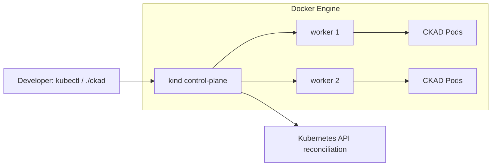

# CKAD Labs — thực hành Kubernetes chạy trong Docker

Bộ bài học **CKAD tiếng Việt** từ dễ đến khó, với **Mermaid flowchart và sequenceDiagram**, YAML thực hành và auto-grader chạy trên Kubernetes API thật.

**Môi trường:** [kind](https://kind.sigs.k8s.io/docs/user/quick-start/) tạo một cluster Kubernetes gồm 1 control plane + 2 worker, mỗi node là container Docker. Không dùng Docker Compose giả lập Kubernetes.

## Bắt đầu

Yêu cầu Docker Engine (hoặc Docker Desktop + WSL2), kind, kubectl, Bash; nên có ít nhất 6–8 GB RAM trống.

```bash
git clone https://github.com/TomJennyDev/ckad-labs.git
cd ckad-labs
./env/kind/up.sh
./ckad doctor
./ckad list
./ckad start 001
kubectl --context kind-ckad-labs -n ckad-001 get pods
# Tự làm bài theo README của lab
./ckad check 001
./ckad solve 001
./ckad check 001
./ckad reset 001
```

## Architecture



Mỗi lab được cô lập trong namespace `ckad-NNN`. Lệnh `reset` chỉ xóa namespace của lab, và từ chối xóa nếu namespace không do CKAD Labs tạo. Lệnh `down.sh --confirm` mới xóa toàn bộ cluster kind.

Các lab có `README.md` (tình huống, giải thích, sơ đồ, negative test), `setup.yaml`, `solution.yaml` và `verify.sh`. Xem [ROADMAP.md](ROADMAP.md) để phân biệt lab đã làm và dự kiến.

Tham khảo [Kubernetes docs](https://kubernetes.io/docs/concepts/), [CNCF curriculum](https://github.com/cncf/curriculum), [dgkanatsios/CKAD-exercises](https://github.com/dgkanatsios/CKAD-exercises), [bmuschko/ckad-crash-course](https://github.com/bmuschko/ckad-crash-course). Tình huống và diagram được tự biên soạn.
