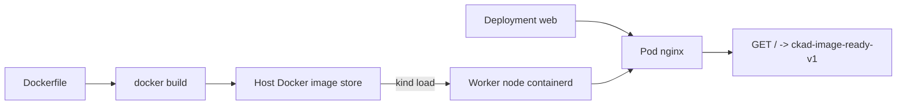
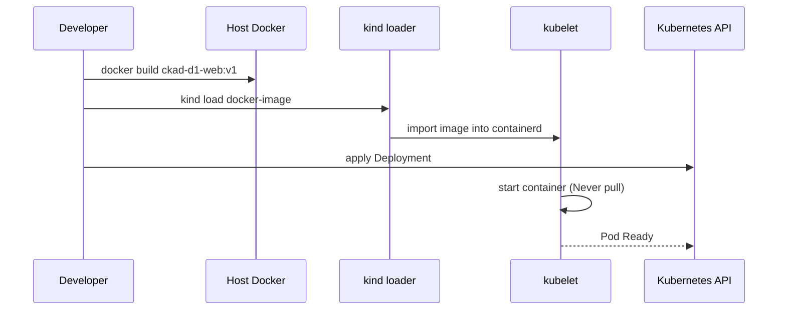

# D1-001 · Xây Docker image và nạp vào cluster kind

**Domain 1 — Container image build & modify** · 35 phút · context `kind-ckad-labs` · namespace `ckad-d1-001`.

## Bài thi / Acceptance criteria

Sửa Dockerfile để NGINX trả về chuỗi chính xác `ckad-image-ready-v1`, build image `ckad-d1-web:v1`, nạp bằng `kind load docker-image`, deploy `web` 1 replica với `imagePullPolicy: Never` và kiểm chứng HTTP thực.

## Tại sao cần cơ chế này?

Docker Engine trên host giữ image ở cache riêng. Kubernetes node của kind dùng containerd; kubelet chỉ tạo container được khi image đã vào containerd của node (hoặc pull từ registry). Đây là nguyên nhân thực tế của lỗi ErrImageNeverPull.

## Kiến trúc



## Luồng hoạt động (sequence)



## Dựng lab

```bash
./env/kind/up.sh                    # chỉ cần làm một lần
./ckad domain start D1-001
kubectl --context kind-ckad-labs -n ckad-d1-001 get pods,deploy,jobs,cronjobs
kubectl --context kind-ckad-labs -n ckad-d1-001 get events --sort-by=.lastTimestamp
```

## Build image (riêng lab này)

```bash
# Sửa Dockerfile, sau đó build trong thư mục lab
docker build -t ckad-d1-web:v1 -f domains/01-application-design-build/labs/001-image-build/Dockerfile domains/01-application-design-build/labs/001-image-build
kind load docker-image --name ckad-labs ckad-d1-web:v1
# Tự viết Deployment YAML và apply -n ckad-d1-001
```

## Chấm bài bằng trạng thái cluster thật

```bash
./ckad domain check D1-001
```

**Không xem `solution.yaml` trước khi giải.** Tạo image từ Dockerfile, nạp vào **tất cả** node qua `kind load docker-image --name ckad-labs ckad-d1-web:v1`, rồi `kubectl apply`.

## Negative test / Troubleshooting

Không chạy `kind load docker-image`: Deployment có thể bị `ErrImageNeverPull`. Quan sát `kubectl describe pod` để phân biệt lỗi registry và image cache.

Giải thích rõ: controller nào reconcile, Desired State khác Actual State chỗ nào; check event và lỗi ở bước scheduling, image hoặc app.

## Lời giải và reset

```bash
./ckad domain solve D1-001
./ckad domain check D1-001
./ckad domain reset D1-001
```

Tài liệu: [Kubernetes Concepts](https://kubernetes.io/docs/concepts/) · [CKAD curriculum](https://github.com/cncf/curriculum).
