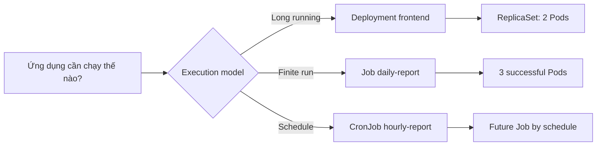
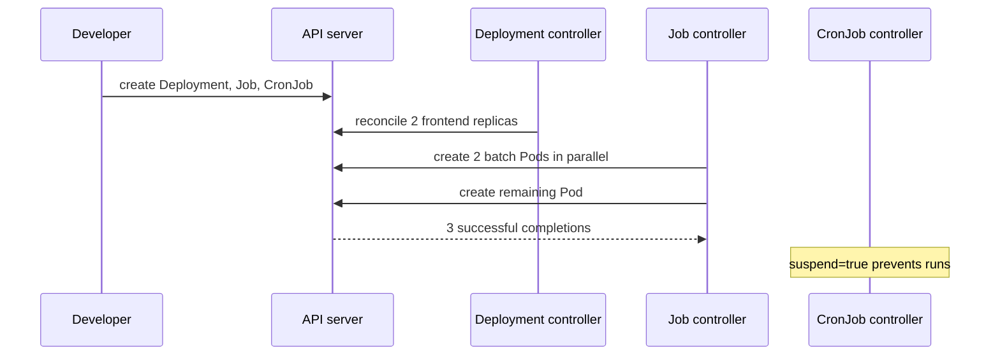

# D1-002 · Chọn Deployment, Job và CronJob

**Domain 1 — Choose the right workload controller** · 40 phút · context `kind-ckad-labs` · namespace `ckad-d1-002`.

## Bài thi / Acceptance criteria

Tạo Deployment `frontend` nginx:1.27 (2 replicas), Job `daily-report` completions=3 parallelism=2 (restartPolicy Never), CronJob `hourly-report` chạy `0 * * * *`, concurrencyPolicy Forbid, suspend true.

## Tại sao cần cơ chế này?

Deployment giữ workload lâu dài với số replica mong muốn. Job đếm số lần chạy thành công. CronJob là bộ lập lịch để tạo Job. Sử dụng Deployment cho batch hoặc CronJob cho web server làm sai semantics và recovery.

## Kiến trúc



## Luồng hoạt động (sequence)



## Dựng lab

```bash
./env/kind/up.sh                    # chỉ cần làm một lần
./ckad domain start D1-002
kubectl --context kind-ckad-labs -n ckad-d1-002 get pods,deploy,jobs,cronjobs
kubectl --context kind-ckad-labs -n ckad-d1-002 get events --sort-by=.lastTimestamp
```

## Chấm bài bằng trạng thái cluster thật

```bash
./ckad domain check D1-002
```

**Không xem `solution.yaml` trước khi giải.** Dùng `kubectl create deploy ... --dry-run=client -o yaml`; tạo Job/CronJob từ `kubectl create job` và `kubectl create cronjob` hoặc YAML.

## Negative test / Troubleshooting

Thử Job `restartPolicy: Always` (API sẽ từ chối); so sánh `Job.status.succeeded` với `Deployment.status.readyReplicas`.

Giải thích rõ: controller nào reconcile, Desired State khác Actual State chỗ nào; check event và lỗi ở bước scheduling, image hoặc app.

## Lời giải và reset

```bash
./ckad domain solve D1-002
./ckad domain check D1-002
./ckad domain reset D1-002
```

Tài liệu: [Kubernetes Concepts](https://kubernetes.io/docs/concepts/) · [CKAD curriculum](https://github.com/cncf/curriculum).
