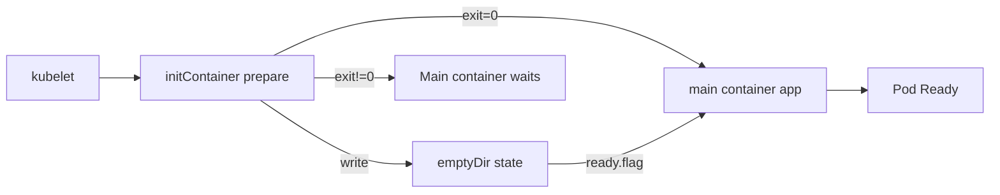
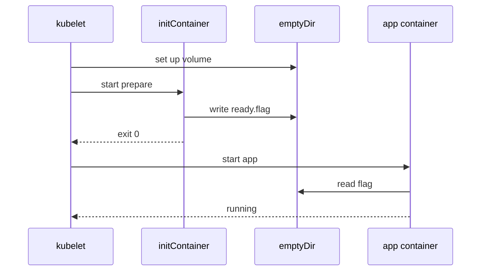

# D1-003 · InitContainer chuẩn bị môi trường trước ứng dụng

**Domain 1: Multi-container Pod: init container** · Thời lượng 35 phút · cluster `kind-ckad-labs`, namespace `ckad-d1-003`.

## Mục tiêu học và yêu cầu đầu ra

Tạo Pod `bootstrap`, initContainer `prepare` ghi `initialized` vào `/work/ready.flag` trên `emptyDir` tên `state`. Container chính `app` chỉ được chạy khi file tồn tại và có nội dung đúng. Kiểm tra init exitCode=0 và Pod Ready.

## Tại sao phải hiểu?

InitContainer phải hoàn tất thành công trước khi kubelet khởi chạy containers chính. Init không phải một sidecar chạy mãi; dùng để chuẩn bị tập tin, schema hoặc cấu hình và tách logic bootstrap khỏi application image.

## Diagram các thành phần và trách nhiệm



## Diagram luồng hoạt động thực



## Dựng môi trường luyện như đề thi

```bash
./env/kind/up.sh
./ckad domain start D1-003
kubectl --context kind-ckad-labs -n ckad-d1-003 get all
kubectl --context kind-ckad-labs -n ckad-d1-003 get events --sort-by=.lastTimestamp
```

Hãy tự viết manifest vào file riêng, apply vào namespace của đề bài. Không sửa resource ngoài phạm vi `ckad-d1-003`.

## Tự chấm và troubleshooting

```bash
./ckad domain check D1-003
./ckad domain hint D1-003
```

Kiểm tra `kubectl get pod -w` và `kubectl describe pod/bootstrap`: giai đoạn init trước main là tính chất quan trọng cần nắm.

## Negative test

Đổi init command thành `exit 1`. Tạo Pod mới (PodSpec phần lớn immutable). Quan sát `Init:CrashLoopBackOff`, container app không chạy.

Sau khi làm negative test, sửa lại để `./ckad domain check D1-003` đạt. Quan sát `describe`, events, các trạng thái Pod/Job/PVC và các controller có liên quan.

## Tham khảo lời giải và dọn lab

```bash
./ckad domain solve D1-003
./ckad domain check D1-003
./ckad domain reset D1-003
```

Không mở `solution.yaml` trước khi làm. Tham khảo [Kubernetes docs](https://kubernetes.io/docs/concepts/) và [curriculum CKAD chính thức](https://github.com/cncf/curriculum).
