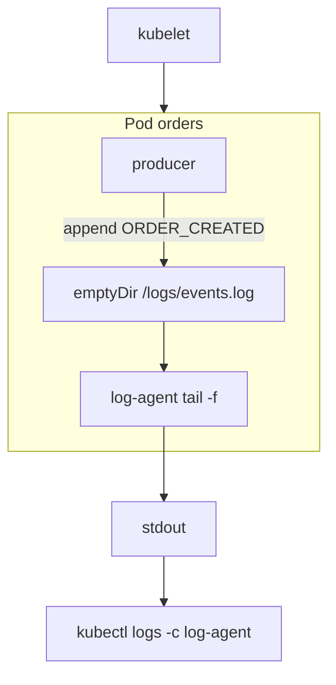
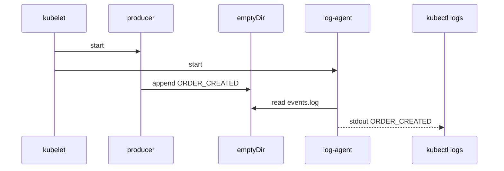

# D1-004 · Sidecar đọc log qua emptyDir

**Domain 1: Multi-container Pod: sidecar container** · Thời lượng 35 phút · cluster `kind-ckad-labs`, namespace `ckad-d1-004`.

## Mục tiêu học và yêu cầu đầu ra

Tạo Pod `orders` có container `producer` viết `ORDER_CREATED` vào `/logs/events.log` mỗi 2 giây, container `log-agent` tail file rồi xuất ra stdout. Hai container mount cùng emptyDir `logs` tại `/logs`. `kubectl logs orders -c log-agent` phải có sự kiện.

## Tại sao phải hiểu?

Hai container trong Pod dùng chung namespace mạng, có thể chia sẻ cùng filesystem qua volume mount. Sidecar tách nhiệm vụ cross-cutting như logging khỏi code chính. Sidecar truyền thống là container chạy lâu dài trong `spec.containers`; native sidecar có lifecycle khác và sẽ là lab nâng cao.

## Diagram các thành phần và trách nhiệm



## Diagram luồng hoạt động thực



## Dựng môi trường luyện như đề thi

```bash
./env/kind/up.sh
./ckad domain start D1-004
kubectl --context kind-ckad-labs -n ckad-d1-004 get all
kubectl --context kind-ckad-labs -n ckad-d1-004 get events --sort-by=.lastTimestamp
```

Hãy tự viết manifest vào file riêng, apply vào namespace của đề bài. Không sửa resource ngoài phạm vi `ckad-d1-004`.

## Tự chấm và troubleshooting

```bash
./ckad domain check D1-004
./ckad domain hint D1-004
```

Quan sát log container riêng: `kubectl logs orders -c log-agent`. Sự kiện nằm trên file `emptyDir`, sau đó sidecar đưa lên stdout.

## Negative test

Chỉ mount volume ở producer, bỏ volumeMount của log-agent: log-agent không thấy file. So sánh `kubectl logs orders -c producer` với sidecar.

Sau khi làm negative test, sửa lại để `./ckad domain check D1-004` đạt. Quan sát `describe`, events, các trạng thái Pod/Job/PVC và các controller có liên quan.

## Tham khảo lời giải và dọn lab

```bash
./ckad domain solve D1-004
./ckad domain check D1-004
./ckad domain reset D1-004
```

Không mở `solution.yaml` trước khi làm. Tham khảo [Kubernetes docs](https://kubernetes.io/docs/concepts/) và [curriculum CKAD chính thức](https://github.com/cncf/curriculum).
