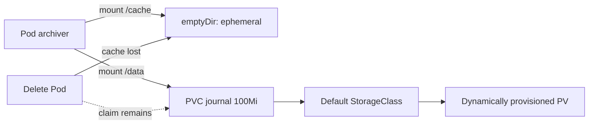
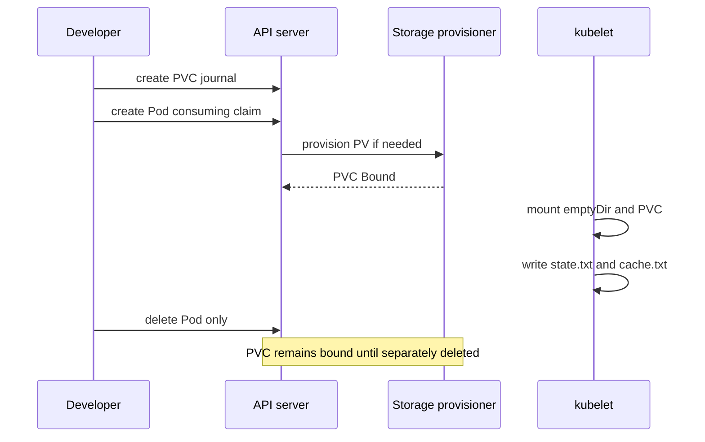

# D1-005 · emptyDir và PersistentVolumeClaim: khác vòng đời

**Domain 1: Persistent and ephemeral volumes** · Thời lượng 45 phút · cluster `kind-ckad-labs`, namespace `ckad-d1-005`.

## Mục tiêu học và yêu cầu đầu ra

Tạo PVC `journal` ReadWriteOnce 100Mi bằng default StorageClass. Tạo Pod `archiver` với `emptyDir` tên `cache` mount `/cache`, và PVC `journal` tên `data` mount `/data`. Ghi `durable-v1` vào `/data/state.txt` (chỉ ghi nếu chưa có) và `temporary-v1` vào `/cache/cache.txt`. Kiểm tra PVC Bound và Pod Ready.

## Tại sao phải hiểu?

emptyDir tồn tại đến khi Pod bị xóa (container restart vẫn dùng lại được). PVC đại diện yêu cầu storage độc lập với vòng đời Pod; kind thường dùng default local-path provisioner, không có HA giữa các node. Không hardcode StorageClass tránh lỗi khi môi trường khác nhau.

## Diagram các thành phần và trách nhiệm



## Diagram luồng hoạt động thực



## Dựng môi trường luyện như đề thi

```bash
./env/kind/up.sh
./ckad domain start D1-005
kubectl --context kind-ckad-labs -n ckad-d1-005 get all
kubectl --context kind-ckad-labs -n ckad-d1-005 get events --sort-by=.lastTimestamp
```

Hãy tự viết manifest vào file riêng, apply vào namespace của đề bài. Không sửa resource ngoài phạm vi `ckad-d1-005`.

## Tự chấm và troubleshooting

```bash
./ckad domain check D1-005
./ckad domain hint D1-005
```

Dùng `kubectl get sc` và `kubectl describe pvc/journal`. Nếu PVC Pending, kiểm tra default StorageClass và storage provisioner.

## Negative test

Viết marker riêng vào cả `/data` và `/cache`. Xóa **chỉ Pod** `archiver`, tạo lại Pod (không xóa PVC). Marker trên PVC vẫn còn; marker emptyDir mất. Với `WaitForFirstConsumer`, PVC có thể chưa Bound trước khi có Pod.

Sau khi làm negative test, sửa lại để `./ckad domain check D1-005` đạt. Quan sát `describe`, events, các trạng thái Pod/Job/PVC và các controller có liên quan.

## Tham khảo lời giải và dọn lab

```bash
./ckad domain solve D1-005
./ckad domain check D1-005
./ckad domain reset D1-005
```

Không mở `solution.yaml` trước khi làm. Tham khảo [Kubernetes docs](https://kubernetes.io/docs/concepts/) và [curriculum CKAD chính thức](https://github.com/cncf/curriculum).
