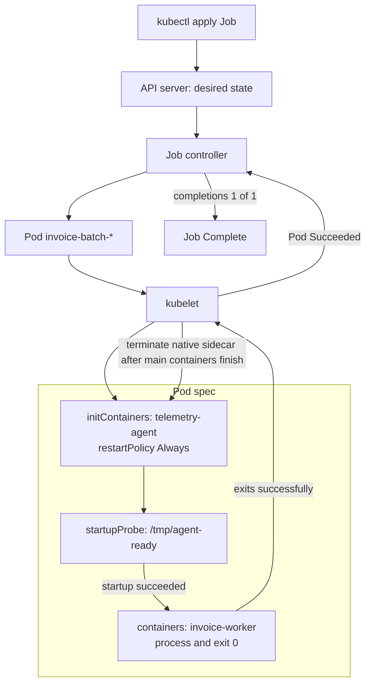
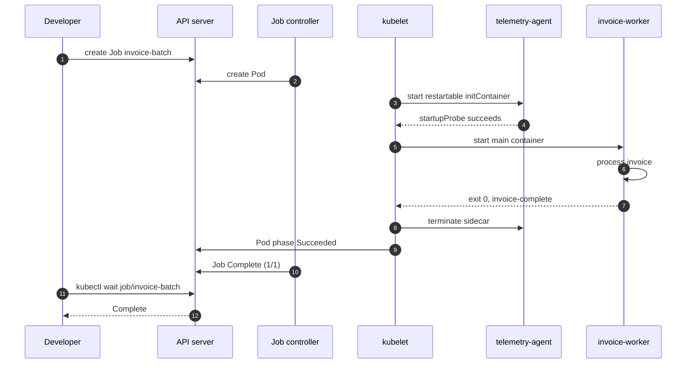

# D1-006 · Native Sidecar: vòng đời initContainer và Job hoàn tất

**Domain 1 — Application Design and Build** · **45 phút** · **Mức:** intermediate · **Cluster:** `kind-ckad-labs` · **Namespace:** `ckad-d1-006`.

## 1. Tình huống production

Một Job `invoice-batch` xử lý hóa đơn xong trong vài giây, nhưng đội platform cần một agent telemetry chạy cùng Pod từ trước khi worker khởi động đến khi worker hoàn thành. Agent chạy vòng lặp vô hạn. Nếu khai báo agent như một container thường trong `spec.containers`, Job có thể **không bao giờ Complete** vì container thường không thoát. Nếu dùng initContainer thông thường với lệnh chạy vô hạn, worker lại **không bao giờ bắt đầu**.

**Bài toán:** sử dụng **native sidecar container**: đặt `telemetry-agent` trong `spec.initContainers` và đặt **`restartPolicy: Always` ở chính init container**. Job controller phải báo Complete khi main worker thành công, dù agent vốn có vòng lặp dài.

Đây là bài **lifecycle + controller semantics**, khác D1-004 (sidecar logging và shared volume). Không cần xây registry hoặc ứng dụng mới.

## 2. Yêu cầu như đề thi

Trong namespace `ckad-d1-006`, tạo **Job `invoice-batch`** với:

1. `completions: 1`, `parallelism: 1`, `backoffLimit: 2`; Pod `restartPolicy: Never`.
2. **Native sidecar** `telemetry-agent`: `busybox:1.36`, nằm trong `initContainers`, có `restartPolicy: Always`; in `sidecar-started`, tạo `/tmp/agent-ready`, sau đó chạy vòng lặp.
3. `startupProbe` của sidecar kiểm tra file `/tmp/agent-ready`; đây là tín hiệu sidecar đã sẵn sàng để kubelet khởi động container tiếp theo.
4. Main container `invoice-worker`: `busybox:1.36`, in `invoice-processing`, đợi khoảng 2 giây, in `invoice-complete`, kết thúc với exit code 0.
5. Cả hai container khai báo requests/limits hợp lý. **Không** thay sidecar bằng container thường, cũng không dùng sleep vô hạn trong main worker.
6. Job phải đạt `Complete` và log phải thể hiện cả hai marker.

**Đầu ra cần kiểm tra:** Job succeeded=1; main worker log `invoice-complete`; sidecar log `sidecar-started`. Thời gian mục tiêu: 15–20 phút sau khi đọc đề.

## 3. Kiến trúc: controller nào chịu trách nhiệm?



**Phân biệt:** `restartPolicy: Always` ở `initContainers[*]` biến init container thành *restartable sidecar*. Nó khác `spec.restartPolicy: Never` áp dụng cho Pod trong Job. Kubelet không đợi sidecar thoát trước khi chạy main container. Khi tất cả main containers kết thúc, kubelet có thể dừng sidecar theo thứ tự ngược với thứ tự khai báo; sidecar không ngăn Job hoàn thành.

## 4. Sequence: startup gate → work → graceful shutdown



## 5. Thực hành từ trạng thái sạch

```bash
./env/kind/up.sh
./ckad domain start D1-006
kubectl --context kind-ckad-labs -n ckad-d1-006 get jobs,pods
# Tự tạo manifest theo yêu cầu, không mở solution.yaml trước
kubectl --context kind-ckad-labs -n ckad-d1-006 apply -f my-invoice-job.yaml
kubectl --context kind-ckad-labs -n ckad-d1-006 get pods -w
kubectl --context kind-ckad-labs -n ckad-d1-006 wait --for=condition=complete job/invoice-batch --timeout=120s
kubectl --context kind-ckad-labs -n ckad-d1-006 logs job/invoice-batch -c invoice-worker
kubectl --context kind-ckad-labs -n ckad-d1-006 logs job/invoice-batch -c telemetry-agent
./ckad domain check D1-006
```

### Tự giải thích kết quả

- Tại sao init container thông thường phải thoát trước khi main container bắt đầu?
- Tại sao native sidecar có thể vẫn chạy trong lúc main worker đang xử lý?
- Vì sao một Job có regular sidecar vô hạn thường không hoàn thành?
- Vì sao `startupProbe` quan trọng nếu worker phụ thuộc agent đã khởi động?
- Pod `restartPolicy: Never` và sidecar `restartPolicy: Always` có mâu thuẫn không?

## 6. Negative tests (làm trên resource tên khác)

**Thử nghiệm A — initContainer không restartable:** tạo Job `broken-init` có initContainer `busybox` chạy `sleep 3600` **không** đặt `restartPolicy: Always`. Main container in `should-not-run`. Quan sát `kubectl describe pod` và `kubectl get pod -o jsonpath='{.status.initContainerStatuses}'`: main worker chưa bắt đầu. Xóa Job này sau thử nghiệm.

**Thử nghiệm B — regular sidecar trong Job:** tạo Job `broken-regular` có hai phần tử `spec.containers`: worker thoát 0 và agent `sleep 3600`. Quan sát Job không Complete vì container thường còn chạy. Xóa Job sau khi đã chứng minh.

**Thử nghiệm C — startupProbe fail:** đặt startupProbe kiểm tra file không tồn tại, quan sát main container không được khởi động; sửa lại trong **Job mới** (Job `spec.template` phần lớn immutable). Đừng cố `kubectl apply` đè PodTemplate của Job đã tạo: xóa Job rồi tạo lại.

Các negative tests là bài thực hành tùy chọn, không nằm trong auto-grader; chúng có thể mất thời gian nên tránh khi luyện tốc độ thi.

## 7. Troubleshooting theo symptom

| Symptom | Lệnh quan sát | Giả thuyết | Cách sửa |
|---|---|---|---|
| Pod `Init:0/1` mãi | `kubectl describe pod` | Init container không phải restartable sidecar | Kiểm tra `initContainers[].restartPolicy` |
| Worker không chạy | `kubectl get pod -o yaml` | Startup probe fail | Kiểm tra file marker và command |
| Job không Complete | `kubectl get pod -o json` | Agent khai báo trong `containers` thường | Chuyển sang restartable init container |
| `ErrImagePull` | `kubectl get events` | Image tag/network | Kiểm tra `busybox:1.36` |
| Job Failed | `kubectl logs -c invoice-worker` | Worker exit nonzero | Kiểm tra exit code và `backoffLimit` |

## 8. Tự chấm, lời giải và cleanup

```bash
./ckad domain check D1-006
./ckad domain hint D1-006
./ckad domain solve D1-006
./ckad domain check D1-006
./ckad domain reset D1-006
```

`reset` chỉ xóa namespace `ckad-d1-006`. Không dùng `docker compose down -v` hoặc xóa cluster CKA khác.

## 9. Tài liệu chuẩn

- [Kubernetes: Sidecar Containers](https://kubernetes.io/docs/concepts/workloads/pods/sidecar-containers/)
- [Kubernetes: Init Containers](https://kubernetes.io/docs/concepts/workloads/pods/init-containers/)
- [Kubernetes: Jobs](https://kubernetes.io/docs/concepts/workloads/controllers/job/)
- [Kubernetes: Container Probes](https://kubernetes.io/docs/concepts/configuration/liveness-readiness-startup-probes/)
- [CKAD curriculum](https://github.com/cncf/curriculum)

**Version note:** native sidecar containers are stable in Kubernetes v1.33+; verify actual kind node version with `kubectl --context kind-ckad-labs version` before troubleshooting version-specific behavior.
