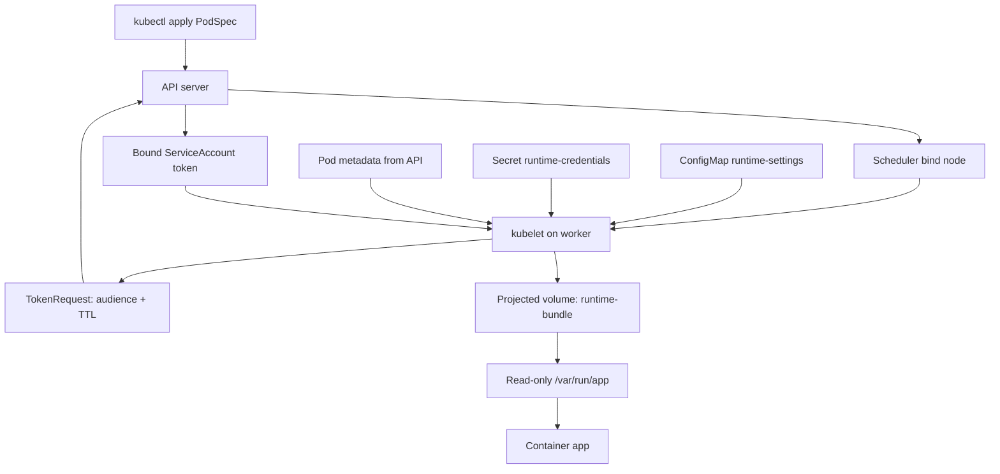
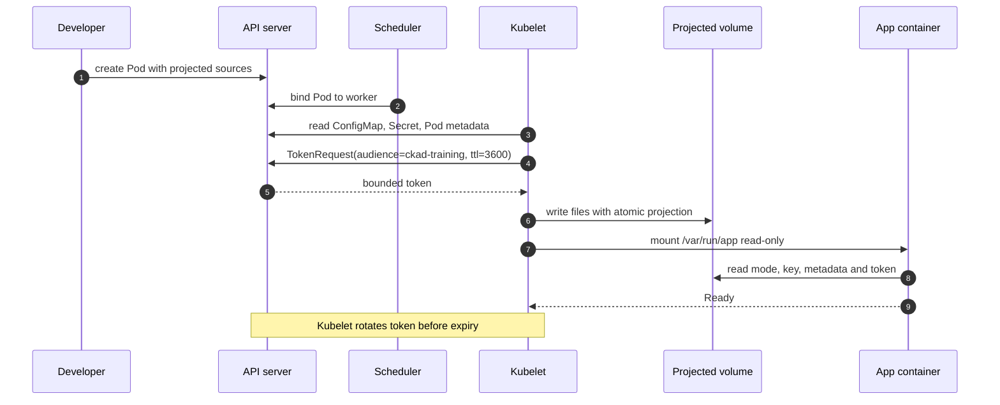

# D1-007 · Projected Volumes: hợp nhất cấu hình, Secret, Pod metadata và token có thời hạn

**Domain 1 — Application Design and Build** · **Mức intermediate** · **Thời gian 40–50 phút** · **Context `kind-ckad-labs`** · **Namespace `ckad-d1-007`**.

## 1. Tình huống production

Ứng dụng xử lý đơn hàng cần bốn nguồn dữ liệu lúc khởi động: cấu hình môi trường, một API key, thông tin Pod/namespace để gắn vào log và một Kubernetes ServiceAccount token dùng để xác thực với một API chỉ chấp nhận audience `ckad-training`. Team từng mount nhiều volume độc lập và vô tình để mặc định token API server tự động mount, khó audit. Nhiệm vụ là hợp nhất các nguồn thành **một projected volume**, chỉ mount read-only, và tắt token tự động để dùng token được chỉ định rõ audience/TTL.

**Không nhầm lẫn:** projected volume hợp nhất *nguồn file*, không phải Kubernetes controller riêng; kubelet chuẩn bị nội dung. Token được TokenRequest API cấp, có thời hạn và audience; không nên đưa token vào log hay commit. `Secret` mã hóa base64 trong API representation không đồng nghĩa đã mã hóa an toàn khi lưu.

## 2. Đề bài kiểu CKAD

Sau khi `./ckad domain start D1-007` tạo ConfigMap `runtime-settings` (`mode=production`, `feature-flag=enabled`), Secret `runtime-credentials` (`api-key=lab-only-key`) và ServiceAccount `workload-reader`, hãy tạo **Pod `projected-app`**:

1. Container `app`, image `busybox:1.36`, duy trì Running, requests/limits hợp lý.
2. `serviceAccountName: workload-reader`, `automountServiceAccountToken: false`.
3. Một `projected` volume tên `runtime-bundle`, mount **read-only** tại `/var/run/app`.
4. Project `mode`, `feature-flag` từ ConfigMap thành `/var/run/app/mode` và `/var/run/app/feature-flag`.
5. Project Secret key `api-key` thành `/var/run/app/credentials/api-key`.
6. Project Downward API `metadata.name` và `metadata.namespace` thành `metadata/pod-name` và `metadata/namespace`.
7. Project **serviceAccountToken** tại `identity/token` với `audience: ckad-training` và `expirationSeconds: 3600`.
8. Pod Ready, file đúng nội dung và token tồn tại, không in token ra terminal.

**Lưu ý:** không sử dụng `subPath` để mount file cần tự cập nhật. Token audience này chỉ phục vụ học, không giả định có API đích thực sự xác thực token.

## 3. Diagram — đường đi của dữ liệu



**Kubelet** nhận PodSpec, lấy dữ liệu từ API, thực hiện projection và mount. **Scheduler** chỉ chọn node; không đọc Secret để dựng file. `automountServiceAccountToken: false` không ngăn việc khai báo token rõ ràng trong projected volume.

## 4. Sequence — request và vòng đời token



## 5. Làm bài và quan sát

```bash
./env/kind/up.sh
./ckad domain start D1-007
kubectl --context kind-ckad-labs -n ckad-d1-007 get configmap,secret,serviceaccount
# Viết my-projected-pod.yaml theo đề bài
kubectl --context kind-ckad-labs -n ckad-d1-007 apply -f my-projected-pod.yaml
kubectl --context kind-ckad-labs -n ckad-d1-007 describe pod projected-app
kubectl --context kind-ckad-labs -n ckad-d1-007 exec projected-app -- ls -lR /var/run/app
kubectl --context kind-ckad-labs -n ckad-d1-007 exec projected-app -- cat /var/run/app/metadata/pod-name
./ckad domain check D1-007
```

Không dùng `cat` với `identity/token` và tránh đưa Secret ra CI log. Checker chỉ kiểm tra token có tồn tại, không xuất giá trị.

## 6. Negative tests — dự đoán, quan sát, sửa

**A — Thiếu ConfigMap key.** Trong Pod thử nghiệm tên khác, project `missing-mode` thay cho `mode`. Quan sát Pod event, container chưa khởi động vì volume setup lỗi. Vì sao `kubectl apply` vẫn báo created?

**B — Sai Secret name.** Đổi thành `runtime-credentials-typo`. `kubectl describe pod` cho thấy MountVolume.SetUp failed. Khôi phục tên đúng trong Pod mới (Pod volume spec phần lớn immutable).

**C — Sai đường dẫn token.** Đổi `identity/token` thành `identity/wrong-token`. Pod có thể Running nếu command không kiểm tra token, nhưng workload không tìm thấy file. Đây là lỗi **application contract**, không nhất thiết là lỗi admission.

**D — Token audience.** Thử `audience: wrong-service`; kubelet vẫn có thể mount token hợp lệ cho audience mới, nhưng API yêu cầu `ckad-training` sẽ từ chối token. **Không** giả định bài lab có API thực để xác thực audience.

## 7. Troubleshooting theo triệu chứng

| Symptom | Điều tra | Nguyên nhân có thể | Sửa |
|---|---|---|---|
| `ContainerCreating` kéo dài | `kubectl describe pod` → Events | Missing ConfigMap/Secret key | Kiểm tra tên và `items[].key` |
| File không đúng path | `kubectl exec ... -- find /var/run/app` | Sai `path` projection | Sửa manifest, recreate Pod |
| `CreateContainerError` | `kubectl get pod -o yaml` | Mount/command không đúng | Xem status và events |
| Token trống/không có | `kubectl describe pod` | TokenRequest hoặc projected path | Kiểm tra SA, `audience`, `expirationSeconds` |
| Pod Running nhưng checker fail | `./ckad domain check D1-007` | Field/path sai so với đề | So khớp PodSpec + runtime files |

## 8. Self-grade và cleanup

```bash
./ckad domain hint D1-007
./ckad domain solve D1-007
./ckad domain check D1-007
./ckad domain reset D1-007
```

Lời giải là **tham khảo sau khi tự làm**. `reset` chỉ xóa namespace đã được CKAD Labs gắn nhãn quản lý.

## 9. Tài liệu chuẩn

- [Projected Volumes](https://kubernetes.io/docs/concepts/storage/projected-volumes/)
- [ServiceAccount token projection](https://kubernetes.io/docs/tasks/configure-pod-container/configure-service-account/)
- [Downward API](https://kubernetes.io/docs/concepts/workloads/pods/downward-api/)
- [ConfigMaps](https://kubernetes.io/docs/concepts/configuration/configmap/)
- [Secrets](https://kubernetes.io/docs/concepts/configuration/secret/)
- [CKAD curriculum](https://github.com/cncf/curriculum)

**Phiên bản:** dùng Kubernetes hỗ trợ projected serviceAccountToken; kiểm tra `kubectl --context kind-ckad-labs version` trước khi debug.
