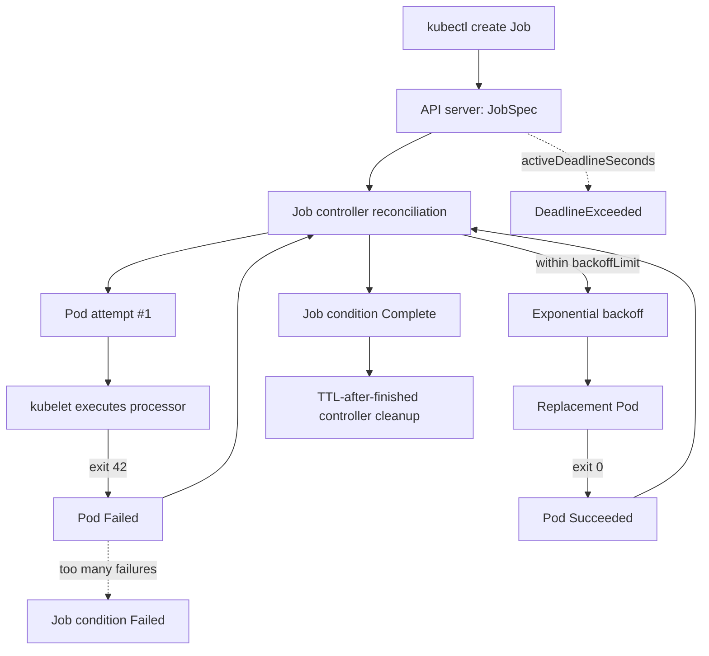

# D1-008 · Job Retry, backoffLimit và Failure Handling

**Domain:** Application Design and Build (20%) · **Mức:** intermediate · **Thời gian mục tiêu:** 35–45 phút · **Context:** `kind-ckad-labs` · **Namespace:** `ckad-d1-008`.

## 1. Production incident: batch xử lý hóa đơn bị upstream 503

Service billing chạy batch bằng Kubernetes Job. Khi hệ thống upstream tạm lỗi, worker in `ERROR upstream 503` rồi exit code **42**. Nếu Job retry không giới hạn hoặc không có deadline, Pod thất bại có thể liên tục tiêu tốn tài nguyên. Nếu chỉ nhìn `kubectl get pods` mà không kiểm tra Job conditions, developer dễ hiểu nhầm rằng lỗi do scheduler.

Mục tiêu là hiểu **Job controller** tạo Pod mới sau khi Pod cũ thất bại, cách `backoffLimit` giới hạn số lần thất bại, `activeDeadlineSeconds` giới hạn tổng thời gian Job và `ttlSecondsAfterFinished` tự dọn Job hoàn tất. Đây là retry của **Kubernetes Job**, không phải retry HTTP ở application layer; Kubernetes không biết exit code 42 có retryable hay không.

## 2. Đề bài theo kiểu CKAD

`./ckad domain start D1-008` tạo Job `invoice-retry` đang cố chạy worker luôn exit 42. Hãy điều tra events, status và logs, sau đó sửa workload để hoàn tất một batch thành công với yêu cầu:

1. Giữ tên Job `invoice-retry`, `completions: 1`, `parallelism: 1`.
2. `backoffLimit: 2`, `activeDeadlineSeconds: 180`, `ttlSecondsAfterFinished: 3600`.
3. Pod `restartPolicy: Never` để thất bại dẫn tới Pod mới thay vì restart container cùng Pod.
4. Image `busybox:1.36`; main container `processor` in chính xác `invoice-processed` rồi exit 0.
5. Requests CPU 25m, memory 16Mi; limits CPU 100m, memory 64Mi.
6. Job đạt condition `Complete`, `status.succeeded=1`, logs có marker.

**Giới hạn thực tế:** Pod template của Job đã tạo phần lớn immutable. Không thể chỉ `kubectl apply` đè command; hãy xóa **đúng Job invoice-retry** rồi tạo lại bằng manifest sửa. Namespace và các lab khác không được xóa.

## 3. Kiến trúc: desired state → retries → condition



**Controller trách nhiệm:** scheduler chọn node cho từng Pod; kubelet chạy container và báo Pod status; Job controller quyết định tạo Pod tiếp theo và cập nhật Job condition. TTL-after-finished controller xóa Job sau TTL, không xóa namespace.

## 4. Sequence: một failure và một recovery

```mermaid
sequenceDiagram
  autonumber
  participant Dev as Developer
  participant API as API server
  participant JC as Job controller
  participant KL as kubelet
  participant Pod as processor
  Dev->>API: create Job backoffLimit=2
  JC->>API: create first Pod
  KL->>Pod: start worker
  Pod-->>KL: exit 42 (upstream 503)
  KL->>API: Pod Failed, terminated exitCode=42
  JC->>API: observe failure, update Job status
  JC->>JC: wait exponential retry backoff
  JC->>API: create replacement Pod (if budget remains)
  Note over Dev,API: Fix command requires deleting and recreating this Job
  Dev->>API: delete invoice-retry, then create corrected Job
  JC->>API: create new worker Pod
  Pod-->>KL: invoice-processed; exit 0
  KL->>API: Pod Succeeded
  JC->>API: Job Complete
```

**Quan trọng:** sequence minh họa cả cơ chế retry và thao tác sửa Job. Việc tạo Job mới sau khi xóa không giữ nguyên bộ đếm failure của Job cũ. Không được diễn giải đây là cùng một Job tự phục hồi khi command vẫn luôn exit 42.

## 5. Thực hành có thể chạy trên kind

```bash
./env/kind/up.sh
./ckad domain start D1-008
kubectl --context kind-ckad-labs -n ckad-d1-008 get job invoice-retry -o wide
kubectl --context kind-ckad-labs -n ckad-d1-008 get pods -l job-name=invoice-retry -w
kubectl --context kind-ckad-labs -n ckad-d1-008 describe job invoice-retry
kubectl --context kind-ckad-labs -n ckad-d1-008 get events --sort-by=.lastTimestamp
kubectl --context kind-ckad-labs -n ckad-d1-008 logs job/invoice-retry -c processor
```

Kiểm tra các field `status.failed`, `status.conditions`, `status.startTime`, Pod `containerStatuses[*].state.terminated.exitCode`. Chờ vài lần retry và quan sát Pod mới có UID khác nhau. **Đừng chờ quá lâu**: `activeDeadlineSeconds=180` có thể kết thúc Job trước khi bạn kịp theo dõi.

Tạo `my-invoice-job.yaml` theo yêu cầu; xóa Job lỗi và apply Job mới:

```bash
kubectl --context kind-ckad-labs -n ckad-d1-008 delete job invoice-retry --wait=true
kubectl --context kind-ckad-labs -n ckad-d1-008 apply -f my-invoice-job.yaml
./ckad domain check D1-008
```

## 6. Negative tests — dự đoán rồi kiểm chứng

**A — Không retry:** Job khác tên `no-retry` với `backoffLimit: 0`, command exit 42. Quan sát Job chuyển Failed sau lần thất bại đầu. So sánh số Pod với `invoice-retry`.

**B — Retry budget:** Job `retry-budget` có `backoffLimit: 2`, `restartPolicy: Never`, command exit 42. Dùng `kubectl get pods -l job-name=retry-budget -w` xem Pod mới; giải thích tại sao số Pod thất bại có thể lớn hơn số được phép retry.

**C — Deadline:** Job `short-deadline` có `activeDeadlineSeconds: 10`, worker `sleep 120`. Quan sát condition `Failed` với reason `DeadlineExceeded`. Đây là deadline cho Job, không phải timeout HTTP.

**D — TTL:** Job `ttl-short` thành công, `ttlSecondsAfterFinished: 15`. Quan sát Job biến mất sau khoảng TTL (controller reconciliation có thể chậm); không dùng TTL ngắn cho bài chính vì checker cần đọc Job.

Negative tests phải chạy với **Job tên riêng** trong namespace `ckad-d1-008`, xóa từng Job thử nghiệm sau khi xong. Không sửa các lab khác.

## 7. Troubleshooting nhanh theo triệu chứng

| Symptom | Quan sát | Nguyên nhân thường gặp | Cách xử lý |
|---|---|---|---|
| Job Failed | `kubectl describe job` | BackoffLimitExceeded / DeadlineExceeded | Đọc reason và số failed Pods |
| Worker exit 42 | `kubectl logs pod/<name>` | Upstream/command fail | Sửa nguyên nhân ứng dụng |
| Apply báo immutable | `kubectl apply -f` | `spec.template` của Job không sửa trực tiếp | Delete/recreate **chỉ Job này** |
| Không có Pod mới ngay | `kubectl get pods -w` | Backoff exponential delay | Chờ hoặc xem Job conditions |
| Job Complete nhưng checker FAIL | `./ckad domain check D1-008` | Thiếu TTL, limits hoặc sai image | So sánh PodTemplate và status |
| Job biến mất | `kubectl get jobs` | TTL-after-finished controller | Tăng TTL hoặc tạo lại |

## 8. Auto-grade, đáp án và cleanup

```bash
./ckad domain hint D1-008
./ckad domain solve D1-008
./ckad domain check D1-008
./ckad domain reset D1-008
```

`verify.sh` đọc Job spec/status thật, đợi condition Complete và kiểm tra marker trong logs; không chỉ so sánh YAML. `solution.sh` chỉ delete Job đúng tên, rồi apply manifest mẫu. `reset` chỉ xóa namespace `ckad-d1-008` đã gắn nhãn sở hữu.

## 9. Tài liệu chính thức

- [Kubernetes Jobs](https://kubernetes.io/docs/concepts/workloads/controllers/job/)
- [Pod failure policy](https://kubernetes.io/docs/concepts/workloads/controllers/job/#pod-failure-policy)
- [TTL after finished](https://kubernetes.io/docs/concepts/workloads/controllers/ttlafterfinished/)
- [Job backoffLimit](https://kubernetes.io/docs/concepts/workloads/controllers/job/#pod-backoff-failure-policy)
- [CKAD curriculum](https://github.com/cncf/curriculum)

**Mục tiêu kiểm tra:** hiểu cơ chế retry/failure của controller, không phải chỉ copy YAML.

