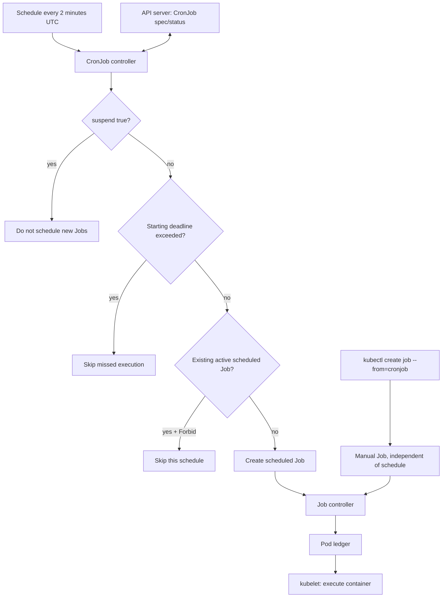
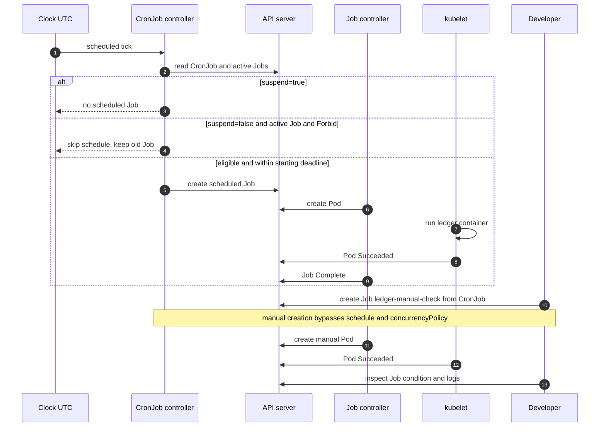

# D1-009 · CronJob Concurrency, Missed Schedules và Time Zone

**Domain:** Application Design and Build (20%) · **Mức:** intermediate · **Thời gian:** 35–45 phút · **Context:** `kind-ckad-labs` · **Namespace:** `ckad-d1-009`.

## 1. Incident thực tế: hai batch cùng cập nhật sổ cái

Một ứng dụng kế toán chạy batch đối soát định kỳ. Một lần chạy có thể mất lâu hơn chu kỳ lịch. Với `concurrencyPolicy: Allow`, CronJob controller có thể tạo **nhiều Job đồng thời**, dẫn đến ghi đè kết quả nếu ứng dụng không idempotent. Khi cluster/control plane bận hoặc tạm ngừng, CronJob còn có thể **missed schedules**. Developer cần phân biệt giới hạn chạy đồng thời, deadline của lịch và retry của Job.

**Mục tiêu:** hiểu CronJob controller *tạo Job*; Job controller *tạo Pod*; kubelet *chạy container*. `Forbid` chỉ ngăn **lần chạy theo lịch mới** khi Job trước còn active, không phải distributed lock cho các Job được tạo thủ công, và không thay thế idempotency của ứng dụng.

## 2. Đề bài theo kiểu CKAD

`./ckad domain start D1-009` tạo CronJob `nightly-ledger` bị cấu hình sai nhưng đang `suspend: true` để tránh tạo batch ngoài ý muốn. Hãy sửa **đúng CronJob đó**, giữ namespace riêng:

1. `schedule: "*/2 * * * *"`, `timeZone: Etc/UTC` (cố định timezone, không phụ thuộc timezone kube-controller-manager).
2. `concurrencyPolicy: Forbid` để lần chạy lịch kế tiếp bị bỏ qua nếu Job trước còn active.
3. `startingDeadlineSeconds: 45` để bỏ các lần chạy quá trễ; giá trị này không phải thời gian tối đa chạy của Job.
4. `successfulJobsHistoryLimit: 2`, `failedJobsHistoryLimit: 1`.
5. `suspend: true` khi nộp bài, tránh tác vụ lặp không kiểm soát trong lab. Thử nghiệm unsuspend chỉ thực hiện trong negative test có giám sát.
6. Job template: `backoffLimit: 1`, `ttlSecondsAfterFinished: 3600`, `restartPolicy: Never`, container `ledger` dùng `busybox:1.36`, CPU request 25m, memory request 16Mi, CPU limit 100m, memory limit 64Mi. Khi chạy phải in đúng `ledger-reconciled` và exit 0.
7. Tạo một Job thủ công **từ CronJob template** tên `ledger-manual-check`, chờ Job Complete, xác nhận log.

**Không** cần chờ 2 phút để được chấm. `kubectl create job --from=cronjob/nightly-ledger` tạo Job ngay cả khi CronJob đang suspend; đây là điểm kiểm tra riêng biệt.

## 3. Flowchart — controller nào quyết định chạy?



**Giải thích:** `startingDeadlineSeconds` áp dụng cho độ trễ *bắt đầu* Job, không tự dừng Pod. `Forbid` không hủy Job đang chạy; nếu muốn hủy Job cũ và thay bằng Job mới thì `Replace` mới là chính sách tương ứng. `suspend` không hủy các Job đã được tạo.

## 4. SequenceDiagram — schedule bị skip và manual trigger



## 5. Dựng lab và điều tra

```bash
./env/kind/up.sh
./ckad domain start D1-009
kubectl --context kind-ckad-labs -n ckad-d1-009 get cronjob nightly-ledger -o yaml
kubectl --context kind-ckad-labs -n ckad-d1-009 describe cronjob nightly-ledger
kubectl --context kind-ckad-labs -n ckad-d1-009 get events --sort-by=.lastTimestamp
```

Đọc `setup.yaml`: `Allow`, history 10, command exit 3. Sửa manifest của riêng bạn và `kubectl apply -f my-cronjob.yaml`. Không copy đáp án ngay.

Tạo Job thủ công và xem trạng thái:

```bash
kubectl --context kind-ckad-labs -n ckad-d1-009 create job ledger-manual-check --from=cronjob/nightly-ledger
kubectl --context kind-ckad-labs -n ckad-d1-009 wait --for=condition=complete job/ledger-manual-check --timeout=120s
kubectl --context kind-ckad-labs -n ckad-d1-009 logs job/ledger-manual-check -c ledger
./ckad domain check D1-009
```

`verify.sh` kiểm tra spec CronJob từ API server, Job Complete và log thật; không chấm bằng việc so khớp file YAML.

## 6. Negative tests (có dọn dẹp)

**A — Forbid khi Job active:** Sao lưu YAML, tạm đặt `suspend: false`, `schedule: "* * * * *"`, command `sleep 150`. Theo dõi `kubectl get jobs -w` qua ít nhất hai mốc phút. Job đầu còn active ở tick kế tiếp; CronJob controller không tạo Job lịch mới. Sau đó **khôi phục ngay** `suspend: true`, lịch 2 phút, command ban đầu; xóa các Job thử nghiệm.

**B — Allow:** Cũng tình huống Job chạy 150 giây nhưng `concurrencyPolicy: Allow`. Qua hai tick, có thể thấy hai Job active. Chú ý việc missed schedule hoặc controller timing khiến thời điểm quan sát thay đổi.

**C — Missed schedules:** Dùng `suspend: true` trong vài phút rồi bật lại với `startingDeadlineSeconds: 45`; quan sát `lastScheduleTime`, `lastSuccessfulTime`, events. Không giả định mọi lịch bị bỏ sẽ được tạo lại; controller có cửa sổ reconciliation và quy tắc tính missed schedules.

**D — Replace:** Với Job chạy dài, thử `concurrencyPolicy: Replace`; quan sát controller xóa Job cũ rồi tạo Job lịch mới. Chính sách này không bảo đảm rollback nghiệp vụ.

**Lưu ý:** negative tests là bài mở rộng, không chạy tự động trong `solution.sh`; tránh gây ra các Job lặp ngoài ý muốn.

## 7. Troubleshooting theo triệu chứng

| Triệu chứng | Lệnh quan sát | Nguyên nhân / cách xử lý |
|---|---|---|
| CronJob không tạo Job | `kubectl describe cronjob` | `suspend: true`, lịch chưa đến, hoặc missed deadline |
| Hai Job cùng active | `kubectl get jobs` | `Allow` hoặc Job tạo thủ công; kiểm tra ownerReferences |
| Job Failed | `kubectl logs job/<name>` | App exit code khác 0; `backoffLimit` chỉ giới hạn retry |
| Job không có Pod | `kubectl describe job` | Quota, admission, image pull hoặc controller chưa reconcile |
| `kubectl apply` bị từ chối | `kubectl explain cronjob.spec` | Sai vị trí field, ví dụ `concurrencyPolicy` phải ở CronJob spec |
| Kết quả sai timezone | `kubectl get cronjob -o yaml` | `timeZone` không đúng hoặc thiếu |
| Manual Job chạy dù suspended | `kubectl get jobs` | `suspend` chỉ chặn lịch tự động, không chặn create job --from |

**Trade-off:** `Forbid` phù hợp batch không được overlap, nhưng có thể bỏ một lần chạy. `Allow` tăng throughput nhưng cần idempotency. `Replace` có thể cắt ngang batch chưa commit transaction. Nếu nghiệp vụ đòi đúng một lần xử lý, cần thiết kế idempotency key và transaction phía ứng dụng/database.

## 8. Lời giải, kiểm tra và cleanup

```bash
./ckad domain hint D1-009
./ckad domain solve D1-009
./ckad domain check D1-009
./ckad domain reset D1-009
```

`solution.sh` chỉ áp dụng CronJob trong namespace sở hữu và tạo đúng một manual Job để kiểm tra. `reset` chỉ xóa `ckad-d1-009`.

## 9. Tài liệu chính thức

- [CronJob concepts](https://kubernetes.io/docs/concepts/workloads/controllers/cron-jobs/)
- [CronJob concurrency policy](https://kubernetes.io/docs/concepts/workloads/controllers/cron-jobs/#concurrency-policy)
- [CronJob time zones](https://kubernetes.io/docs/concepts/workloads/controllers/cron-jobs/#time-zones)
- [CronJob limitations](https://kubernetes.io/docs/concepts/workloads/controllers/cron-jobs/#cronjob-limitations)
- [Job controller](https://kubernetes.io/docs/concepts/workloads/controllers/job/)
- [kubectl create job](https://kubernetes.io/docs/reference/kubectl/generated/kubectl_create/kubectl_create_job/)

