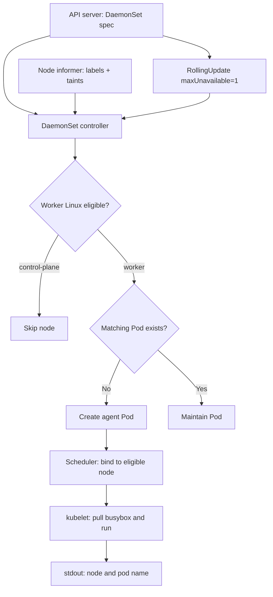
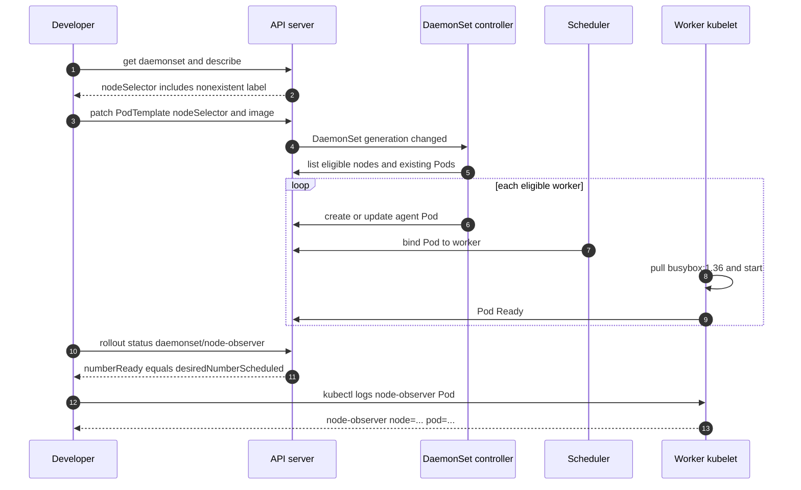

# D1-010 — DaemonSet: một telemetry agent trên mỗi worker node

**Domain:** Application Design and Build (20%) · **Mức:** intermediate → advanced · **Thời gian:** 40–50 phút · **Context:** `kind-ckad-labs` · **Namespace:** `ckad-d1-010`.

## 1. Sự cố production: monitoring agent mất trên toàn bộ worker

Nhóm SRE triển khai một lightweight telemetry agent để ghi nhận tên node và tên Pod vào stdout, giúp kiểm tra độ phủ của agent trên từng worker. Sau một thay đổi cấu hình, dashboard báo không còn agent nào hoạt động. Trong namespace, DaemonSet `node-observer` đã tồn tại, nhưng **không có Pod nào được lên lịch** vì `nodeSelector` yêu cầu một label không có thật; image cũng bị đặt thành tag không tồn tại. Đây là hai nguyên nhân độc lập: sửa image trước khi sửa scheduling sẽ chưa làm Pod xuất hiện.

### Mục tiêu

Sửa **DaemonSet đang tồn tại**, không đổi tên hoặc selector bất biến, để mỗi worker Linux của kind có đúng một Pod agent. Không chạy trên control-plane. Agent phải in định kỳ `node-observer node=<node> pod=<pod>` bằng Downward API; rollout tối đa một Pod unavailable tại một thời điểm. Dùng resource requests/limits nhỏ để phù hợp lab local.

**Tại sao DaemonSet?** Deployment duy trì số replica toàn cluster, không bảo đảm mỗi node một replica. DaemonSet controller theo dõi tập node đủ điều kiện và tạo Pod tương ứng. Đây là workload dành cho log collector, node exporter, CNI agents; không thay thế monitoring production thực tế.

## 2. Flowchart: desired node coverage → reconciliation



**Điểm quan trọng:** Controller tạo một Pod cho từng node phù hợp. Scheduler vẫn xử lý binding; DaemonSet controller định hình tập node mục tiêu. Node affinity dùng `DoesNotExist` để loại control-plane, không xóa taint của node. Nếu cluster có worker taint khác, có thể cần toleration có chủ đích; không dùng `operator: Exists` cho tất cả taint trong bài này.

## 3. SequenceDiagram: sửa lỗi scheduling và image pull



**Khác biệt với Deployment:** Nếu thêm một worker node đủ điều kiện, DaemonSet tự bổ sung agent; Deployment không tự tăng replicas theo số node. Nếu node mất điều kiện, DaemonSet sẽ reconcile lại. `maxUnavailable=1` chỉ điều khiển rolling update, không bảo đảm mọi node luôn khỏe trong sự cố node failure.

## 4. Đề bài CKAD — 8 tiêu chí

1. Giữ `DaemonSet/node-observer`, selector `app=node-observer`, Pod label `role=telemetry`.
2. Chạy image `busybox:1.36` với command vòng lặp in node/pod name mỗi 5 giây.
3. Dùng Downward API: `spec.nodeName` → `NODE_NAME`, `metadata.name` → `POD_NAME`.
4. Chỉ schedule trên worker Linux, loại control-plane bằng required node affinity với key `node-role.kubernetes.io/control-plane` và `DoesNotExist`.
5. `updateStrategy.type=RollingUpdate`, `maxUnavailable=1`.
6. Requests CPU=10m, memory=16Mi; limits CPU=50m, memory=32Mi.
7. Đợi rollout hoàn tất, `numberReady == desiredNumberScheduled` và ít nhất một worker đủ điều kiện.
8. Xác nhận Pod ở **các node khác nhau**, log của từng agent có node và Pod name; không dùng DaemonSet chạy đặc quyền hoặc hostPath.

## 5. Dựng lab và điều tra trước khi sửa

```bash
./env/kind/up.sh
./ckad domain start D1-010
kubectl --context kind-ckad-labs get nodes --show-labels
kubectl --context kind-ckad-labs -n ckad-d1-010 get ds node-observer -o wide
kubectl --context kind-ckad-labs -n ckad-d1-010 describe ds node-observer
kubectl --context kind-ckad-labs -n ckad-d1-010 get events --sort-by=.lastTimestamp
```

Kiểm tra `DESIRED`, `CURRENT`, `READY`. Nếu `DESIRED=0`, ưu tiên xem nodeSelector/affinity và label của node; **đừng** kết luận ImagePullBackOff khi Pod chưa được tạo. Nếu `DESIRED>0` nhưng `READY=0`, kiểm tra `kubectl describe pod` và container waiting reason.

Sửa manifest riêng của bạn rồi apply trong namespace; không đổi `spec.selector` của DaemonSet vì selector là immutable. Xem danh sách node và Pod:

```bash
kubectl --context kind-ckad-labs -n ckad-d1-010 get pods -l app=node-observer -o wide
kubectl --context kind-ckad-labs -n ckad-d1-010 rollout status ds/node-observer --timeout=180s
kubectl --context kind-ckad-labs -n ckad-d1-010 logs -l app=node-observer --prefix --tail=5
./ckad domain check D1-010
```

`verify.sh` đọc DaemonSet spec/status, đếm unique node từ Pod thật và kiểm tra stdout. Không so sánh nội dung manifest của học viên với file solution.

## 6. Negative tests (thực hiện lần lượt, có cleanup)

**A — Label không tồn tại:** Tạm thêm `nodeSelector.ckad.example.io/pool=nonexistent` vào PodTemplate. Quan sát `desiredNumberScheduled=0` hoặc Pod bị loại khi controller reconcile. Xóa selector sai, đợi rollout lại. **Không tự gắn label vào node** chỉ để vượt qua bài.

**B — ImagePullBackOff:** Đổi image thành `busybox:nonexistent-ckad-tag`, quan sát `kubectl get pods` và `describe pod` khi Pod đã được tạo. Đối chiếu event `Failed to pull image` với trường hợp A không có Pod. Sửa về `busybox:1.36`.

**C — Control-plane:** Bỏ required affinity loại control-plane và quan sát `desiredNumberScheduled` cùng số Pod; control-plane có thể có taint nên không nhất thiết có Pod Running ở đó. Không gỡ taint cluster để làm bài; khôi phục affinity.

**D — RollingUpdate:** Đổi một label trong PodTemplate, quan sát `kubectl rollout status`, số Ready và số Pod đang thay. Không xóa DaemonSet hoặc namespace khi đang kiểm tra rolling update.

**E — New worker (tùy chọn, nâng cao):** Dùng kind cluster mới có thêm worker trong file cấu hình riêng, quan sát DaemonSet tự tạo thêm Pod. Không giả định `kind` hỗ trợ thêm worker động vào cluster đang tồn tại. Dọn cluster thử nghiệm riêng sau khi học.

## 7. Troubleshooting theo triệu chứng

| Triệu chứng | Cách kiểm tra | Cách xử lý |
|---|---|---|
| `DESIRED=0` | `get nodes --show-labels`, `get ds -o yaml` | Node selector hoặc affinity quá chặt |
| Pod Pending | `describe pod` | Kiểm tra taints, resources, affinity |
| ImagePullBackOff | `describe pod`, Events | Image/tag sai hoặc registry không truy cập |
| Pod CrashLoopBackOff | `logs --previous` | Lỗi shell command, process exit |
| `READY < DESIRED` | `get pods -o wide` | Có Pod chưa Ready, rollout chưa xong |
| Duplicate agents | `get pods -o wide` | Xem rollout, selector, orphan Pod và node name |
| Không thấy log | `logs -c observer` | Container chưa start hoặc stdout không được ghi |

**Trade-offs:** DaemonSet tiêu tốn resources theo số node. Với 2 worker, requests tổng 20m CPU và 32Mi memory; với 100 worker là 1000m CPU và 1600Mi memory. Limit chỉ áp dụng từng container. Dùng tolerations tối thiểu và quyền thấp nhất, không mặc định `privileged: true`.

## 8. Lời giải, auto-grade và cleanup

```bash
./ckad domain hint D1-010
./ckad domain solve D1-010
./ckad domain check D1-010
./ckad domain reset D1-010
```

`solution.sh` chỉ sửa DaemonSet trong namespace của bài. `reset` chỉ xóa `ckad-d1-010`, không xóa kind cluster, node, Docker volume hay namespace khác.

## 9. Tài liệu Kubernetes chính thức

- [DaemonSet](https://kubernetes.io/docs/concepts/workloads/controllers/daemonset/)
- [DaemonSet rolling updates](https://kubernetes.io/docs/tasks/manage-daemon/update-daemon-set/)
- [Assign Pods to Nodes](https://kubernetes.io/docs/concepts/scheduling-eviction/assign-pod-node/)
- [Downward API](https://kubernetes.io/docs/concepts/workloads/pods/downward-api/)
- [Debug running Pods](https://kubernetes.io/docs/tasks/debug/debug-application/debug-running-pod/)

