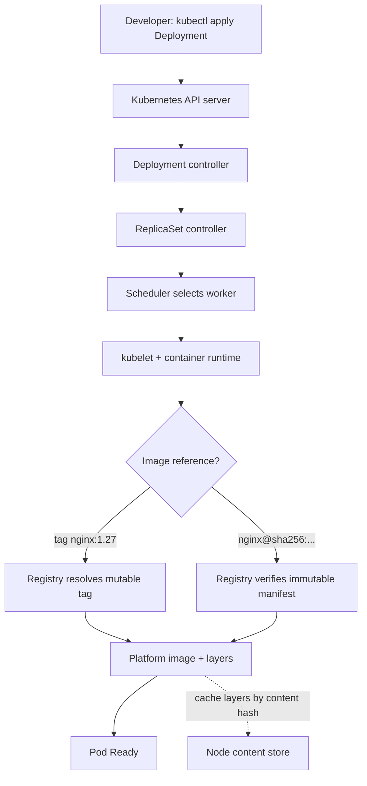
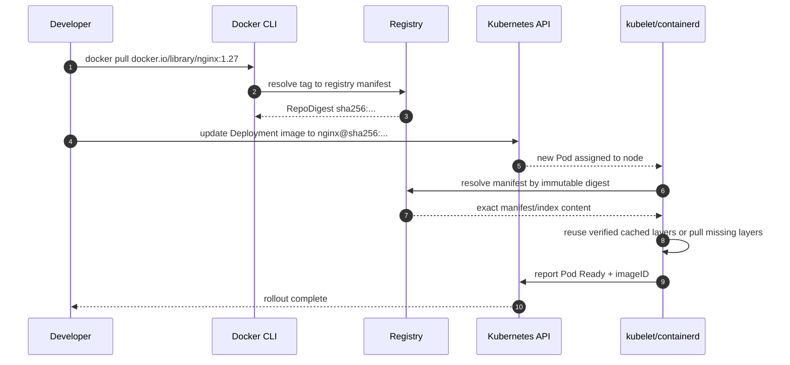

# D1-011 — Image Digest Pinning & Reproducible Deployments

**Domain:** Application Design and Build · **Độ khó:** intermediate → advanced · **Thời gian:** 35–45 phút · **Context:** `kind-ckad-labs` · **Namespace:** `ckad-d1-011`.

## 1. Sự cố production — cùng một tag, hai phiên bản khác nhau

Một nhóm backend chạy dịch vụ `catalog-api` với `nginx:1.27` trên hai Pod. Pipeline triển khai lại cùng một YAML, nhưng kết quả có thể thay đổi nếu tag bị cập nhật trong registry. `imagePullPolicy: IfNotPresent` còn cho phép kubelet dùng image đã cache ở node. Như vậy cùng một tag không nhất thiết mô tả cùng một nội dung theo thời gian.

**Mục tiêu:** Sửa Deployment có sẵn thành **immutable digest reference** `nginx@sha256:<registry-manifest-digest>` (64 ký tự hex), giữ 2 replicas, imagePullPolicy `Always`, resources đã cấp, label `release=digest-pinned`, và xác nhận cả hai Pod Ready. Không dùng local image ID (config digest) thay cho registry manifest digest.

**Điểm phân biệt quan trọng:** Tag là alias có thể thay đổi; registry manifest digest là content-addressed. Với image đa kiến trúc, digest có thể trỏ đến image index (manifest list), còn container runtime chọn manifest phù hợp kiến trúc node. Không nên nhầm image index digest, platform manifest digest và image config digest. `Always` vẫn có thể dùng layer cache nếu digest đã có, không nhất thiết tải lại mọi byte.

## 2. Flowchart: đường đi của image và registry



Kubernetes không tự biến tag thành digest trong Deployment spec. `status.containerStatuses[*].imageID` phản ánh image thực sự chạy; định dạng imageID khác nhau tùy runtime nên không dùng để suy đoán digest trong spec.

## 3. Sequence diagram: tag drift và triển khai tái lập



## 4. Đề bài CKAD (làm trước khi xem lời giải)

1. Kiểm tra Deployment `catalog-api` trong namespace `ckad-d1-011`: 2 replicas, `nginx:1.27`, `IfNotPresent`.
2. Dùng Docker CLI truy vấn **registry manifest digest thật** của `docker.io/library/nginx:1.27`, không tự viết chuỗi hash và không lấy `docker inspect .Id`.
3. Sửa **Deployment đang tồn tại**, giữ selector `app=catalog-api` (immutable), giữ requests `20m CPU / 32Mi RAM` và limits `150m CPU / 128Mi RAM`.
4. Đặt `image: docker.io/library/nginx@sha256:<digest>`, `imagePullPolicy: Always` và Pod template label `release: digest-pinned`.
5. Chứng minh 2 Pod Ready, Pod spec đều chứa đúng digest, và `kubectl rollout status` hoàn tất.

## 5. Khởi tạo và điều tra

```bash
./env/kind/up.sh
./ckad domain start D1-011
kubectl --context kind-ckad-labs -n ckad-d1-011 get deployment catalog-api -o wide
kubectl --context kind-ckad-labs -n ckad-d1-011 get pods -o wide
docker pull docker.io/library/nginx:1.27
docker image inspect docker.io/library/nginx:1.27 --format '{{json .RepoDigests}}'
# KHÔNG dùng: docker image inspect ... --format '{{.Id}}' (image config digest)
```

Từ `RepoDigests`, chọn tham chiếu `nginx@sha256:...` có digest hợp lệ. Trên các nền tảng khác nhau, registry có thể trả digest của image index hoặc platform manifest; lấy reference từ pull thật, không copy hash ví dụ trên Internet.

Tự tạo file `/tmp/d1-011.yaml` và apply vào namespace. Có thể dùng `kubectl set image deployment/catalog-api web=nginx@sha256:<digest>`, sau đó `kubectl patch`/edit để cập nhật label và pull policy. Đừng sửa `spec.selector` vì immutable.

```bash
kubectl --context kind-ckad-labs -n ckad-d1-011 rollout status deployment/catalog-api --timeout=180s
kubectl --context kind-ckad-labs -n ckad-d1-011 get pods -l app=catalog-api -o wide
kubectl --context kind-ckad-labs -n ckad-d1-011 get pods -l app=catalog-api -o jsonpath='{range .items[*]}{.metadata.name}{" image="}{.status.containerStatuses[0].imageID}{"\n"}{end}'
./ckad domain check D1-011
```

**Auto-grader** kiểm tra live Deployment và Pod qua API, không so khớp văn bản manifest. Nếu local Docker đã pull tag, checker còn so digest được pin với RepoDigest đã biết. Một chuỗi hash ngẫu nhiên đúng định dạng nhưng không pull được sẽ không đạt rollout.

## 6. Negative tests (thực hiện riêng từng lần)

**A — Image config digest bị nhầm thành manifest digest:** Lấy `docker image inspect ... --format '{{.Id}}'` và thử dùng làm image manifest reference. Thường registry không có manifest tương ứng; Pod bị `ErrImagePull` hoặc `ImagePullBackOff`. Khôi phục digest thật. Không giả định config digest luôn trùng manifest digest.

**B — Tag drift:** Dùng `kubectl set image` đổi về `nginx:1.27` và xem checker fail vì thiếu `@sha256:`. Đây là lỗi tính tái lập dù Pod vẫn có thể Ready. Trở lại digest.

**C — ImagePullPolicy:** Chuyển `Always` thành `IfNotPresent`; checker fail theo tiêu chí bài thi. Digest vẫn bảo đảm nội dung bất biến; pull policy là lựa chọn vận hành khác nhau và không phải điều kiện bắt buộc của mọi deployment pin digest.

**D — Manifest digest không tồn tại:** Đổi một ký tự của digest; quan sát event registry `manifest unknown`, rồi khôi phục. Không dùng digest giả trong hệ thống thật.

**E — Rollout:** Quan sát `kubectl get rs` và `kubectl rollout history` sau khi thay PodTemplate; Deployment tạo ReplicaSet mới, không thay container trong Pod hiện tại.

## 7. Troubleshooting theo triệu chứng

| Triệu chứng | Quan sát | Nguyên nhân / hướng xử lý |
|---|---|---|
| `ErrImagePull` | `kubectl describe pod` → Events | Digest sai, registry/network/auth lỗi |
| `ImagePullBackOff` | `kubectl get pods` | Runtime retry với backoff; sửa reference |
| Rollout timeout | `kubectl rollout status`, `get rs` | Pod mới chưa Ready hoặc pull lỗi |
| 2 Pod chạy khác image | `get pods -o jsonpath` | Kiểm tra rollout cũ/mới và imageID |
| Docker RepoDigests rỗng | `docker pull`, `docker inspect` | Image local build chưa có registry manifest |
| `docker pull` fail | Docker daemon, registry DNS/proxy | Kiểm tra kết nối trước khi kết luận lỗi YAML |

**Trade-offs:** Digest pinning tăng khả năng tái lập và kiểm toán nhưng đòi hỏi pipeline tự động cập nhật digest khi vá CVE; pin digest không thay thế image signing, SBOM, scanning hay admission policy. Với multi-arch images, chọn đúng digest theo mục tiêu deploy.

## 8. Đáp án và dọn dẹp

`solution.yaml` là template có placeholder cố ý để tránh lưu một digest không được xác minh hoặc lỗi thời. `solution.sh` pull image thật, lấy RepoDigest và render template trước khi apply.

```bash
./ckad domain hint D1-011
./ckad domain solve D1-011
./ckad domain check D1-011
./ckad domain reset D1-011
```

Chỉ namespace `ckad-d1-011` được tạo/xóa; không tác động CKA repo, node hoặc cluster khác.

## 9. Tài liệu chính thức

- [Kubernetes Images: Image names and tags](https://kubernetes.io/docs/concepts/containers/images/)
- [Kubernetes Deployments](https://kubernetes.io/docs/concepts/workloads/controllers/deployment/)
- [Docker image inspect](https://docs.docker.com/reference/cli/docker/image/inspect/)
- [OCI Image Manifest Specification](https://github.com/opencontainers/image-spec/blob/main/manifest.md)
- [kind: Loading an Image Into Your Cluster](https://kind.sigs.k8s.io/docs/user/quick-start/#loading-an-image-into-your-cluster)
