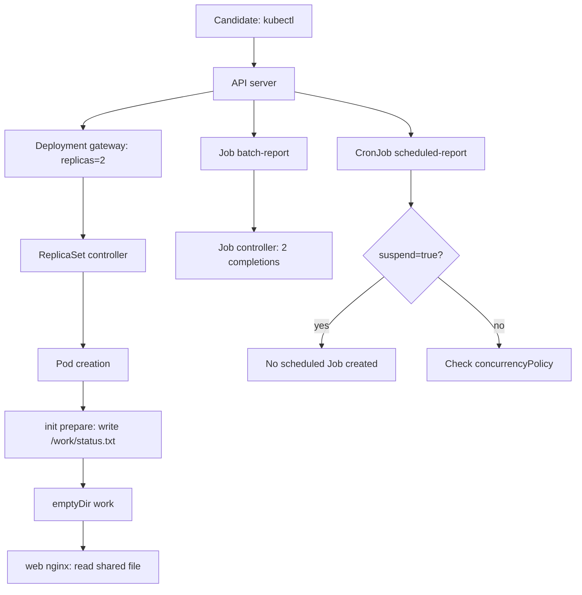
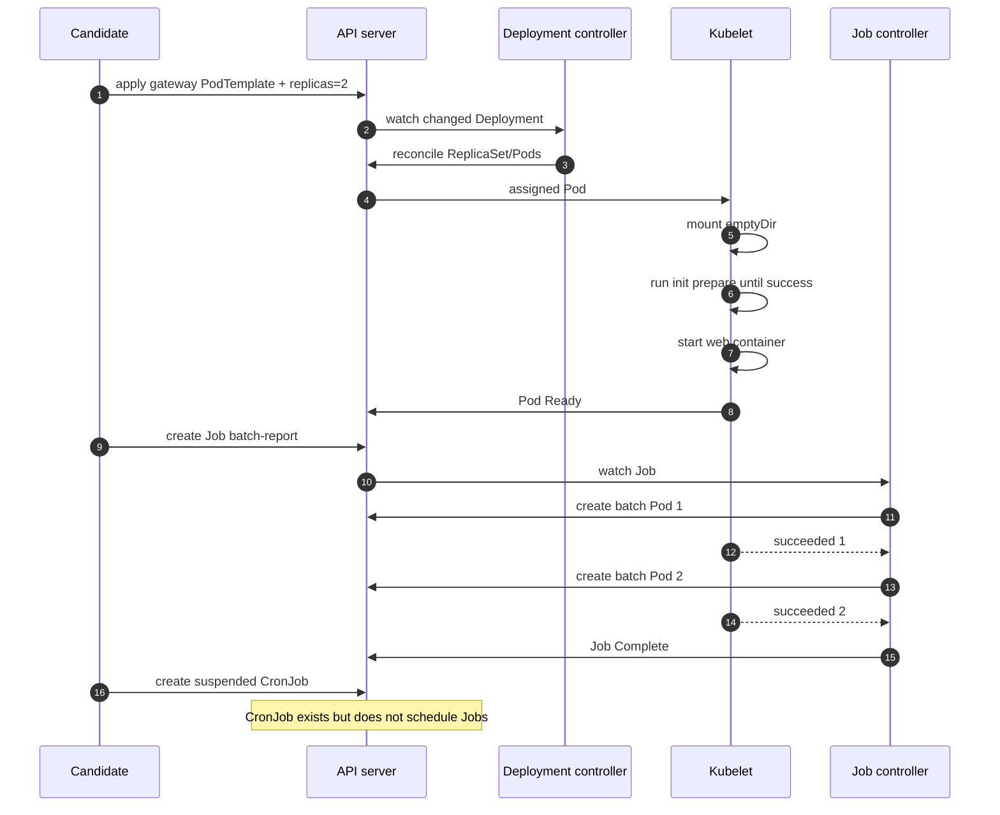

# D1-012 — Domain 1 Mock Exam: Application Design and Build

**Domain:** Application Design and Build (20% CKAD) · **Hình thức:** mini mock exam · **Thời gian khuyến nghị:** 35 phút · **Context:** `kind-ckad-labs` · **Namespace:** `ckad-d1-012` · **Điểm tối đa:** 100.

> Đây là **một lab tổng hợp**, gồm 5 nhiệm vụ trong cùng namespace, không phải 5 lab mới. Bài mô phỏng cách đọc đề và thao tác với cluster trong điều kiện thời gian; không tái tạo PSI secure browser. Ngưỡng 66% chỉ là mốc luyện tập, không phải chấm điểm CKAD chính thức.

## 1. Bối cảnh production

Nhóm backend chuẩn bị triển khai gateway và batch reporting trên Kubernetes. Một deployment đang chỉ chạy một replica; trước khi nhận traffic cần tạo dữ liệu vào volume. Job báo cáo phải hoàn tất hai lần, trong khi CronJob không được chạy chồng lịch. Bạn nhận cluster đã có sẵn ConfigMap `exam-config`, ConfigMap `batch-script`, Deployment `gateway`.

**Luật luyện thi:** Chỉ thao tác context `kind-ckad-labs`, namespace `ckad-d1-012`. Không xem `solution.yaml`/`solution.sh` trước khi hoàn tất. Tự đặt đồng hồ 35 phút, không chạy `./ckad domain check` cho đến khi kết thúc.

## 2. Đề thi thực hành (100 điểm)

| Câu | Điểm | Yêu cầu |
|---|---:|---|
| Q1 | 20 | Scale Deployment `gateway` lên **2 replicas Ready**; giữ image `nginx:1.27`, selector `app=gateway` |
| Q2 | 25 | Thêm init container `prepare` dùng `busybox:1.36`, ghi chuỗi `prepared` vào `/work/status.txt`; cả init container và container `web` cùng mount `emptyDir` tên `work` ở `/work` |
| Q3 | 15 | Container `web`: requests CPU `25m`, memory `32Mi`; limits CPU `150m`, memory `128Mi` |
| Q4 | 25 | Tạo Job `batch-report`, `completions=2`, `parallelism=1`, `backoffLimit=2`, `restartPolicy=Never`; dùng `busybox:1.36` và command in `batch-completed`. Đợi đủ 2 lần thành công |
| Q5 | 15 | Tạo CronJob `scheduled-report`, lịch `*/10 * * * *`, `concurrencyPolicy=Forbid`, `suspend=true`, template Pod `busybox:1.36` in `scheduled-report`, `restartPolicy=Never` |

**Điểm Q2** yêu cầu chứng minh file thực sự được init container tạo và đọc được từ container chính, không chỉ khai báo trường YAML. **Điểm Q4** yêu cầu Job thực sự thành công, không chỉ có JobSpec.

## 3. Flowchart — chuỗi phụ thuộc của bài thi



Tại sao phải có từng bước: API server chỉ lưu desired state; Deployment và ReplicaSet controllers reconcile replicas; kubelet chạy init container **trước** app container; Job controller theo dõi số Pod succeeded; CronJob controller quyết định tạo Job dựa trên schedule, suspend và concurrency policy.

## 4. Sequence diagram — thứ tự điều phối và xác minh



## 5. Cách chạy đề thi

```bash
./env/kind/up.sh
./ckad domain start D1-012
kubectl --context kind-ckad-labs -n ckad-d1-012 get all
# Tự giải Q1..Q5 trong 35 phút.
kubectl --context kind-ckad-labs -n ckad-d1-012 get pods -o wide
kubectl --context kind-ckad-labs -n ckad-d1-012 get events --sort-by=.lastTimestamp
./ckad domain check D1-012
```

Checker chấm **live API state** và kiểm tra file bên trong Pod; không so sánh text với solution. Chấm từng câu theo trọng số 20/25/15/25/15. Đạt từ 66 điểm trong mini exam. Không nên coi việc chạy `solve` là đã tự vượt qua bài thi.

## 6. Negative tests (chạy sau khi đã chấm)

1. **Q1: replica chưa Ready** — sửa image thành tag không tồn tại; Deployment có desired replicas nhưng readyReplicas giảm. Dùng `describe pod` và events, sau đó khôi phục.
2. **Q2: init container lỗi** — sửa command thành `exit 1`; app container không được start. Quan sát `Init:CrashLoopBackOff` và `kubectl logs POD -c prepare`.
3. **Q2: mount lệch tên** — dùng `volumeMount.name` không tồn tại: API validation từ chối PodSpec, phân biệt lỗi admission với runtime.
4. **Q4: Job failure** — đổi command thành `exit 42`; xem retry/backoff. Vì Job PodTemplate immutable, tạo Job mới thay vì sửa trực tiếp.
5. **Q5: schedule không an toàn** — bỏ `suspend`, đổi `concurrencyPolicy` sang Allow; kiểm tra risk khi job chạy dài hơn chu kỳ, rồi phục hồi.

## 7. Troubleshooting nhanh

| Triệu chứng | Câu | Chẩn đoán |
|---|---|---|
| Deployment không đủ Ready | Q1/Q2 | `kubectl describe pod`, init container logs, image pull |
| File `status.txt` không tồn tại | Q2 | mount cùng emptyDir? init command đã exit 0? |
| Pod Pending | Q3 | kiểm tra requests và node allocatable |
| Job không Complete | Q4 | `kubectl get jobs,pods`, logs và status.failed |
| CronJob tạo Job ngoài ý muốn | Q5 | `kubectl get cronjob -o yaml`, kiểm tra suspend |
| Chấm thiếu điểm | Tất cả | so sánh field trong API, không chỉ manifest local |

## 8. Lời giải, reset và rút kinh nghiệm

```bash
./ckad domain solve D1-012   # Chỉ dùng sau khi tự làm
./ckad domain check D1-012
./ckad domain reset D1-012
```

`reset` chỉ xóa namespace `ckad-d1-012` có label sở hữu CKAD Labs, không xóa cluster hay Docker volumes. Đây là mini mock Domain 1; full mock CKAD 120 phút sẽ thuộc lộ trình sau, không tuyên bố đây là đề thi thật.

## 9. Tài liệu chính thức

- [CKAD certification](https://training.linuxfoundation.org/certification/certified-kubernetes-application-developer-ckad/)
- [Kubernetes: init containers](https://kubernetes.io/docs/concepts/workloads/pods/init-containers/)
- [Kubernetes: Deployments](https://kubernetes.io/docs/concepts/workloads/controllers/deployment/)
- [Kubernetes: Jobs](https://kubernetes.io/docs/concepts/workloads/controllers/job/)
- [Kubernetes: CronJobs](https://kubernetes.io/docs/concepts/workloads/controllers/cron-jobs/)
- [Kubernetes: emptyDir](https://kubernetes.io/docs/concepts/storage/volumes/#emptydir)
- [Kubernetes: resource management](https://kubernetes.io/docs/concepts/configuration/manage-resources-containers/)

