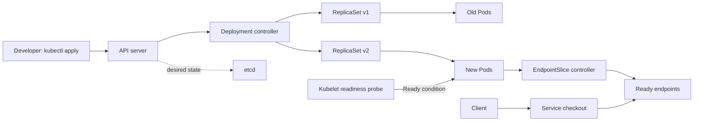
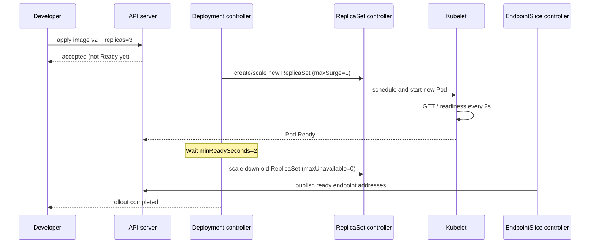

# D2-001 — RollingUpdate không gián đoạn và readiness gate

**Domain:** Application Deployment · **Mức độ:** cơ bản → trung cấp · **Thời gian:** 25–35 phút · **Namespace:** `ckad-d2-001`

## 1. Tình huống production

Dịch vụ checkout đang chạy hai Pod nginx:1.27 sau một Service ClusterIP. Nhóm triển khai muốn đưa phiên bản v2 lên **ba replicas** nhưng không được làm giảm số Pod sẵn sàng trong lúc rollout. Deployment hiện dùng giá trị phần trăm mặc định cho `maxUnavailable` và chưa có readiness probe. Khi container khởi động chậm hoặc image lỗi, một rollout có thể làm giảm số backend Ready; `kubectl apply` thành công không chứng minh deployment đã phục vụ được request.

### Mục tiêu cần đạt

1. Cập nhật Deployment `checkout` sang image `nginx:1.29`, giữ nguyên tên container và selector `app=checkout`.
2. Scale `replicas=3`; đặt `strategy.type=RollingUpdate`, `maxSurge=1`, `maxUnavailable=0`.
3. Đặt `minReadySeconds=2`, `progressDeadlineSeconds=120`, `revisionHistoryLimit=3`.
4. Thêm readiness HTTP GET `/` qua named port `http`, `periodSeconds=2`; label PodTemplate `release=v2`.
5. Đảm bảo ba replicas Available và Service `checkout` có ít nhất ba endpoint Ready.

**Lưu ý:** `maxUnavailable=0` giữ số Pod Available tối thiểu theo chiến lược rollout, nhưng **không phải cam kết tuyệt đối zero downtime** trước sự cố node, network, app hoặc lỗi hệ thống khác.

## 2. Architecture: Deployment controller khác Service routing



**Ai chịu trách nhiệm?** Deployment controller điều chỉnh kích thước các ReplicaSet; ReplicaSet controller tạo/xóa Pod; kubelet thực hiện readinessProbe và cập nhật Pod status; EndpointSlice controller cập nhật địa chỉ backend. Service không đợi `rollout status` để nhận traffic, mà dùng các backend Ready.

## 3. Sequence: một rollout an toàn diễn ra thế nào?



Với `maxSurge=1`, số Pod trong lúc cập nhật có thể tăng tạm thời lên 4 khi desired replicas là 3. `maxUnavailable=0` giữ số Available tối thiểu 3 trong rollout sau khi Deployment đã đạt trạng thái đó; nếu khởi đầu chỉ có 2 replicas, không thể tự nhiên bảo đảm 3 Available ngay từ đầu.

## 4. Thực hành (không mở solution trước)

```bash
./env/kind/up.sh
./ckad domain start D2-001
kubectl --context kind-ckad-labs -n ckad-d2-001 get deploy,rs,pods,svc -o wide
kubectl --context kind-ckad-labs -n ckad-d2-001 describe deploy checkout
kubectl --context kind-ckad-labs -n ckad-d2-001 get events --sort-by=.lastTimestamp
```

Dùng `kubectl edit deployment checkout` hoặc tự viết manifest. Đừng thay `spec.selector.matchLabels` vì selector của Deployment là immutable. Sau khi chỉnh, quan sát:

```bash
kubectl --context kind-ckad-labs -n ckad-d2-001 rollout status deploy/checkout --timeout=120s
kubectl --context kind-ckad-labs -n ckad-d2-001 get rs -l app=checkout
kubectl --context kind-ckad-labs -n ckad-d2-001 get endpointslices -l kubernetes.io/service-name=checkout -o yaml
./ckad domain check D2-001
```

## 5. Negative tests — dự đoán trước khi chạy

- **N1: Image không tồn tại.** Thử `nginx:missing-ckad-tag`; quan sát Pod `ImagePullBackOff`, rollout không hoàn tất. Dùng `kubectl rollout undo deploy/checkout` để khôi phục phiên bản trước (lưu ý lịch sử revision).
- **N2: Readiness sai.** Đặt path `/not-found`; Pod chạy nhưng không Ready. Kiểm tra `describe pod`, sự kiện Unhealthy và EndpointSlice; không nhầm với liveness.
- **N3: maxUnavailable=1.** So sánh số Available trong rollout với `maxUnavailable=0`; giải thích tại sao cấu hình 1 có thể giảm capacity.
- **N4: Đổi selector.** Thử sửa `spec.selector.matchLabels`; API từ chối vì immutable. Giữ selector cũ và thay PodTemplate labels bổ sung.
- **N5: Service selector sai.** Đổi selector sang `app=wrong`; Deployment vẫn Available nhưng EndpointSlice không còn backend Ready.

**Chạy negative tests trên một lần reset riêng**, sau đó `./ckad domain solve D2-001` để đưa về cấu hình đáp án. Không áp dụng lỗi thử nghiệm vào cluster production.

## 6. Debug theo triệu chứng

| Triệu chứng | Lệnh | Nguyên nhân cần phân biệt |
|---|---|---|
| Apply OK, rollout timeout | `kubectl describe deploy checkout` | Pod không Ready, image pull, scheduling |
| Pod Running nhưng 0/1 Ready | `kubectl describe pod <name>` | readiness path/port, ứng dụng chưa sẵn sàng |
| Deployment Available nhưng client lỗi | `kubectl get endpointslices -o yaml` | selector Service, backend readiness, DNS/data plane |
| Image mới không lên | `kubectl get rs; kubectl rollout history deploy/checkout` | Deployment revision và trạng thái ReplicaSet |
| Không đủ Pod | `kubectl describe pod; kubectl get events` | CPU/memory requests, node capacity |

## 7. Lời giải, chấm và cleanup

```bash
./ckad domain solve D2-001
./ckad domain check D2-001
./ckad domain reset D2-001
```

`verify.sh` gọi Kubernetes API thực, kiểm tra cấu hình Deployment, rollout, số Available, Service selector và các Ready EndpointSlice; không chỉ grep text YAML.

## 8. Tài liệu chính thức

- [Deployments — RollingUpdate](https://kubernetes.io/docs/concepts/workloads/controllers/deployment/#rolling-update-deployment)
- [Configure liveness, readiness and startup probes](https://kubernetes.io/docs/tasks/configure-pod-container/configure-liveness-readiness-startup-probes/)
- [EndpointSlices](https://kubernetes.io/docs/concepts/services-networking/endpoint-slices/)
- [kubectl rollout](https://kubernetes.io/docs/reference/kubectl/generated/kubectl_rollout/)
- [kind Quick Start](https://kind.sigs.k8s.io/docs/user/quick-start/)

