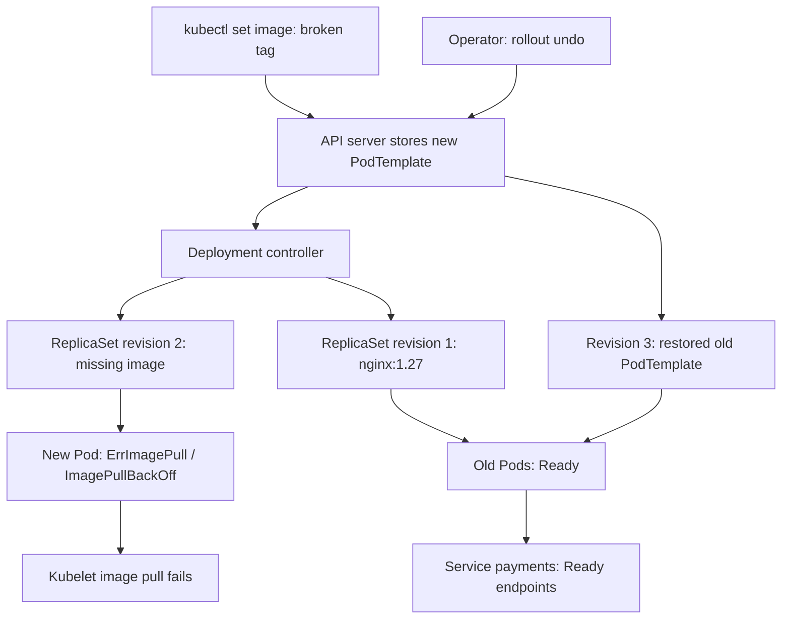
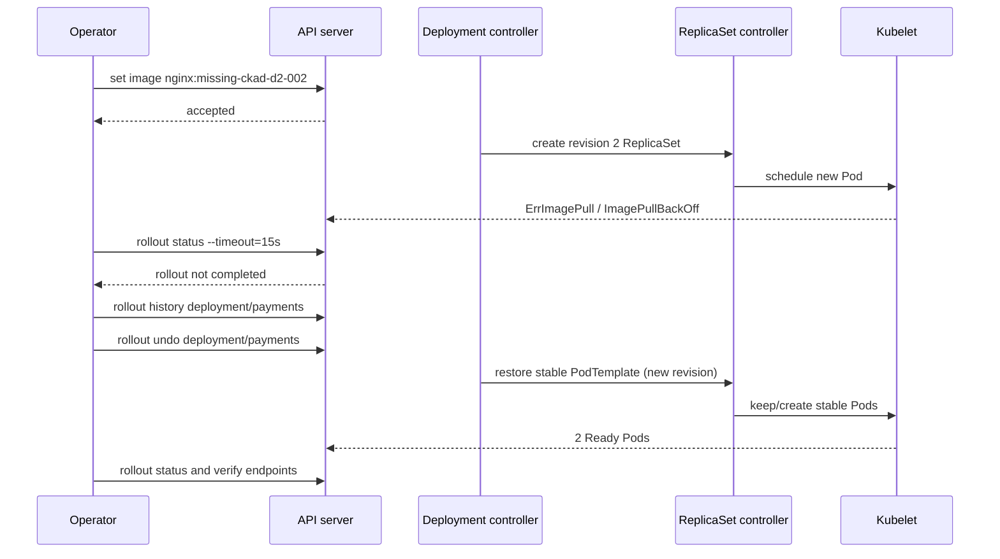

# D2-002 — Rollout History & Rollback After Broken Release

**Domain:** Application Deployment · **Độ khó:** cơ bản → trung cấp · **Thời gian:** 25–35 phút · **Namespace:** `ckad-d2-002`

## 1. Sự cố production: phát hành payments bị lỗi

Dịch vụ `payments` đang chạy **2 Pod nginx:1.27**, được truy cập qua Service ClusterIP. Nhóm phát hành nhầm image `nginx:missing-ckad-d2-002`. Kubernetes API chấp nhận Deployment mới nhưng kubelet không pull được image. Deployment controller vẫn giữ ReplicaSet cũ phục vụ traffic trong quá trình rollout (với điều kiện các Pod cũ còn khỏe). Nhiệm vụ của bạn là **chẩn đoán, xem lịch sử, rollback**, không xóa Deployment để tạo lại.

**Điều kiện hoàn thành:** Deployment dùng lại `nginx:1.27`, template label `version=stable`, có 2 replicas Available, Service có 2 Ready endpoints, và lịch sử ReplicaSet vẫn lưu bản lỗi để điều tra. Grader không chỉ so sánh YAML: nó đọc Kubernetes API và kiểm tra trạng thái runtime.

> Khác D2-001 (thiết kế RollingUpdate/readiness): bài này tập trung **revision history, rollout failure và rollback an toàn**, không chỉnh chiến lược rollout.

## 2. Sơ đồ controller và lịch sử revision



**Tách vai trò:** API server lưu desired state; Deployment controller tạo và scale ReplicaSet; ReplicaSet controller quản lý Pod; scheduler chọn node; kubelet pull image và báo Pod status. `kubectl rollout undo` sửa PodTemplate về một revision trước, tạo một revision Deployment **mới**. Nó không xóa bản lỗi khỏi lịch sử ngay lập tức; việc giữ history chịu ảnh hưởng bởi `revisionHistoryLimit`.

## 3. Sequence: phát hành lỗi → rollback



**Quan trọng:** `rollout status --timeout=15s` hết hạn ở client không đồng nghĩa Deployment đã có condition `ProgressDeadlineExceeded`; condition này phụ thuộc `progressDeadlineSeconds` và thời gian controller quan sát. Không suy diễn rằng `kubectl apply` thành công nghĩa là ứng dụng đã khỏe.

## 4. Đề thi: làm trước khi xem lời giải

```bash
./env/kind/up.sh
./ckad domain start D2-002
NS=ckad-d2-002
K="kubectl --context kind-ckad-labs -n $NS"
$K rollout status deploy/payments --timeout=120s
$K set image deploy/payments web=nginx:missing-ckad-d2-002
$K get deploy,rs,pods -l app=payments
$K rollout history deploy/payments
$K describe deploy payments
$K get events --sort-by=.lastTimestamp
```

**Yêu cầu:** (1) xác định Pod nào lỗi và vì sao; (2) xác định revision cũ còn khỏe; (3) rollback mà không delete Deployment hoặc ReplicaSet; (4) đợi rollout ổn định; (5) kiểm tra image, replicas, endpoints và lịch sử.

Gợi ý các lệnh thi CKAD: `kubectl rollout history deploy/payments --revision=2`, `kubectl rollout undo deploy/payments`, `kubectl rollout status deploy/payments`, `kubectl get rs -l app=payments`. Đừng chỉnh selector Deployment immutable.

## 5. Chấm bằng trạng thái cluster

```bash
./ckad domain check D2-002
# Khi cần tham khảo:
./ckad domain solve D2-002
./ckad domain check D2-002
./ckad domain reset D2-002
```

**Điểm dễ mất:** nếu chỉ apply lại manifest stable sau khi reset mà không tạo revision lỗi, grader sẽ không thấy lịch sử release thất bại. Đó là chủ ý: phải thực hành rollback thực sự.

## 6. Negative tests có thể tái hiện

Mỗi lần thử nên reset/start lại lab để lịch sử không lẫn nhau.

| Thử nghiệm | Thao tác | Dấu hiệu quan sát | Khôi phục |
|---|---|---|---|
| N1: tag không tồn tại | `set image deploy/payments web=nginx:missing-ckad-d2-002` | `ImagePullBackOff`, rollout không hoàn tất | `rollout undo` |
| N2: rollback khi chưa có revision trước | `rollout undo` ngay sau `start` | không có previous revision; không thể undo | tạo revision lỗi rồi undo |
| N3: history bị prune | đặt `revisionHistoryLimit=0` trước nhiều rollout | revision cũ có thể bị dọn; undo không còn target | phục hồi cấu hình và redeploy bản đã biết tốt |
| N4: sửa Service selector | `patch svc payments -p '{"spec":{"selector":{"app":"unknown"}}}'` | Pod Available nhưng Ready EndpointSlice trống | phục hồi `app=payments` |
| N5: rollout timeout ngắn | `rollout status deploy/payments --timeout=1s` lúc Pod chưa Ready | CLI timeout, không đủ bằng chứng ProgressDeadlineExceeded | kiểm tra Deployment conditions |

**Chỉ thực hiện N3 sau khi hiểu hệ quả:** giảm history có thể làm mất revision phục vụ rollback. Không chạy trên production. N4 cần khôi phục selector trước khi chấm.

## 7. Troubleshooting theo triệu chứng

| Triệu chứng | Quan sát | Phân tích / cách sửa |
|---|---|---|
| `kubectl apply` thành công nhưng rollout treo | `describe pod`, `get events` | image pull, readiness, scheduling; API acceptance khác readiness |
| Pod mới `ImagePullBackOff` | `get pods -o wide`, `describe pod` | tag sai, registry auth, DNS, network |
| Không undo được | `rollout history`, `get rs` | thiếu revision trước hoặc history bị prune |
| Undo rồi nhưng không đủ Ready | `rollout status`, `get deploy` | Pod cũ cũng lỗi, node thiếu tài nguyên |
| Deployment khỏe nhưng không có traffic | `get endpointslices -l kubernetes.io/service-name=payments -o yaml` | Service selector hoặc readiness không khớp |
| Revision number tăng sau undo | `rollout history` | đúng kỳ vọng: rollback tạo revision mới |

## 8. Giải thích trade-offs

- **Rollback nhanh** khôi phục image/config PodTemplate; không tự rollback database schema, Secret, ConfigMap hoặc dữ liệu ngoài cluster.
- **ReplicaSet history** chỉ giữ PodTemplate. `kubectl rollout history` không thay thế release audit log đầy đủ.
- **Không delete Deployment**: tránh mất lịch sử và tạo khoảng trống phục vụ request.
- **Rollback chỉ an toàn khi revision cũ còn hoạt động**: luôn xác minh Service endpoints và traffic thực tế.

## 9. Tài liệu chính thức

- [Kubernetes Deployments: rolling back a Deployment](https://kubernetes.io/docs/concepts/workloads/controllers/deployment/#rolling-back-a-deployment)
- [Kubernetes Deployments: revision history limit](https://kubernetes.io/docs/concepts/workloads/controllers/deployment/#revision-history-limit)
- [kubectl rollout history](https://kubernetes.io/docs/reference/kubectl/generated/kubectl_rollout/kubectl_rollout_history/)
- [kubectl rollout undo](https://kubernetes.io/docs/reference/kubectl/generated/kubectl_rollout/kubectl_rollout_undo/)
- [Debug Pods](https://kubernetes.io/docs/tasks/debug/debug-application/debug-pods/)
- [kind Quick Start](https://kind.sigs.k8s.io/docs/user/quick-start/)
