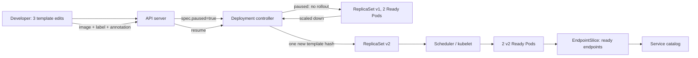
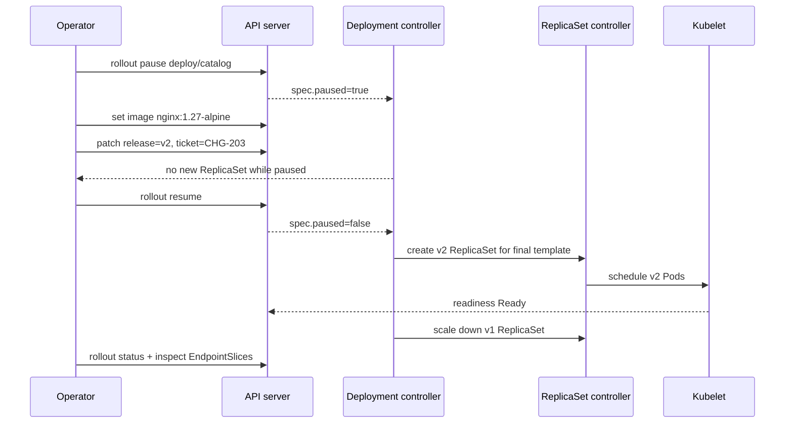

# D2-003 — Pause/Resume Deployment: gộp thay đổi thành một release

**Domain 2 · Application Deployment · Mức độ trung cấp · 30–40 phút · Namespace:** `ckad-d2-003`

## 1. Production incident và mục tiêu

Team Catalog cần phát hành **đồng thời** image mới, nhãn release và annotation change-ticket. Nếu cập nhật image trước rồi cập nhật metadata sau, Deployment controller có thể tạo nhiều ReplicaSet và tiến hành nhiều lần rollout. Mục tiêu là **pause → batch edits → kiểm tra → resume**, chỉ tạo một ReplicaSet mới cho bộ thay đổi này. Khác D2-001 (readiness strategy) và D2-002 (rollback khi image lỗi), lab này dạy **điều phối nhiều thay đổi PodTemplate trong một release**.

Hệ thống ban đầu: Deployment `catalog` có 2 replica image `nginx:1.27`, label `release=v1`, Service `catalog`. Release mong muốn: `nginx:1.27-alpine`, `release=v2`, annotation `ckad.dev/change-ticket=CHG-203`; 2 Pod Available; Deployment **không còn paused**; Service có 2 ready endpoints.

## 2. Kiến trúc và controller flow



**Trách nhiệm:** API server ghi desired state; Deployment controller bỏ qua rollout PodTemplate khi paused; khi resume nó tạo ReplicaSet mới cho template cuối; ReplicaSet controller tạo Pod; scheduler gán node; kubelet pull image, chạy readiness probe; EndpointSlice controller cập nhật endpoints cho Service. Pause **không** dừng Pod đang chạy và không chặn mọi thay đổi khác (ví dụ scale).

## 3. Sequence diagram: thời điểm tạo revision



**Lưu ý:** Không có yêu cầu chờ `rollout status` trong khi Deployment đang paused; thao tác này không có rollout mới để hoàn thành. Revision number không được giả định cố định vì môi trường có thể đã chạy lại lab.

## 4. Bài thi thực hành

```bash
./env/kind/up.sh
./ckad domain start D2-003
NS=ckad-d2-003
kubectl --context kind-ckad-labs -n "$NS" rollout status deploy/catalog --timeout=120s
kubectl --context kind-ckad-labs -n "$NS" get deploy,rs,pods -l app=catalog
```

**Yêu cầu (không xem lời giải):** (1) pause Deployment; (2) sửa image, PodTemplate label và annotation; (3) xác minh template đã đổi nhưng không tạo ReplicaSet mới khi paused; (4) resume; (5) đợi 2 Available Pod; (6) kiểm tra EndpointSlice và revision history. Không xóa Deployment, không đổi selector bất biến.

Các lệnh gợi ý: `kubectl rollout pause`, `kubectl set image`, `kubectl patch --type=merge`, `kubectl rollout resume`, `kubectl rollout status`, `kubectl get rs -o wide`.

## 5. Lời giải và tự chấm

```bash
./ckad domain solve D2-003
./ckad domain check D2-003
./ckad domain reset D2-003
```

`solution.sh` thực thi pause → 2 cập nhật → resume → wait. `solution.yaml` là tham khảo desired state, không phải script mô phỏng pause. `verify.sh` đọc **Kubernetes API thật**, kiểm tra image, label, annotation, trạng thái paused, số replicas, observedGeneration, rollout, Service selector, ready EndpointSlices và ReplicaSet history. **Giới hạn có chủ ý:** trạng thái cuối không chứng minh được người học thực sự pause giữa các edit; cần quan sát ReplicaSet trước/sau trong quá trình làm bài.

## 6. Negative tests (chạy riêng, reset sau mỗi thử nghiệm)

| Test | Thao tác | Dấu hiệu | Khắc phục |
|---|---|---|---|
| N1: quên resume | pause + sửa template nhưng không resume | image desired đổi, Pod vẫn v1 | rollout resume |
| N2: image sai | thay `nginx:does-not-exist-d2-003` rồi resume | ErrImagePull/ImagePullBackOff | rollback hoặc sửa image |
| N3: metadata ngoài template | `kubectl annotate deploy/catalog ckad.dev/change-ticket=CHG-203` | metadata Deployment đổi nhưng PodTemplate annotation thiếu; grader fail | patch `spec.template.metadata.annotations` |
| N4: thiếu readiness | patch probe thành path `/not-found` | Pod chạy nhưng không Ready, EndpointSlice không đủ | sửa probe về `/` |
| N5: Service selector sai | patch selector thành `app=missing` | Deployment Available nhưng EndpointSlice rỗng | trả về `app=catalog` |

Thử N2–N5 trên namespace lab, không chạy trên cluster production. Dùng `./ckad domain reset D2-003` và `start` để làm lại sạch.

## 7. Troubleshooting có thứ tự

1. **Không thấy ReplicaSet mới:** `kubectl get deploy catalog -o jsonpath='{.spec.paused}'`; nếu true thì resume.
2. **Resume nhưng rollout không xong:** `kubectl describe deploy catalog`, `kubectl get pods -l app=catalog`, `kubectl get events --sort-by=.lastTimestamp`; phân biệt ImagePullBackOff, FailedScheduling và readiness failure.
3. **Có 2 Pods nhưng không Available:** xem `kubectl describe pod` và readiness probe; Pod Running không đồng nghĩa Ready.
4. **Service không có endpoints:** kiểm tra selector, `kubectl get endpointslices -l kubernetes.io/service-name=catalog -o yaml`.
5. **Có nhiều ReplicaSet hơn mong đợi:** so sánh revision annotations và PodTemplate hashes; chỉnh template khi chưa pause có thể tạo rollout riêng.
6. **CLI báo timeout:** kiểm tra `status.conditions` và `progressDeadlineSeconds`; timeout phía client không tự chứng minh ProgressDeadlineExceeded.

## 8. Trade-offs và kiến thức CKAD

- **Ưu điểm:** batch nhiều thay đổi template thành một lần rollout; dễ review ticket và giảm revision nhiễu.
- **Nhược điểm:** nếu quên resume, phiên bản chạy thực tế không cập nhật dù spec đã đổi; thêm bước kiểm soát trong CI/CD.
- **Không phải transaction:** pause/resume không đảm bảo atomicity cho ConfigMap, Secret, database migration hay external services.
- **Tương tác với scale:** thay đổi replicas khi paused vẫn có thể có tác dụng; đừng hiểu pause là freeze toàn bộ Deployment.
- **Bảo mật:** annotation change ticket không chứa credential hay token.

## 9. Tài liệu chính thức

- [Kubernetes: Pausing and Resuming a rollout](https://kubernetes.io/docs/concepts/workloads/controllers/deployment/#pausing-and-resuming-a-rollout-of-a-deployment)
- [Kubernetes: Updating a Deployment](https://kubernetes.io/docs/concepts/workloads/controllers/deployment/#updating-a-deployment)
- [kubectl rollout pause](https://kubernetes.io/docs/reference/kubectl/generated/kubectl_rollout/kubectl_rollout_pause/)
- [kubectl rollout resume](https://kubernetes.io/docs/reference/kubectl/generated/kubectl_rollout/kubectl_rollout_resume/)
- [Kubernetes EndpointSlices](https://kubernetes.io/docs/concepts/services-networking/endpoint-slices/)
- [kind Quick Start](https://kind.sigs.k8s.io/docs/user/quick-start/)
