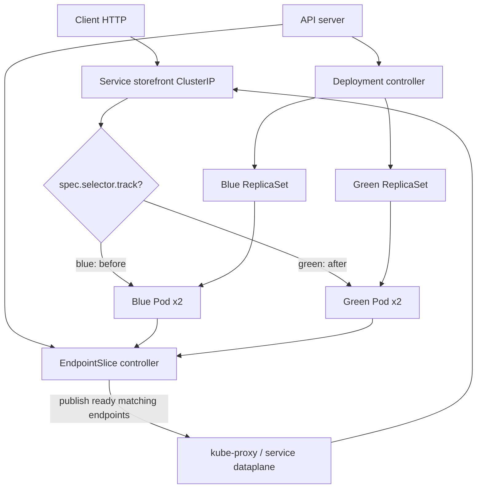
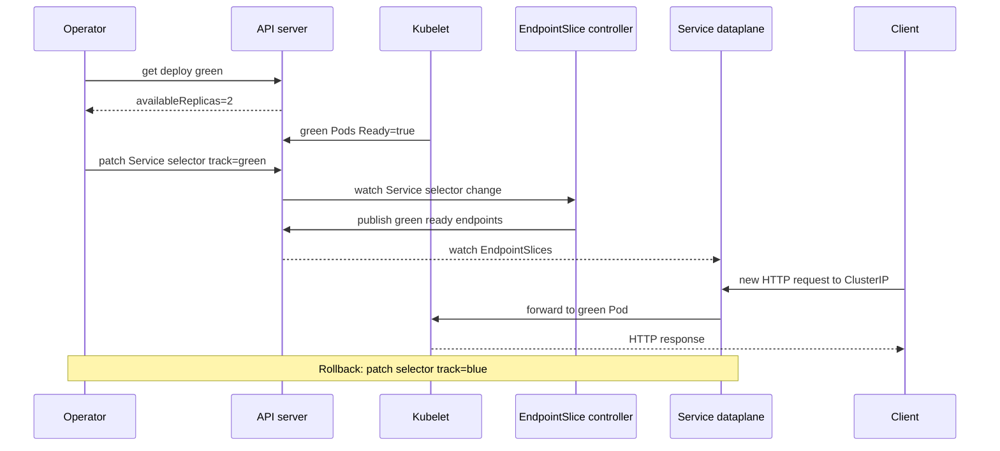

# D2-004 — Blue/Green Deployment: chuyển traffic bằng Service selector

**Domain 2 · Application Deployment · Trung cấp · 40–50 phút · Namespace:** `ckad-d2-004`

## 1. Incident production

Storefront có hai phiên bản chạy song song: **blue** đang phục vụ khách hàng và **green** đã triển khai nhưng chưa nhận traffic. Đội vận hành muốn kiểm tra sức khỏe green trước khi chuyển toàn bộ traffic; nếu phát hiện lỗi phải chuyển lại blue nhanh mà không cần rebuild image. Đây là chiến lược **blue/green**, khác với D2-001 RollingUpdate, D2-002 rollback revision và D2-003 pause/resume.

**Đầu vào:** 2 Deployment `storefront-blue`, `storefront-green`, mỗi Deployment 2 replicas; Service `storefront` ban đầu chọn `track=blue`. **Đích:** Service chọn `track=green`; hai green Pod Ready, EndpointSlice chỉ có 2 địa chỉ green; blue vẫn có 2 Pod Available để rollback nhanh.

## 2. Sơ đồ luồng traffic và controller



**Ai làm gì?** API server lưu selector của Service. Deployment controller duy trì số replica riêng cho mỗi màu; ReplicaSet controller tạo Pod; scheduler chọn node; kubelet chạy readiness probe; EndpointSlice controller công bố các endpoint khớp selector và Ready. kube-proxy (hoặc dataplane tương đương) áp dụng endpoint mới cho kết nối mới. **Không đảm bảo chuyển đổi atomic cho mọi kết nối đang mở** và không tự rollback khi lỗi ứng dụng.

## 3. SequenceDiagram: preflight và cutover



## 4. Thực hành trên kind

```bash
./env/kind/up.sh
./ckad domain start D2-004
NS=ckad-d2-004
kubectl --context kind-ckad-labs -n "$NS" get deploy,pod,svc -l app=storefront
kubectl --context kind-ckad-labs -n "$NS" get svc storefront -o yaml
kubectl --context kind-ckad-labs -n "$NS" get endpointslices -l kubernetes.io/service-name=storefront -o wide
```

**Nhiệm vụ:** (1) kiểm tra hai Deployment có 2 Available Pod; (2) kiểm tra Service ban đầu route tới blue; (3) xác nhận green đã Ready; (4) đổi **chỉ** Service selector `track` từ blue sang green, giữ `app=storefront`; (5) quan sát EndpointSlice hội tụ và xác minh không còn endpoint blue; (6) thử rollback sang blue rồi cutover lại green; (7) chạy grader. Không scale blue về 0 vì đây là đường rollback nhanh.

Gợi ý: `kubectl patch svc storefront --type=merge -p '{"spec":{"selector":{"app":"storefront","track":"green"}}}'`.

## 5. Lời giải, kiểm chứng, cleanup

```bash
./ckad domain solve D2-004
./ckad domain check D2-004
./ckad domain reset D2-004
```

`solution.sh` đợi hai Deployment ổn định rồi patch Service. `verify.sh` lấy JSON trực tiếp từ Kubernetes API, so sánh Pod IP với địa chỉ Ready trong EndpointSlice, kiểm tra green/blue replicas, observedGeneration và selector. Chấm theo **trạng thái thật**, không đọc file YAML để giả lập. Không thể xác nhận thứ tự thao tác lịch sử chỉ từ trạng thái cuối.

## 6. Negative tests — chạy độc lập, reset giữa các test

| Case | Cách gây lỗi | Quan sát | Khôi phục |
|---|---|---|---|
| N1 | Patch `track=unknown` | EndpointSlice không có ready endpoint, grader fail | Patch lại green |
| N2 | Scale green về 0 trước cutover | Không có green ready endpoint | Scale green=2, wait Available |
| N3 | Patch `app=wrong` | Selector không khớp Pod | Trả về `app=storefront` |
| N4 | Xóa readiness probe green hoặc đặt path `/missing` | Pod không Ready hoặc policy mất bảo đảm | Khôi phục readiness probe và rollout |
| N5 | Scale blue về 0 sau cutover | Mất đường rollback nhanh, grader fail | Scale blue=2 |

Ví dụ N1: `kubectl --context kind-ckad-labs -n ckad-d2-004 patch svc storefront -p '{"spec":{"selector":{"app":"storefront","track":"unknown"}}}'`; chạy check để thấy FAIL; sau đó reset và start lại.

## 7. Troubleshooting theo dấu vết request

1. **Service có ClusterIP nhưng không có endpoint:** `kubectl get svc storefront -o jsonpath='{.spec.selector}'`; đối chiếu `kubectl get pods --show-labels`.
2. **Green Running nhưng chưa Ready:** `kubectl describe pods -l track=green`, `kubectl get events --sort-by=.lastTimestamp`, xem readinessProbe và image pull.
3. **EndpointSlice vẫn blue ngay sau patch:** controller cần thời gian hội tụ; chạy lại `kubectl get endpointslices -l kubernetes.io/service-name=storefront -o yaml` sau vài giây.
4. **HTTP không đổi ngay:** Service routing là eventual consistency; kết nối TCP hiện hữu có thể tiếp tục tới backend cũ.
5. **Green chỉ có 1 Pod:** `kubectl describe deploy storefront-green`, kiểm tra quota, FailedScheduling, requests và kubelet.
6. **Rollback:** patch Service selector về blue; kiểm tra EndpointSlice và HTTP mới, không xóa green để còn điều tra.

## 8. Trade-offs và giới hạn

Blue/green cần tài nguyên để chạy song song hai phiên bản, nhưng rollback selector nhanh và dễ xác minh trước khi nhận traffic. Khác canary, selector chuyển toàn bộ nhóm endpoint; không hỗ trợ chia 10/90 traffic theo phần trăm. Cần tương thích schema database hai chiều và kế hoạch xử lý session/connections; Service selector không giải quyết migration dữ liệu. Bài dùng cùng image cho hai màu để tập trung vào **cơ chế routing**; trong thực tế hai phiên bản có thể có image digest khác nhau.

## 9. Tài liệu chính thức

- [Kubernetes Service selectors](https://kubernetes.io/docs/concepts/services-networking/service/)
- [EndpointSlices](https://kubernetes.io/docs/concepts/services-networking/endpoint-slices/)
- [Deployment](https://kubernetes.io/docs/concepts/workloads/controllers/deployment/)
- [Readiness probes](https://kubernetes.io/docs/concepts/configuration/liveness-readiness-startup-probes/)
- [kind Quick Start](https://kind.sigs.k8s.io/docs/user/quick-start/)
