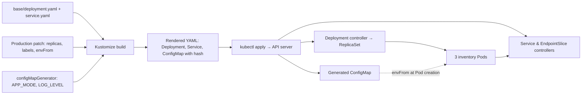
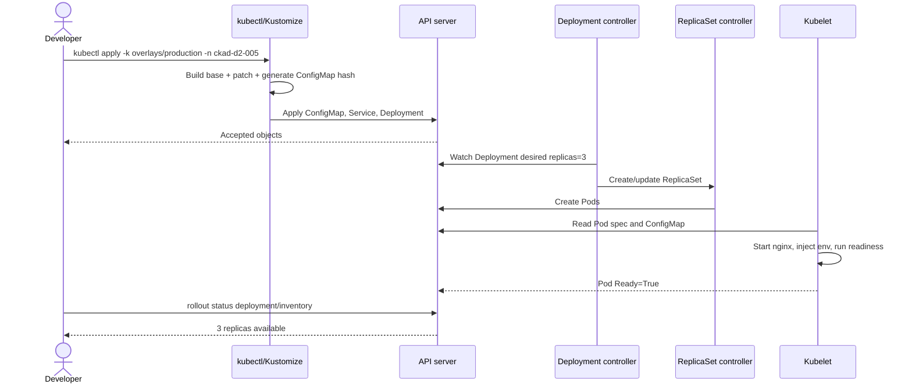

# D2-005 — Kustomize Base & Production Overlay: triển khai cấu hình theo môi trường

**Domain 2 — Application Deployment | Trung cấp | 45–60 phút | Namespace `ckad-d2-005`**

## 1. Tình huống production

Dịch vụ inventory dùng cùng image ở dev và production. Nhóm phát triển copy YAML rồi sửa thủ công replicas, labels, cấu hình runtime cho từng môi trường. Sau vài đợt release, hai file lệch nhau: production chỉ còn một replica, thiếu readiness probe và một lần thay đổi nhầm `spec.selector` khiến Deployment bị API server từ chối. Mục tiêu là **một base tái sử dụng + overlay production**, không dùng Helm hay công cụ ngoài `kubectl`.

**Ban đầu:** `setup.yaml` tạo Deployment inventory (1 replica) và Service port 80. **Đích:** overlay tạo 3 replicas, `environment=production` ở Deployment và Pod template, ConfigMap generated với `APP_MODE=production` và `LOG_LEVEL=warn`, tham chiếu ConfigMap bằng `envFrom`, vẫn giữ Service selector, image và readiness. Khác D2-001..004, bài này tập trung **render manifests declarative** chứ không phải cơ chế rollout hay traffic cutover.

## 2. Luồng render và controller



**Tại sao tên ConfigMap có hash?** Kustomize tạo tên dạng `inventory-settings-<hash>` và tự rewrite tham chiếu trong Deployment. Thay đổi dữ liệu ConfigMap làm thay đổi tên tham chiếu, từ đó tạo revision PodTemplate và kích hoạt rollout. Đây là cơ chế hữu ích cho env vars: env vars không tự cập nhật trong container đang chạy. `solution.yaml` là tài liệu mô tả trạng thái đích, **không apply trực tiếp** vì nó không chứa tên hash thực tế.

## 3. Sequence diagram: một lần triển khai production



## 4. Thực hành kind (không sửa lab cũ)

Từ repository root:

```bash
./env/kind/up.sh
./ckad domain start D2-005
NS=ckad-d2-005
LAB=domains/02-application-deployment/labs/005-kustomize-environment-overlays
kubectl --context kind-ckad-labs -n "$NS" get deploy,svc,pods
kubectl kustomize "$LAB/overlays/production"
kubectl --context kind-ckad-labs -n "$NS" apply -k "$LAB/overlays/production"
kubectl --context kind-ckad-labs -n "$NS" rollout status deploy/inventory --timeout=180s
./ckad domain check D2-005
```

**Bài tập:** (1) xác định base chứa những gì; (2) đọc patch production và dự đoán `replicas`; (3) render overlay, tìm ConfigMap tên hash và Deployment `envFrom`; (4) apply overlay; (5) so sánh `spec.selector` và `spec.template.metadata.labels`; (6) xem Pod Ready; (7) sửa `LOG_LEVEL` thành `info`, apply và quan sát ReplicaSet mới; (8) trả `warn`, apply, verify. Bước 7 là quan sát, grader chấm trạng thái đích ban đầu.

Lời giải tự động: `./ckad domain solve D2-005`. Reset: `./ckad domain reset D2-005`. Kiểm tra trạng thái Kubernetes bằng `verify.sh`, không chấm từ nội dung file và không giả định thứ tự thao tác.

## 5. Negative tests (reset giữa từng trường hợp)

| ID | Phá có chủ đích | Dấu hiệu | Khôi phục |
|---|---|---|---|
| N1 | Patch `replicas: 1` | Grader fail desired/available replicas | Trả 3, apply -k |
| N2 | Đổi `LOG_LEVEL=debug` | ConfigMap hash mới; config check fail | Trả warn, apply -k |
| N3 | Xóa `envFrom` trong patch | ConfigMap không được mount thành env; grader fail | Khôi phục patch |
| N4 | Đổi `spec.selector.matchLabels.app` thành `other` | API server báo immutable selector | Không sửa selector; dùng label bổ sung ở Pod template |
| N5 | Đổi readiness path thành `/not-found` | Pod Running nhưng NotReady; rollout timeout | Trả `/` và rollout |
| N6 | Đổi Service selector `app=other` | Service không có matching endpoints | Khôi phục `app=inventory` |

Ví dụ N2: sửa literal trong `overlays/production/kustomization.yaml`, apply lại, chạy `./ckad domain check D2-005` để thấy FAIL. Khôi phục `LOG_LEVEL=warn`, apply lại và check. Không sửa trực tiếp ConfigMap generated vì overlay sẽ quản lý lại object.

## 6. Troubleshooting từng lớp

- **Build lỗi `no matches for Id`:** kiểm tra `patches.path` và `metadata.name` có khớp resource trong base. Chạy `kubectl kustomize overlays/production` trước khi apply.
- **Deployment không tiến lên 3 replicas:** `kubectl describe deployment inventory`, `kubectl get events --sort-by=.lastTimestamp`, kiểm tra quota và FailedScheduling.
- **ConfigMap đã đổi nhưng env cũ:** kiểm tra `kubectl get deploy inventory -o yaml` và tên ConfigMap trong `envFrom`; cần Pod mới để lấy env vars.
- **Pod ImagePullBackOff:** `kubectl describe pod <pod>`, kiểm tra mạng registry, không đánh đồng với lỗi Kustomize.
- **Pod Running nhưng Ready=false:** xem `kubectl describe pod` và readiness probe; Deployment availableReplicas không tăng.
- **Service không có backend:** so sánh `kubectl get svc inventory -o jsonpath='{.spec.selector}'` với Pod labels và EndpointSlices.
- **`field is immutable`:** Deployment selector không thể thay tùy ý; chỉ thêm `environment` vào Pod labels, không đổi `app=inventory`.

## 7. Trade-offs

Kustomize được tích hợp trong kubectl, giúp giảm YAML copy/paste và giữ manifest rõ ràng. Overlay nhiều tầng có thể khó debug; luôn render diff trước apply. ConfigMap **không dành cho bí mật**: production secrets phải dùng Secret và RBAC phù hợp. Hash rollout cho ConfigMap không đảm bảo application tự reload config. Bài này dùng nginx và biến môi trường để chứng minh cơ chế Kubernetes, không giả định nginx sử dụng `APP_MODE`.

## 8. Tài liệu chính thức

- [Kustomize declarative management](https://kubernetes.io/docs/tasks/manage-kubernetes-objects/kustomization/)
- [Deployments](https://kubernetes.io/docs/concepts/workloads/controllers/deployment/)
- [ConfigMaps](https://kubernetes.io/docs/concepts/configuration/configmap/)
- [Configure environment variables](https://kubernetes.io/docs/tasks/inject-data-application/define-environment-variable-container/)
- [kind Quick Start](https://kind.sigs.k8s.io/docs/user/quick-start/)
