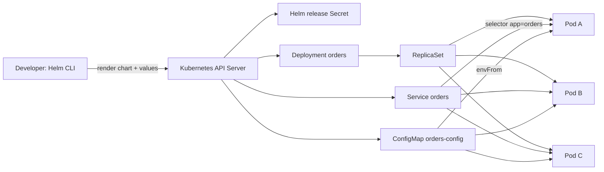
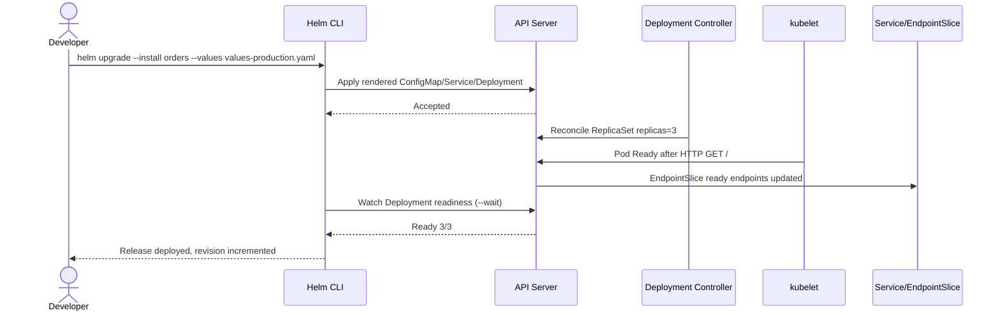

# D2-006 — Helm Chart: Values, Upgrade và Rollback có kiểm chứng

## Bối cảnh production
Đội vận hành dịch vụ `orders-api` đang copy nhiều YAML theo môi trường. Một lần nâng cấp cấu hình sai `replicaCount` khiến ứng dụng chỉ còn 1 Pod. Nhiệm vụ: đóng gói Deployment, Service, ConfigMap thành **Helm chart**, dùng `values.yaml` làm mặc định, `values-production.yaml` làm override, nâng cấp release và kiểm tra Kubernetes **thật**.

**Khác D2-005:** Kustomize patch manifest tĩnh; Helm render Go template, lưu revision trong release Secret và hỗ trợ `helm rollback`. Không dùng Helm để che lỗi Pod readiness.

## Mục tiêu (25–35 phút)
1. Namespace `ckad-d2-006` riêng, context `kind-ckad-labs`.
2. Helm release `orders` triển khai 3 replicas `nginx:1.27-alpine`, label `environment: production`, `LOG_LEVEL=warn`.
3. Service `orders` chọn đúng Pods; readiness HTTP `/`; RollingUpdate không gián đoạn.
4. Helm upgrade với `--wait --atomic`, kiểm tra revision, thực hành rollback revision trước khi nâng cấp.
5. Chạy auto-grader đọc trạng thái API server, không chỉ grep YAML.

## Kiến trúc / controller flow




## Chuẩn bị
```bash
./env/kind/up.sh
helm version
./ckad domain start D2-006
export NS=ckad-d2-006
kubectl --context kind-ckad-labs -n "$NS" get deploy,svc,cm
```
Helm v3 hoặc v4, Docker, kind, kubectl và Python 3 phải được cài sẵn. Không chạy trên cluster production.

## Thực hành từng bước
```bash
D=domains/02-application-deployment/labs/006-helm-values-upgrade
helm lint "$D/chart" -f "$D/values-production.yaml"
helm template orders "$D/chart" -n ckad-d2-006 -f "$D/values-production.yaml"
helm upgrade --install orders "$D/chart" \
  --kube-context kind-ckad-labs -n ckad-d2-006 \
  -f "$D/values-production.yaml" --wait --atomic --timeout 180s
kubectl --context kind-ckad-labs -n ckad-d2-006 get deploy,po,svc,cm
helm history orders --kube-context kind-ckad-labs -n ckad-d2-006
./ckad domain check D2-006
```

Hãy so sánh `helm template` với `kubectl get -o yaml`: render chỉ tạo manifest; controller mới tạo Pod. Đổi `LOG_LEVEL` rồi upgrade để quan sát Helm revision. Lưu ý ConfigMap thay đổi không tự restart Pod nếu chỉ dùng `envFrom`; chart có checksum annotation trên Pod template để kích hoạt rollout.

## Lời giải và tự chấm
```bash
./ckad domain solve D2-006
./ckad domain check D2-006
```
`solution.sh` sẽ cài release từ chart và chờ Deployment ready. `verify.sh` kiểm tra 12 điều kiện thực tế, exit 1 nếu có điều kiện sai.

## Negative tests (thử lần lượt, khôi phục bằng solution.sh)
1. `kubectl -n "$NS" --context kind-ckad-labs scale deploy/orders --replicas=1` → sai số replicas.
2. `kubectl -n "$NS" --context kind-ckad-labs set image deploy/orders web=nginx:does-not-exist` → không ready/image sai.
3. `kubectl -n "$NS" --context kind-ckad-labs patch svc orders -p '{"spec":{"selector":{"app":"other"}}}'` → EndpointSlice không có ready endpoint.
4. `kubectl -n "$NS" --context kind-ckad-labs delete cm orders-config` → mất cấu hình.
5. `kubectl -n "$NS" --context kind-ckad-labs annotate deploy/orders checksum/config=bad --overwrite` → drift checksum, rollout không đồng nhất.
6. `helm uninstall orders --kube-context kind-ckad-labs -n "$NS"` → không có release và tài nguyên.

Sau mỗi case chạy `./ckad domain check D2-006`, ghi lại FAIL và giải thích nguyên nhân; sau đó chạy `./ckad domain solve D2-006`. Với case sửa trực tiếp Deployment, `helm upgrade` có thể không tự sửa drift nếu chart và release không đổi; `solution.sh` dùng `--force` để reconcile.

## Troubleshooting
- `helm: command not found`: cài Helm từ tài liệu chính thức.
- `context not found`: kiểm tra `kubectl config get-contexts`, chạy kind bootstrap.
- `UPGRADE FAILED: timed out waiting`: `kubectl describe pod`, `kubectl get events --sort-by=.lastTimestamp`, xem ImagePullBackOff và readiness.
- `release name already in use`: `helm list -n "$NS" --all`; chỉ xóa release thuộc namespace lab.
- Service không có endpoint: `kubectl get endpointslice -l kubernetes.io/service-name=orders -o yaml`; kiểm tra selector và Ready condition.
- Helm rollback: `helm history orders -n "$NS"`, `helm rollback orders <revision> -n "$NS" --wait`; rollback chỉ đảo manifest, không rollback dữ liệu bên ngoài.
- `--atomic` tự rollback khi upgrade thất bại; không thay thế monitoring hoặc integration test.

## Tài liệu chính thức
- https://helm.sh/docs/helm/helm_upgrade/
- https://helm.sh/docs/chart_template_guide/values_files/
- https://helm.sh/docs/helm/helm_rollback/
- https://kubernetes.io/docs/concepts/workloads/controllers/deployment/
- https://kubernetes.io/docs/concepts/services-networking/endpoint-slices/
