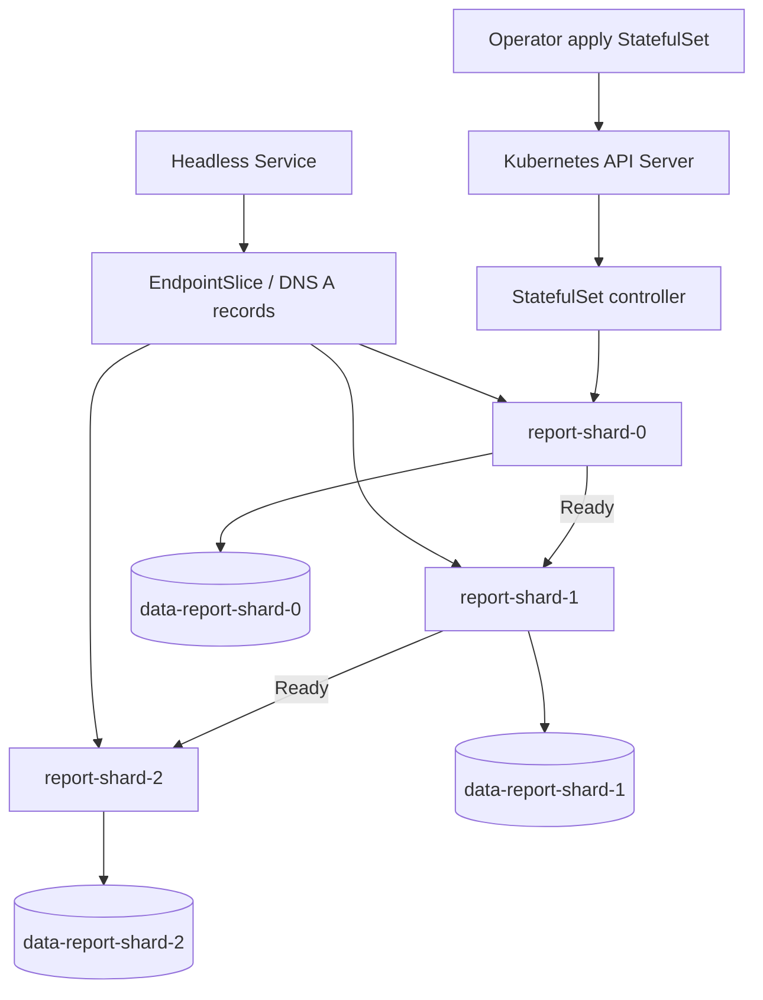

# D2-007 — StatefulSet: stable identity, OrderedReady và per-Pod PVC

## Sự cố production
Một nhóm phát triển chạy ba replica của dịch vụ **report-shard** trên Deployment, gắn chung dữ liệu ghi được. Khi Pod bị thay thế, tên Pod đổi và dữ liệu local mất; các shard không thể xác định danh tính. Nhiệm vụ là chuyển sang **StatefulSet** với DNS ổn định và một PVC riêng cho từng Pod. Đây là bài tập workload có trạng thái, **không phải** triển khai cơ sở dữ liệu production: không có replication, backup hay quorum.

**Phân biệt với D2-001–D2-006:** rolling update/rollback, pause/resume, blue-green, Kustomize và Helm đã học. Bài này tập trung vào StatefulSet controller, thứ tự khởi tạo và volumeClaimTemplates.

## Mục tiêu (30–45 phút)
1. Làm việc trên kind context `kind-ckad-labs`, namespace `ckad-d2-007` do CLI tạo và gắn nhãn sở hữu.
2. Tạo headless Service `report-shard` (`clusterIP: None`) có selector `app: report-shard`.
3. StatefulSet `report-shard` với 3 replicas, `serviceName: report-shard`, `podManagementPolicy: OrderedReady`, updateStrategy `RollingUpdate`.
4. Mỗi Pod có PVC riêng từ `volumeClaimTemplates` tên `data`, yêu cầu 100Mi, access mode ReadWriteOnce.
5. Init container ghi hostname vào `/data/index.html` trên PVC; container nginx phục vụ nội dung từ PVC. Khi xóa Pod `report-shard-1`, PVC và identity phải tồn tại sau khi Pod được tạo lại.
6. Auto-grader kiểm tra Kubernetes API, PVC Bound, readiness, DNS endpoints và HTTP response trên **Pod thực tế**.

## Kiến trúc và controller flow



```mermaid
sequenceDiagram
  actor Dev as Developer
  participant API as API Server
  participant SC as StatefulSet controller
  participant PV as Storage provisioner
  participant K as kubelet
  participant DNS as CoreDNS / Headless Service
  Dev->>API: Apply Service + StatefulSet
  API->>SC: Watch desired replicas=3
  SC->>API: Create PVC data-report-shard-0 and Pod -0
  API->>PV: Provision PVC 0
  PV-->>API: PVC Bound
  K->>API: Init writes index; nginx Ready on -0
  SC->>API: Create -1 then -2 after readiness
  Dev->>DNS: Resolve report-shard-1.report-shard
  DNS-->>Dev: Pod-specific address (when Ready)
  Dev->>API: Delete Pod report-shard-1
  SC->>API: Recreate same ordinal using existing PVC
  K-->>API: Pod -1 Ready; stored identity retained
```

## Chuẩn bị
```bash
./env/kind/up.sh
./ckad doctor
./ckad domain start D2-007
export NS=ckad-d2-007
kubectl --context kind-ckad-labs -n "$NS" get cm
```
Cần Docker, kind, kubectl và Python 3. Cluster kind mặc định cần StorageClass provisioner hoạt động. **Không chạy** trên cluster production.

## Thực hành theo từng bước
1. Đọc `setup.yaml`: đây chỉ là tài nguyên gợi ý, không phải lời giải.
2. Tạo `Service` headless trước; nếu dùng Service thông thường, Pod-specific DNS không hoạt động như mong đợi.
3. Tạo StatefulSet với selector và Pod template labels trùng nhau, `serviceName` đúng; dùng `volumeClaimTemplates` thay vì một PVC dùng chung.
4. Init container `busybox:1.36` ghi `$(hostname)` vào `/data/index.html` **chỉ khi file chưa tồn tại**. nginx `nginx:1.27-alpine` mount cùng PVC vào `/usr/share/nginx/html`; HTTP readiness `GET /` cổng 80.
5. Quan sát thứ tự ordinal và PVC:
```bash
kubectl --context kind-ckad-labs -n "$NS" get sts,pods,pvc,svc,endpointslice -o wide
kubectl --context kind-ckad-labs -n "$NS" rollout status sts/report-shard --timeout=240s
kubectl --context kind-ckad-labs -n "$NS" exec report-shard-1 -c web -- wget -qO- http://127.0.0.1/
kubectl --context kind-ckad-labs -n "$NS" delete pod report-shard-1
kubectl --context kind-ckad-labs -n "$NS" wait --for=condition=Ready pod/report-shard-1 --timeout=240s
kubectl --context kind-ckad-labs -n "$NS" exec report-shard-1 -c web -- cat /usr/share/nginx/html/index.html
./ckad domain check D2-007
```
**Lưu ý:** `kubectl wait pod/report-shard-1` ngay sau khi delete có thể đụng Pod đang terminating; đợi Pod mới có UID khác trước khi đánh giá persistence.

## Lời giải
```bash
./ckad domain solve D2-007
./ckad domain check D2-007
```
`solution.sh` áp dụng `solution.yaml` rồi đợi rollout; `verify.sh` chấm trực tiếp bằng kubectl và HTTP exec, không chỉ grep YAML.

## Negative tests — chạy riêng từng case
Sau mỗi case chạy `./ckad domain check D2-007` để thấy FAIL, sau đó khôi phục như hướng dẫn.
1. Scale `kubectl --context kind-ckad-labs -n "$NS" scale sts/report-shard --replicas=2` → thiếu ordinal -2. Khôi phục: `./ckad domain solve D2-007`.
2. `kubectl --context kind-ckad-labs -n "$NS" patch svc report-shard -p '{"spec":{"selector":{"app":"wrong"}}}'` → EndpointSlice không còn đủ Ready endpoints. Khôi phục: `kubectl --context kind-ckad-labs -n "$NS" apply -f domains/02-application-deployment/labs/007-statefulset-ordered-storage/solution.yaml`.
3. `kubectl --context kind-ckad-labs -n "$NS" set image sts/report-shard web=nginx:not-a-real-tag` → rollout stuck, Pod không Ready. Khôi phục: `kubectl --context kind-ckad-labs -n "$NS" rollout undo sts/report-shard`, đợi Ready.
4. `kubectl --context kind-ckad-labs -n "$NS" delete pvc data-report-shard-2` → Kubernetes thường chặn xóa khi đang được sử dụng (PVC protection). Quan sát trạng thái Terminating; đây là **negative test về storage protection**, không cố force delete.
5. `kubectl --context kind-ckad-labs -n "$NS" exec report-shard-0 -c web -- sh -c 'echo corrupt > /usr/share/nginx/html/index.html'` → HTTP body không đúng identity. Khôi phục: ghi lại hostname qua `kubectl exec` hoặc reset namespace lab.
6. `kubectl --context kind-ckad-labs -n "$NS" delete svc report-shard` → headless DNS và endpoints mất. Khôi phục bằng apply `solution.yaml`.

## Troubleshooting
- PVC Pending: `kubectl get storageclass`, `kubectl describe pvc`, kiểm tra kind default StorageClass và events. Đừng ép `storageClassName` không tồn tại.
- StatefulSet chỉ tạo -0: OrderedReady đang chờ Pod -0 Ready; xem `kubectl describe pod report-shard-0`, init logs và readiness probe.
- ImagePullBackOff: `kubectl describe pod`; kiểm tra mạng registry, không coi đây là lỗi manifest.
- Không có endpoint: `kubectl get endpointslice -l kubernetes.io/service-name=report-shard -o yaml`, so selector, Pod readiness.
- DNS không resolve: headless Service, serviceName, namespace, Pod Ready, CoreDNS; kiểm tra `kubectl get pods -n kube-system`.
- RollingUpdate kẹt ở ordinal cao: sửa template lỗi trước; với StatefulSet OrderedReady đôi khi cần xóa thủ công Pod lỗi sau khi revert template.
- PVC vẫn còn sau khi xóa StatefulSet: mặc định PVC được giữ lại để bảo vệ dữ liệu. Không dùng `docker compose down -v` hay xóa storage của lab khác.

## Tài liệu chính thức
- https://kubernetes.io/docs/concepts/workloads/controllers/statefulset/
- https://kubernetes.io/docs/concepts/storage/persistent-volumes/
- https://kubernetes.io/docs/concepts/services-networking/dns-pod-service/
- https://kubernetes.io/docs/concepts/services-networking/endpoint-slices/
- https://kubernetes.io/docs/tasks/run-application/run-replicated-stateful-application/
