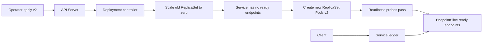
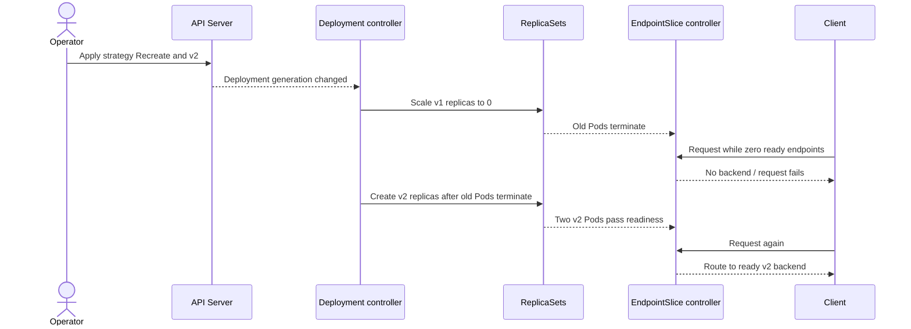

# D2-008 — Recreate Strategy: chấp nhận downtime để tránh hai phiên bản chạy đồng thời

## Tình huống production
Dịch vụ **ledger** sử dụng schema ghi dữ liệu không tương thích giữa v1 và v2. Khi rolling update, hai phiên bản cùng xử lý request trong một khoảng thời gian; dữ liệu có thể bị ghi sai. Đội vận hành quyết định sử dụng **Deployment strategy Recreate**, xóa các Pod cũ trước khi tạo Pod mới. Đây là quyết định có downtime có chủ đích, không phải zero-downtime release.

**Khác D2-001:** bài rolling update trước ưu tiên availability; bài này ưu tiên *không chồng lấn phiên bản*. Không nhầm Recreate với StatefulSet OrderedReady (D2-007).

## Mục tiêu (25–35 phút)
- Chỉ thao tác trong namespace `ckad-d2-008` trên context `kind-ckad-labs`.
- Đổi Deployment `ledger` từ RollingUpdate sang `Recreate`, giữ 2 replicas.
- Đặt template label `version: v2`, readiness HTTP `/`, resource requests/limits.
- Giữ Service `ledger` ổn định; EndpointSlice có đúng 2 backend Ready sau rollout.
- Giải thích downtime giữa scale-down và scale-up, không quảng cáo Recreate là zero downtime.

## Flow controller và đường request




## Thực hành trên kind
```bash
./env/kind/up.sh
./ckad doctor
./ckad domain start D2-008
export NS=ckad-d2-008
kubectl --context kind-ckad-labs -n "$NS" get deploy,rs,pods,svc
```
`setup.yaml` tạo v1 với RollingUpdate. Hãy sửa Deployment bằng manifest hoặc `kubectl edit deployment ledger`. **Chú ý:** chuyển sang Recreate phải bỏ `strategy.rollingUpdate`; Kubernetes không chấp nhận cấu hình RollingUpdate khi type=Recreate.

```bash
kubectl --context kind-ckad-labs -n "$NS" get deployment ledger -o yaml
kubectl --context kind-ckad-labs -n "$NS" rollout status deploy/ledger --timeout=180s
kubectl --context kind-ckad-labs -n "$NS" get rs,pods -l app=ledger -w
./ckad domain check D2-008
```
Để quan sát downtime, chạy một terminal `kubectl --context kind-ckad-labs -n "$NS" get endpointslices -l kubernetes.io/service-name=ledger -w` **trước** khi apply v2. Với ứng dụng khởi động quá nhanh, khoảng trống endpoints có thể ngắn; không suy luận rằng không có downtime chỉ vì polling bỏ lỡ.

## Lời giải và chấm
```bash
./ckad domain solve D2-008
./ckad domain check D2-008
```
`solution.sh` apply YAML và chờ rollout; `verify.sh` gọi Kubernetes API thực tế để kiểm tra strategy, generation, replicas, labels, readiness, Service, EndpointSlice và HTTP từ Pod. Không dùng grep file để tự chấm. Kiểm tra trạng thái cuối **không chứng minh** lịch sử rollout đã không chồng lấn; để chứng minh quá trình, cần quan sát sự kiện/ReplicaSet theo thời gian.

## Negative tests (mỗi case riêng, phục hồi sau mỗi case)
1. Scale xuống 1: `kubectl --context kind-ckad-labs -n "$NS" scale deploy/ledger --replicas=1` → FAIL số replica. Khôi phục bằng solve.
2. Đổi strategy thành RollingUpdate: `kubectl --context kind-ckad-labs -n "$NS" patch deploy ledger --type=json -p='[{"op":"replace","path":"/spec/strategy","value":{"type":"RollingUpdate"}}]'` → FAIL strategy. Solve để phục hồi.
3. Sai selector Service: `kubectl --context kind-ckad-labs -n "$NS" patch svc ledger -p '{"spec":{"selector":{"app":"missing"}}}'` → FAIL EndpointSlice. Phục hồi apply solution.yaml.
4. Image không tồn tại: `kubectl --context kind-ckad-labs -n "$NS" set image deploy/ledger web=nginx:tag-not-found` → FAIL readiness/rollout. Phục hồi solve.
5. Bỏ readiness probe: `kubectl --context kind-ckad-labs -n "$NS" patch deploy ledger --type=json -p='[{"op":"remove","path":"/spec/template/spec/containers/0/readinessProbe"}]'` → FAIL probe. Phục hồi solve.
6. Sửa version label: `kubectl --context kind-ckad-labs -n "$NS" patch deploy ledger --type=json -p='[{"op":"replace","path":"/spec/template/metadata/labels/version","value":"v1"}]'` → FAIL v2 label. Phục hồi solve.

## Troubleshooting
- `spec.strategy.rollingUpdate: Forbidden`: bỏ field rollingUpdate khi dùng Recreate.
- Pod `ImagePullBackOff`: `kubectl ... describe pod <pod>`, kiểm tra image/tag và registry.
- `0/2 Ready`: `kubectl ... describe deploy ledger`, `kubectl ... get events --sort-by=.lastTimestamp`, xem readiness.
- Service không route: kiểm tra selector và EndpointSlice; Service không tự đợi backend Ready.
- Lệnh solve không phục hồi Service selector bị patch: `kubectl apply -f solution.yaml` sẽ sửa selector nếu field được quản lý phù hợp; nếu xung đột field manager, dùng `kubectl edit svc ledger`.
- Xóa lab: `./ckad domain reset D2-008`. Không dùng trên cluster production.

## Tài liệu chính thức
- [Deployment strategies](https://kubernetes.io/docs/concepts/workloads/controllers/deployment/#strategy)
- [Updating a Deployment](https://kubernetes.io/docs/concepts/workloads/controllers/deployment/#updating-a-deployment)
- [Readiness probes](https://kubernetes.io/docs/concepts/configuration/liveness-readiness-startup-probes/)
- [EndpointSlices](https://kubernetes.io/docs/concepts/services-networking/endpoint-slices/)
