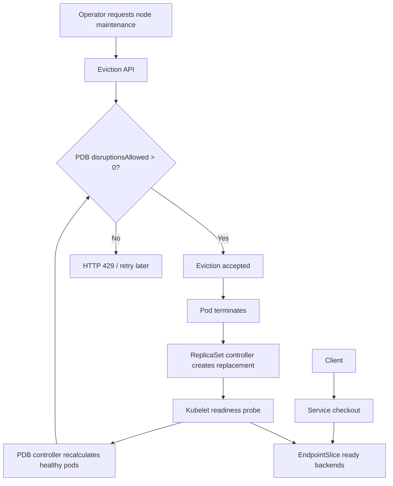
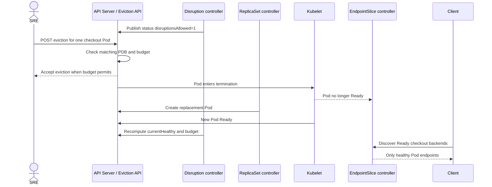

# D2-009 — PodDisruptionBudget: bảo vệ checkout khi bảo trì node

## Production incident và quyết định thiết kế

Đội SRE cần nâng cấp node đang chạy dịch vụ **checkout**. Một kỹ sư chạy `kubectl drain` và kỳ vọng Deployment ba replicas tự đảm bảo luôn có hai instance phục vụ. Nhưng Deployment **không tự giới hạn số Pod bị evict qua Eviction API**. Nếu không có PodDisruptionBudget (PDB), một thao tác bảo trì có thể làm số backend giảm dưới mức chịu tải. Bài này bổ sung PDB `minAvailable: 2` và xác nhận **disruptionsAllowed=1** khi cả ba Pod Ready.

Phân biệt: PDB bảo vệ trước **voluntary disruptions thông qua Eviction API**, không ngăn node crash, direct Pod deletion, và không thay thế readiness, replicas hay rollout strategy. Trong kind một node, `drain` có thể bị chặn mãi vì không còn node để reschedule; **không drain node** trong bài này.

## Mục tiêu và điều kiện (25–35 phút)

- Context bắt buộc: `kind-ckad-labs`; namespace: `ckad-d2-009`, do CLI tạo và gắn nhãn sở hữu.
- Từ Deployment checkout hai replicas, scale lên **3** và đợi ba Pod Ready.
- Tạo PDB `policy/v1` tên `checkout-availability`, selector `app: checkout`, `minAvailable: 2`.
- Xác minh PDB controller tính `currentHealthy=3`, `desiredHealthy=2`, `disruptionsAllowed=1`.
- Service checkout vẫn có ba EndpointSlice backend Ready và HTTP nội bộ thành công.

**Khác D2-001:** D2-001 quản lý rollout và readiness. D2-009 quản lý *eviction budget* khi node bảo trì; không thực hiện rolling update, blue/green hay rollback.

## Sơ đồ: hai controller độc lập





Sơ đồ mô tả đường điều khiển; trong bài lab **không gửi eviction thật** để tránh phụ thuộc node scheduling và không làm gián đoạn các lab khác. `disruptionsAllowed` là trạng thái controller tại thời điểm quan sát, có thể thay đổi tức thời khi Pod mất Ready.

## Thực hành trên kind

```bash
./env/kind/up.sh
./ckad doctor
./ckad domain start D2-009
export NS=ckad-d2-009
kubectl --context kind-ckad-labs -n "$NS" get deploy,po,svc
kubectl --context kind-ckad-labs -n "$NS" scale deploy/checkout --replicas=3
kubectl --context kind-ckad-labs -n "$NS" rollout status deploy/checkout --timeout=180s
```

Tự viết PDB với `policy/v1`. Đọc trạng thái controller:

```bash
kubectl --context kind-ckad-labs -n "$NS" get pdb checkout-availability -o yaml
kubectl --context kind-ckad-labs -n "$NS" get pods -l app=checkout -o wide
kubectl --context kind-ckad-labs -n "$NS" get endpointslices -l kubernetes.io/service-name=checkout
./ckad domain check D2-009
```

**Câu hỏi:** Với 3 Pod Ready và `minAvailable=2`, được phép bao nhiêu voluntary eviction đồng thời? Nếu một Pod NotReady, budget còn bao nhiêu? Nếu chỉ có một worker node, vì sao drain không hoàn thành dù PDB cho phép eviction đầu tiên?

## Lời giải, chấm điểm và reset

```bash
./ckad domain solve D2-009
./ckad domain check D2-009
./ckad domain reset D2-009
```

`solution.sh` apply manifest và chờ trạng thái thực tế. `verify.sh` chấm 11 tiêu chí bằng Kubernetes API: ownership namespace, Deployment, Pod readiness, PDB spec/status, Service, EndpointSlice và HTTP thật. **Không đọc YAML để tự chấm**. Lệnh check thất bại (exit 1) nếu bất kỳ điều kiện nào sai.

## Negative tests — chạy từng case riêng và phục hồi

1. Scale còn 2: `kubectl --context kind-ckad-labs -n "$NS" scale deploy/checkout --replicas=2` → fail replica/PDB budget; chạy solve phục hồi.
2. Đổi `minAvailable` thành 3: `kubectl --context kind-ckad-labs -n "$NS" patch pdb checkout-availability -p '{"spec":{"minAvailable":3}}'` → fail PDB và disruptionsAllowed.
3. Selector sai: `kubectl --context kind-ckad-labs -n "$NS" patch pdb checkout-availability -p '{"spec":{"selector":{"matchLabels":{"app":"unrelated"}}}}'` → fail selector và expectedPods.
4. Xóa PDB: `kubectl --context kind-ckad-labs -n "$NS" delete pdb checkout-availability` → fail PDB spec/status.
5. Sửa selector Service: `kubectl --context kind-ckad-labs -n "$NS" patch svc checkout -p '{"spec":{"selector":{"app":"unrelated"}}}'` → fail Service/EndpointSlice/HTTP.
6. Image lỗi: `kubectl --context kind-ckad-labs -n "$NS" set image deploy/checkout web=nginx:does-not-exist` → fail Ready/available/PDB healthy.

Sau mỗi case, chạy `./ckad domain solve D2-009`, đợi Ready, rồi `./ckad domain check D2-009`. Nếu patch thủ công gây xung đột field manager, chỉnh lại tài nguyên bằng `kubectl edit` trong namespace lab.

## Troubleshooting thực tế

- **PDB disruptionsAllowed=0**: kiểm tra `currentHealthy`, `desiredHealthy`, `expectedPods`; `kubectl describe pdb`. Khi 3/3 Ready và minAvailable=2, kỳ vọng 1.
- **PDB status chưa cập nhật**: controller reconcile bất đồng bộ; đợi vài giây và xem `observedGeneration`.
- **Drain blocked**: PDB ngăn eviction khi vi phạm budget; hoặc cluster một node không có nơi đặt Pod thay thế. Không dùng `--disable-eviction` để lách PDB trong production.
- **Pod NotReady**: `kubectl describe pod`, `kubectl get events --sort-by=.lastTimestamp`; kiểm tra image pull, readiness, resources.
- **EndpointSlice không có backend**: so selector Service và label Pod; xem `kubectl get endpointslices -l kubernetes.io/service-name=checkout -o yaml`.
- **PDB không bảo vệ direct delete**: dùng Eviction API cho quy trình maintenance; PDB không bảo đảm availability khi node crash.

## Tài liệu chính thức

- [Disruptions](https://kubernetes.io/docs/concepts/workloads/pods/disruptions/)
- [PodDisruptionBudget specification](https://kubernetes.io/docs/tasks/run-application/configure-pdb/)
- [Eviction API](https://kubernetes.io/docs/concepts/scheduling-eviction/api-eviction/)
- [Deployments](https://kubernetes.io/docs/concepts/workloads/controllers/deployment/)
- [EndpointSlices](https://kubernetes.io/docs/concepts/services-networking/endpoint-slices/)
