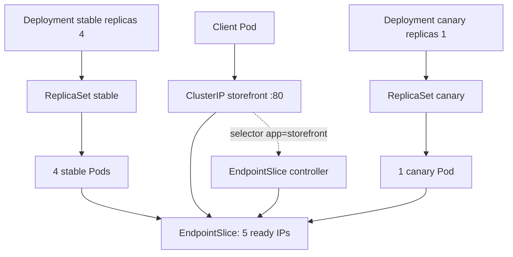
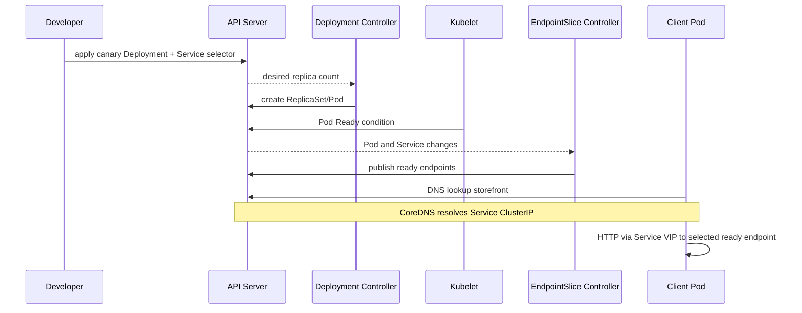

# D2-010 — Canary release bằng replica ratio và EndpointSlice

**Domain:** Application Deployment · **Thời lượng:** 35–45 phút · **Môi trường:** kind Kubernetes-in-Docker · **Namespace:** `ckad-d2-010`

## Tình huống production
Storefront có 4 Pod stable. Team muốn thử phiên bản canary trên **một** Pod, giữ bốn Pod stable và cho Service khám phá cả hai nhóm. Khác với D2-004 (blue/green chuyển selector hoàn toàn), bài này **đồng thời phục vụ hai track**. Tỷ lệ 4:1 ở đây là tỷ lệ **endpoint**, KHÔNG đảm bảo đúng 80/20 số HTTP requests: kube-proxy, keep-alive, topology và session affinity có thể làm lệch phân phối. Muốn weighted traffic chính xác cần gateway/service mesh hỗ trợ trọng số.

## Mục tiêu
1. Tạo Deployment `storefront-canary` 1 replica, label `app=storefront,track=canary`.
2. Giữ `storefront-stable` 4 replicas, không thay đổi image stable.
3. Đổi Service selector thành **chỉ** `app=storefront` để hai nhóm cùng được chọn.
4. Chứng minh 5 Pod Ready, 5 EndpointSlice ready addresses và HTTP qua DNS Service.
5. Phát hiện lỗi selector sai, canary quá nhiều, thiếu readiness hoặc image lỗi.

## Kiến trúc và controller flow





## Chạy lab trên kind

Yêu cầu: Docker, kind, kubectl, Python 3; context `kind-ckad-labs`. Nếu chưa có cluster: `kind create cluster --name ckad-labs`. Các script mặc định dùng context này, không thao tác cluster khác.

```bash
kubectl config use-context kind-ckad-labs
kubectl apply -f setup.yaml
kubectl -n ckad-d2-010 rollout status deployment/storefront-stable --timeout=180s
kubectl -n ckad-d2-010 get deploy,pods,svc
# Tự giải: tạo canary 1 replica và sửa Service selector.
kubectl -n ckad-d2-010 apply -f solution.yaml  # Chỉ xem khi cần đáp án
./solution.sh
./verify.sh
```

**Chấm điểm:** `verify.sh` đọc Kubernetes API thực qua kubectl, kiểm tra generation, replicas, readiness, Pod IP đối chiếu EndpointSlice, và thực thi HTTP qua Service DNS. Trả exit 1 nếu bất kỳ tiêu chí nào không đạt. Không dùng dữ liệu giả hay chỉ grep YAML.

## Negative tests (phải FAIL)
Sau khi giải thành công, chạy **mỗi lần một lỗi**, chờ controller cập nhật rồi chạy `./verify.sh`. Khôi phục `kubectl apply -f setup.yaml && ./solution.sh` trước lỗi kế tiếp.

| Fault | Lệnh | Kỳ vọng |
|---|---|---|
| Canary biến mất | `./negative-test.sh no-canary` | 0 canary, thiếu endpoint |
| Selector chỉ stable | `./negative-test.sh wrong-selector` | Service không chọn canary |
| Canary vượt tỷ lệ | `./negative-test.sh too-many-canary` | Replica ratio sai |
| Stable biến mất | `./negative-test.sh no-stable` | Không đủ 4 stable |
| Image không tồn tại | `./negative-test.sh bad-image` | ImagePullBackOff, Ready sai |

## Troubleshooting
- `kubectl -n ckad-d2-010 describe pod -l app=storefront`: xem Events, image pull, probe.
- `kubectl -n ckad-d2-010 get deploy -o wide`: so desired / ready / available.
- `kubectl -n ckad-d2-010 get endpointslices -l kubernetes.io/service-name=storefront -o yaml`: endpoint nào được publish?
- `kubectl -n ckad-d2-010 get svc storefront -o jsonpath='{.spec.selector}'`: selector có vô tình chứa `track=stable`?
- `kubectl -n ckad-d2-010 rollout status deploy/storefront-canary`: chờ rollout; nếu fail kiểm tra events.
- Lưu ý: `kubectl apply -f setup.yaml` reset Service về stable-only; chạy `./solution.sh` để mở lại cả hai track.

## Dọn dẹp
`kubectl delete namespace ckad-d2-010` — chỉ xóa namespace của lab này.

## Tài liệu chính thức
- [Deployments](https://kubernetes.io/docs/concepts/workloads/controllers/deployment/)
- [Service selectors](https://kubernetes.io/docs/concepts/services-networking/service/)
- [EndpointSlices](https://kubernetes.io/docs/concepts/services-networking/endpoint-slices/)
- [Readiness probes](https://kubernetes.io/docs/concepts/configuration/liveness-readiness-startup-probes/)
- [kind quick start](https://kind.sigs.k8s.io/docs/user/quick-start/)
