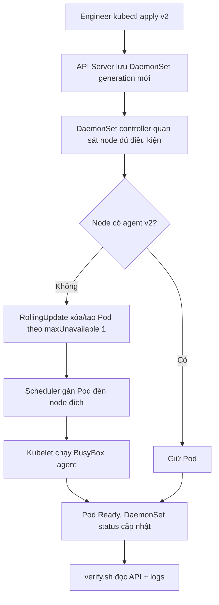
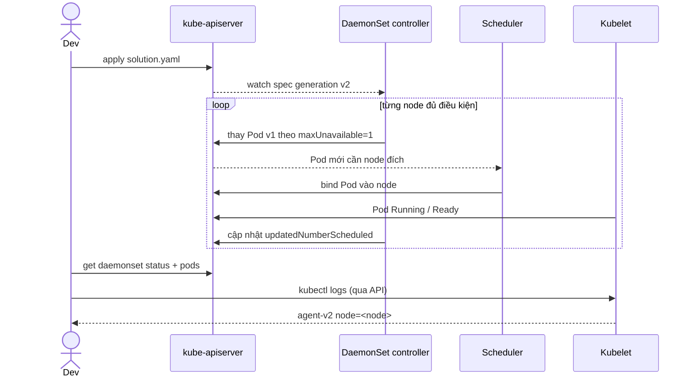

# D2-011 — DaemonSet: triển khai node-agent trên mọi node và RollingUpdate

**Domain:** Application Deployment · **Mức:** Intermediate · **Môi trường:** kind (Kubernetes in Docker) · **Namespace:** `ckad-d2-011`

## 1. Tình huống production
Một hệ thống cần một collector trên **mỗi Kubernetes node** để thu thập thông tin tại node đó. Deployment với 3 replicas không bảo đảm mỗi node có đúng một collector: scheduler có thể đặt nhiều Pod cùng node. DaemonSet điều phối một Pod trên mỗi node đủ điều kiện, tự tạo Pod khi node mới xuất hiện và dọn Pod khi node biến mất. Trong kind, control-plane thường có taint `NoSchedule`, nên agent cần toleration tương ứng nếu muốn chạy cả control-plane.

Nhiệm vụ: nâng agent từ v1 lên v2, cấu hình `RollingUpdate.maxUnavailable=1`, giữ resource requests/limits và inject `spec.nodeName` qua Downward API. Không thay selector `app=node-agent`.

## 2. Mục tiêu và điều kiện đạt
- Namespace riêng; DaemonSet `node-agent` không bị thay bằng Deployment.
- `release=v2`, image `busybox:1.36`, log thực tế chứa `agent-v2 node=<node>`.
- Strategy RollingUpdate, `maxUnavailable: 1`, cho phép cập nhật lần lượt.
- Tolerate control-plane `NoSchedule` để bao phủ node trong kind.
- Controller đã observe generation mới; `desiredNumberScheduled = updatedNumberScheduled = numberReady = numberAvailable > 0`.
- Mỗi Pod Running/Ready nằm trên node khác nhau; không có Pod misscheduled.

> **Giới hạn:** `maxUnavailable=1` không có nghĩa zero downtime; trong quá trình rollout một node có thể tạm không có agent. Trạng thái Ready/Available kiểm tra sau rollout, không chứng minh không có khoảng trống trong lúc cập nhật.

## 3. Luồng điều khiển (controller flow)


## 4. Sequence — đường đi của update và log


Không có HTTP Service trong lab này: đường dữ liệu là log của agent tại node, khác với request flow của các bài Deployment/Service.

## 5. Chuẩn bị kind
Cần Docker, kind, kubectl và Python 3. Chạy từ root repo hoặc thư mục lab:
```bash
kind create cluster --name ckad --config kind-config.yaml
kubectl cluster-info --context kind-ckad
kubectl get nodes -o wide
kubectl apply -f setup.yaml
kubectl -n ckad-d2-011 get ds,pods -o wide
```
Nếu cluster `ckad` đã tồn tại, không cần tạo lại. `kind-config.yaml` tạo 1 control-plane + 2 workers; có thể dùng cluster kind khác với context phù hợp.

## 6. Thực hành từng bước (không đọc solution trước)
1. `kubectl -n ckad-d2-011 describe ds node-agent` và xem `DESIRED/CURRENT/READY`.
2. Xem `kubectl get nodes -o json` để nhận diện taint và điều kiện scheduling.
3. Chỉnh DaemonSet hiện có để cập nhật template sang v2, `release=v2`, strategy RollingUpdate `maxUnavailable=1`; giữ toleration, resources và NODE_NAME.
4. `kubectl -n ckad-d2-011 rollout status ds/node-agent --timeout=180s`.
5. `kubectl -n ckad-d2-011 get pods -l app=node-agent -o wide`; so sánh node name với log từng Pod.
6. Chạy `./verify.sh` để chấm bằng Kubernetes API và logs.

**Đáp án:** `./solution.sh` (apply setup + solution và chấm). **Chấm độc lập:** `./verify.sh`. **Kiểm thử grader:** `./negative-tests.sh` (cố tình phá 5 cấu hình rồi restore).

## 7. Tại sao không dùng Deployment?
Deployment quản lý tổng số replica mong muốn, không bảo đảm một Pod mỗi node. DaemonSet tính `desiredNumberScheduled` dựa trên node phù hợp; toleration quyết định node nào đủ điều kiện. Khi node join/leave, controller tự reconcile. Nếu muốn chỉ chạy trên worker, dùng node affinity/selector thích hợp thay vì toleration control-plane.

## 8. Negative tests và kỳ vọng
| Lỗi chủ động | Grader phải phát hiện |
|---|---|
| `maxUnavailable=2` | Sai chính sách rollout |
| `release=bad` | Sai version template |
| Image `busybox:1.35` | Sai image |
| Bỏ toleration control-plane | Không đúng yêu cầu node coverage |
| Command không phát `agent-v2` | Sai runtime |

Chạy negative tests chỉ trên cluster lab; script phục hồi `solution.yaml` sau mỗi trường hợp. Các trường hợp cấu hình được kiểm tra tức thời; status rollout có thể cập nhật bất đồng bộ.

## 9. Troubleshooting thực tế
| Triệu chứng | Lệnh điều tra | Nguyên nhân / hướng xử lý |
|---|---|---|
| DESIRED nhỏ hơn số node | `kubectl describe node`, `kubectl describe ds` | Node selector, taint/toleration hoặc node NotReady |
| Pod Pending | `kubectl -n ckad-d2-011 describe pod <pod>` | Thiếu resource, scheduling, image pull |
| UPDATED chưa bằng DESIRED | `kubectl -n ckad-d2-011 rollout status ds/node-agent` | Rollout chưa xong hoặc Pod mới không Ready |
| Pod CrashLoopBackOff | `kubectl -n ckad-d2-011 logs <pod> --previous` | Command hoặc image lỗi |
| Log thiếu node name | `kubectl -n ckad-d2-011 get ds node-agent -o yaml` | Downward API `fieldPath` sai |

Lưu ý: `kubectl rollout undo daemonset/node-agent` phụ thuộc ControllerRevision history. Không giả định rằng rollback phục hồi dữ liệu ngoài cluster.

## 10. Tự đánh giá và cleanup
Chạy `./verify.sh`, sau đó `./negative-tests.sh`, cuối cùng `./verify.sh` lần nữa. Chụp kết quả `kubectl -n ckad-d2-011 get ds,pods -o wide`. Dọn **chỉ** namespace của bài: `kubectl delete namespace ckad-d2-011`. Không xóa cluster dùng chung.

## 11. Tài liệu chính thức
- [DaemonSet](https://kubernetes.io/docs/concepts/workloads/controllers/daemonset/)
- [Rolling Update DaemonSet](https://kubernetes.io/docs/tasks/manage-daemon/update-daemon-set/)
- [Taints and tolerations](https://kubernetes.io/docs/concepts/scheduling-eviction/taint-and-toleration/)
- [Downward API](https://kubernetes.io/docs/concepts/workloads/pods/downward-api/)
- [kind configuration](https://kind.sigs.k8s.io/docs/user/configuration/)
