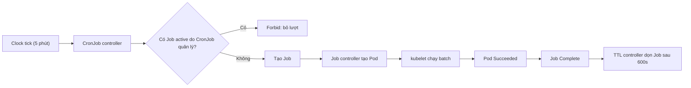
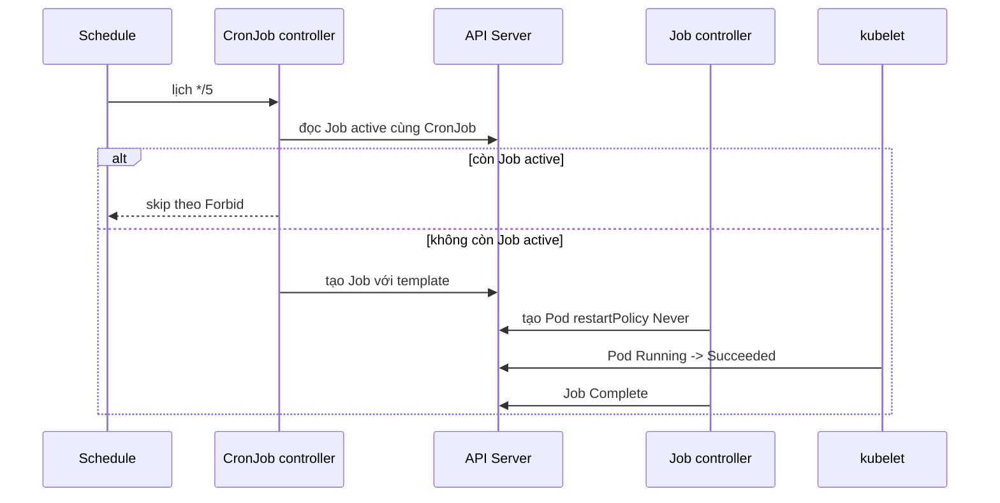

# D2-012 — CronJob: chạy batch định kỳ không chồng lấn

**Domain:** Application Deployment · **Mức:** Intermediate · **Runtime:** kind · **Namespace:** `ckad-d2-012`

## Bối cảnh production
Dịch vụ billing chạy batch đối soát theo lịch. Nếu một lượt xử lý kéo dài quá chu kỳ, việc chạy hai batch đồng thời có thể ghi trùng. Kubernetes CronJob tạo Job theo lịch, nhưng **không cung cấp exactly-once execution**. Ta dùng `concurrencyPolicy: Forbid` để tránh CronJob tạo Job mới khi Job cũ của **cùng CronJob** còn active. Batch vẫn phải idempotent, vì controller có thể tạo trễ hoặc lặp Job trong một số trường hợp.

## Nhiệm vụ
Từ `setup.yaml` (CronJob cố ý cấu hình sai), chỉnh `billing-reconcile`:
- `schedule: "*/5 * * * *"`, `timeZone: "Etc/UTC"`, `concurrencyPolicy: Forbid`.
- `startingDeadlineSeconds: 120`, `successfulJobsHistoryLimit: 2`, `failedJobsHistoryLimit: 1`, `suspend: false`.
- Job template `backoffLimit: 1`, `activeDeadlineSeconds: 180`, `ttlSecondsAfterFinished: 600`.
- Pod template `restartPolicy: Never`, image `busybox:1.36`, lệnh in `reconcile-complete` và thoát thành công.
- Chạy một Job thủ công **từ template CronJob**, quan sát Pod Completed và log thật.

**Lưu ý:** `Forbid` chỉ áp dụng giữa các Job do controller của cùng CronJob quản lý; Job tạo thủ công bằng `kubectl create job --from=cronjob/...` không bị concurrency policy chặn. Không dùng Job thủ công để khẳng định `Forbid` đã được thử nghiệm động.

## Controller flow


## Sequence — lịch và luồng chạy batch


## Thực hành trên kind
Yêu cầu Docker, kind, kubectl, Python 3, bash. Dùng context riêng để tránh thao tác nhầm cluster production:
```bash
kind create cluster --name ckad
kubectl config use-context kind-ckad
kubectl apply -f setup.yaml
kubectl -n ckad-d2-012 get cronjob billing-reconcile -o yaml
# Tự chỉnh CronJob theo yêu cầu, không xem solution
kubectl -n ckad-d2-012 create job manual-reconcile --from=cronjob/billing-reconcile
kubectl -n ckad-d2-012 wait --for=condition=complete job/manual-reconcile --timeout=120s
kubectl -n ckad-d2-012 logs job/manual-reconcile
./verify.sh
```
Nếu đã có kind cluster tên `ckad`, bỏ qua lệnh create. Để tránh Job tự động xuất hiện trong lúc học, có thể hoàn thành trong vòng 5 phút hoặc xem danh sách Job; grader chỉ yêu cầu manual Job thành công và cấu hình policy chính xác.

## Đáp án và chấm điểm
`./solution.sh` apply cấu hình chuẩn, tạo Job kiểm chứng mới và chạy `./verify.sh`. `verify.sh` dùng API thực, xác minh spec CronJob, owner/template, trạng thái Job và log Pod. Không chấm chỉ bằng grep YAML.

`./negative-tests.sh` lần lượt tạo các cấu hình sai, đòi grader **fail** rồi phục hồi trạng thái tốt. Script này chỉ dùng trong namespace lab. Kết thúc bằng `./verify.sh`.

## Negative tests
| Phá lỗi | Tại sao phải fail |
|---|---|
| concurrencyPolicy = Allow | Có thể tạo batch chồng lấn |
| suspend = true | Lịch không hoạt động |
| backoffLimit = 6 | Retry vượt ngân sách |
| restartPolicy = OnFailure | Không đạt yêu cầu Pod retry |
| image = busybox:1.35 | Sai image pin |

## Troubleshooting
| Triệu chứng | Chẩn đoán | Khắc phục |
|---|---|---|
| CronJob không tạo Job | `kubectl describe cronjob`, `kubectl get events` | Kiểm tra suspend, timezone, schedule, deadline |
| Job chưa Complete | `kubectl describe job`; `kubectl get pods -l job-name=...` | Kiểm tra Pod Pending/ImagePullBackOff/Crash |
| Không thấy log | `kubectl logs job/manual-reconcile` | Job có thể chưa tạo Pod hoặc đã bị TTL cleanup |
| Job bị skip | `kubectl get jobs` và `kubectl describe cronjob` | Forbid bỏ lịch khi Job do CronJob quản lý còn active |
| Job chạy lặp | Kiểm tra idempotency và log nghiệp vụ | CronJob không đảm bảo exactly-once |

**Giới hạn kiểm chứng:** grader kiểm tra policy trên Kubernetes API và Job hoàn tất; không chứng minh controller đã bỏ một tick thực sự. Muốn test skip tick phải chạy một Job do CronJob tạo lâu hơn chu kỳ và quan sát qua ít nhất hai tick, không phù hợp bài lab ngắn.

## Dọn dẹp
```bash
kubectl delete namespace ckad-d2-012
```
Không chạy `kind delete cluster` nếu cluster được dùng chung.

## Tài liệu chính thức
- [CronJob](https://kubernetes.io/docs/concepts/workloads/controllers/cron-jobs/)
- [Jobs](https://kubernetes.io/docs/concepts/workloads/controllers/job/)
- [TTL after finished](https://kubernetes.io/docs/concepts/workloads/controllers/ttlafterfinished/)
- [kind quick start](https://kind.sigs.k8s.io/docs/user/quick-start/)
