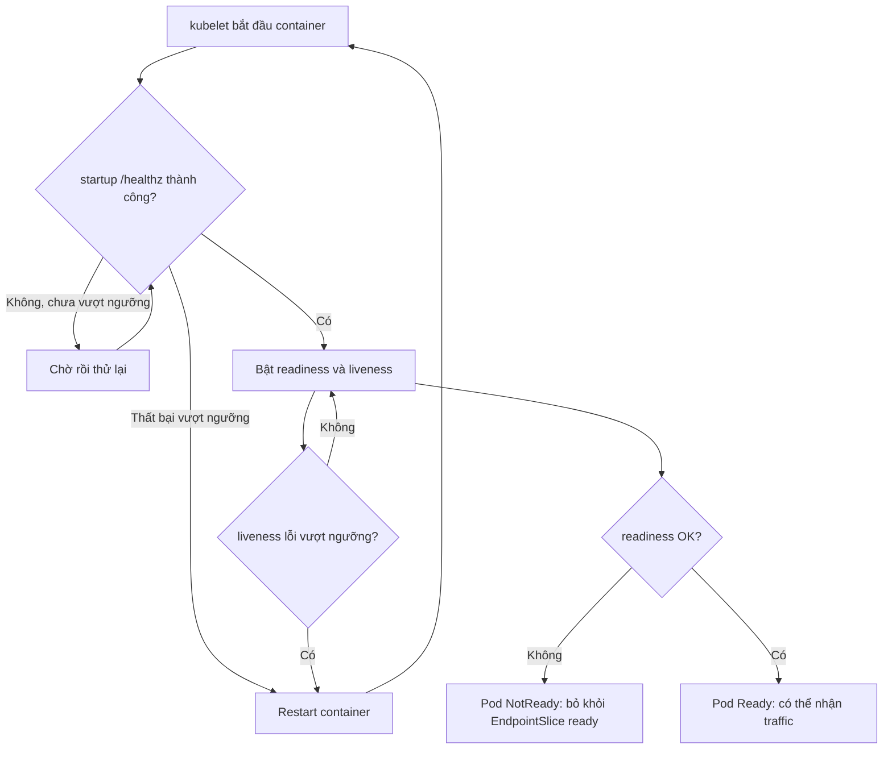
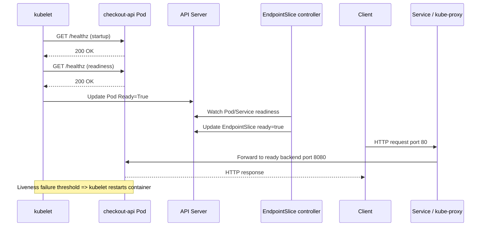

# D3-001 — Health probes, readiness gating và self-healing

**Domain 3 — Application Observability and Maintenance** · **Level:** Foundation · **Namespace:** `ckad-d3-001`

## Tình huống production

Dịch vụ checkout vừa deploy xong nhưng request đôi lúc thất bại. Pod **Running** không đồng nghĩa với ứng dụng **Ready**. Một probe cấu hình sai khiến Pod không xuất hiện trong EndpointSlice của Service; Kubernetes vẫn có thể giữ container chạy. Bài này tách rõ ba cơ chế: **startup** (cho phép khởi động), **readiness** (cho phép nhận traffic), **liveness** (kubelet restart container bị lỗi).

> Chú ý: readiness thất bại **không restart** container. Liveness thất bại không trực tiếp xóa Deployment hay scale replicas. Startup probe, khi tồn tại, chặn việc chạy liveness/readiness cho đến khi startup thành công.

## Mục tiêu thực hành

Từ `setup.yaml` có readiness path sai, sửa Deployment `checkout-api` thành 2 replicas, image `registry.k8s.io/e2e-test-images/agnhost:2.53`, container port 8080, với:

| Probe | HTTP path | Port | periodSeconds | failureThreshold |
|---|---|---|---|---|
| startup | /healthz | 8080 | 2 | 15 |
| readiness | /healthz | 8080 | 3 | 2 |
| liveness | /healthz | 8080 | 5 | 3 |

Service `checkout-api` phải chọn `app: checkout-api`, port 80 → 8080, và có **2 endpoint Ready**. EndpointSlice được kiểm tra bằng API thực chứ không dựa trên YAML tĩnh.

## Flowchart — các nhánh khác nhau của probe



## Sequence — một HTTP request và controller flow



## Chạy trên kind

Yêu cầu Docker, kind, kubectl, Python 3, bash. Không dùng cluster production.

```bash
kind create cluster --name ckad
kubectl config use-context kind-ckad
kubectl apply -f setup.yaml
kubectl -n ckad-d3-001 get pods
kubectl -n ckad-d3-001 describe pod -l app=checkout-api
kubectl -n ckad-d3-001 get endpointslice -l kubernetes.io/service-name=checkout-api
# Sửa Deployment bằng kubectl edit / apply YAML theo bảng mục tiêu
kubectl -n ckad-d3-001 rollout status deploy/checkout-api --timeout=180s
bash verify.sh
```

Nếu cluster `ckad` đã tồn tại, bỏ qua bước tạo. `solution.sh` là đáp án tham khảo; `negative-tests.sh` cố tình phá cấu hình rồi yêu cầu grader phát hiện. Chạy các script từ thư mục lab: `bash solution.sh`, `bash negative-tests.sh`.

## Tự kiểm chứng và quan sát

```bash
kubectl -n ckad-d3-001 get deploy,pods,svc,endpointslices
kubectl -n ckad-d3-001 describe pod -l app=checkout-api
kubectl -n ckad-d3-001 get events --sort-by=.lastTimestamp
kubectl -n ckad-d3-001 port-forward svc/checkout-api 18080:80
# Terminal khác: curl -i http://127.0.0.1:18080/healthz
```

`verify.sh` đọc JSON từ Kubernetes API để chấm cấu hình probe, Deployment availableReplicas, Pod conditions, Service selector và EndpointSlice ready backends. Không chỉ grep manifest.

### Negative tests

1. Xóa readiness probe: grader phải fail.
2. Xóa liveness probe: grader phải fail.
3. Xóa startup probe: grader phải fail.
4. Scale xuống một replica: grader phải fail.
5. Sửa Service selector sang `app: other`: grader phải fail.

**Giới hạn:** Negative tests xác nhận grader từ chối cấu hình sai. Chúng **không** mô phỏng thực nghiệm liveness restart hoặc failure injection vào HTTP server; muốn chứng minh restart cần workload có health endpoint điều khiển được và quan sát restartCount.

## Troubleshooting

| Triệu chứng | Lệnh kiểm tra | Nguyên nhân / xử lý |
|---|---|---|
| Running nhưng 0/1 Ready | `kubectl describe pod` | Readiness path sai, HTTP status không phải 2xx/3xx |
| Restart liên tục | `kubectl get pods`, `kubectl describe pod` | Liveness quá gắt, tăng ngưỡng phù hợp |
| Service không có backend | `kubectl get endpointslice -l kubernetes.io/service-name=checkout-api -o yaml` | Selector mismatch hoặc Pod chưa Ready |
| Pod Pending | `kubectl describe pod` | Image pull, thiếu tài nguyên, scheduling |
| Rollout timeout | `kubectl rollout status`, `kubectl get events` | Probe thất bại, image không pull được |

## Cleanup

```bash
kubectl delete namespace ckad-d3-001
```

Không xóa cluster kind dùng chung.

## Tài liệu chính thức

- [Kubernetes probes](https://kubernetes.io/docs/concepts/configuration/liveness-readiness-startup-probes/)
- [Configure probes](https://kubernetes.io/docs/tasks/configure-pod-container/configure-liveness-readiness-startup-probes/)
- [EndpointSlices](https://kubernetes.io/docs/concepts/services-networking/endpoint-slices/)
- [kind quick start](https://kind.sigs.k8s.io/docs/user/quick-start/)
