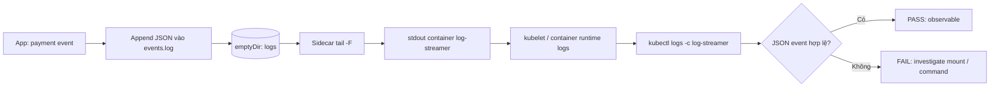
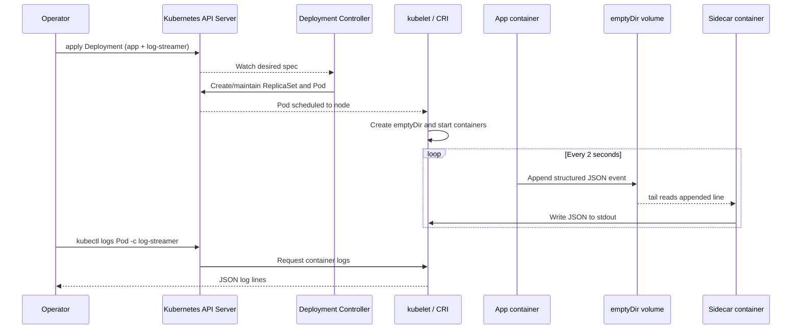

# D3-002 — Structured logs và sidecar streaming (Foundation → Intermediate)

**Domain 3: Application Observability and Maintenance** · Namespace `ckad-d3-002` · kind Kubernetes-in-Docker.

## Bối cảnh production

Một payment worker ghi sự kiện giao dịch vào file nội bộ thay vì stdout. `kubectl logs -c app` không thấy các sự kiện đó, nên on-call không thể chẩn đoán từ Kubernetes logging API. Nhiệm vụ là bổ sung **sidecar** chỉ đọc cùng file qua `emptyDir`, rồi phát các dòng JSON lên stdout. Đây là bài về **đường đi của log**, không lặp lại readiness/liveness của D3-001.

**Giới hạn quan trọng:** `emptyDir` tồn tại suốt vòng đời Pod, nhưng mất khi Pod bị xóa; đây không phải durable log storage. `kubectl logs` không thay thế log aggregation. `tail -F` trong busybox có thể khác GNU tail; quan sát hành vi trên image thực tế.

## Mục tiêu

1. Deployment `payment-worker` một replica, giữ container `app` ghi JSON mỗi 2 giây.
2. Container `log-streamer` đọc `/var/log/payment/events.log` và chuyển ra stdout, không sửa app.
3. Cả hai mount volume `logs` kiểu `emptyDir` tại `/var/log/payment`.
4. Hai container Ready; `kubectl logs ... -c log-streamer` có JSON `level=info`, `service=payment-worker`, `event=payment_processed` và `seq` là số.
5. Grader đọc trạng thái Deployment/Pod và log thật, không chấm bằng grep YAML.

## Sơ đồ flowchart — nơi log đi qua



## Sequence diagram — data plane và controller flow



## Prerequisites / chạy thật

Cần Docker daemon, kind, kubectl, bash, Python 3. **Không chạy trên production.** Kiểm tra `kubectl config current-context` phải bắt đầu bằng `kind-`.

```bash
kind create cluster --name ckad # bỏ qua nếu đã tồn tại
kubectl config use-context kind-ckad
kubectl apply -f setup.yaml
kubectl -n ckad-d3-002 rollout status deploy/payment-worker --timeout=180s
kubectl -n ckad-d3-002 logs deploy/payment-worker -c app --tail=5
# App chỉ ghi vào file, không xuất event ra stdout: hãy quan sát sự khác biệt
kubectl apply -f solution.yaml
kubectl -n ckad-d3-002 rollout status deploy/payment-worker --timeout=180s
kubectl -n ckad-d3-002 logs deploy/payment-worker -c log-streamer --tail=10
bash verify.sh
```

`solution.sh` thực hiện setup + đáp án + verify. Người học nên tự sửa trước khi xem đáp án. Tất cả lệnh chạy từ thư mục lab.

## Thực hành điều tra lỗi

```bash
kubectl -n ckad-d3-002 get deploy,pods -o wide
kubectl -n ckad-d3-002 describe pod -l app=payment-worker
kubectl -n ckad-d3-002 logs deploy/payment-worker -c app --tail=10
kubectl -n ckad-d3-002 logs deploy/payment-worker -c log-streamer --tail=10
kubectl -n ckad-d3-002 exec deploy/payment-worker -c app -- cat /var/log/payment/events.log
kubectl -n ckad-d3-002 get events --sort-by=.lastTimestamp
```

## Negative tests (cố tình làm sai)

Chạy `bash negative-tests.sh` **sau khi** `bash solution.sh`. Script kiểm tra 4 tình huống: (1) replicas=2, (2) sidecar chỉ sleep và không phát log, (3) bỏ volumeMount của sidecar, (4) xóa sidecar. Mỗi tình huống phải khiến `verify.sh` trả exit code khác 0; trap khôi phục đáp án sau khi kết thúc. Không chạy song song các test trong cùng namespace.

## Troubleshooting

| Triệu chứng | Chẩn đoán | Cách xử lý |
|---|---|---|
| `kubectl logs -c app` rỗng | App ghi file, không ghi stdout | Đọc file bằng exec; dùng sidecar |
| `log-streamer` CrashLoopBackOff | File chưa tồn tại hoặc tail options không tương thích | Kiểm tra sidecar logs; vòng đợi file; thử `tail -n +1 -F` |
| Log không cập nhật | Mount path khác nhau hoặc tail dừng | `kubectl get deploy -o yaml`; kiểm tra `volumeMounts` |
| Pod Running nhưng grader fail | Container Ready khác với log stream hợp lệ | `kubectl logs -c log-streamer`; parse JSON |
| Log mất sau reschedule | `emptyDir` không bền | Gửi stdout sang log collector bên ngoài |

## Cleanup

```bash
kubectl delete namespace ckad-d3-002
```

Không xóa kind cluster dùng chung, không sửa các lab khác.

## Tài liệu chính thức

- [Kubernetes logging architecture](https://kubernetes.io/docs/concepts/cluster-administration/logging/)
- [Sidecar containers and logging](https://kubernetes.io/docs/concepts/cluster-administration/logging/#sidecar-container-with-logging-agent)
- [Volumes / emptyDir](https://kubernetes.io/docs/concepts/storage/volumes/#emptydir)
- [kubectl logs](https://kubernetes.io/docs/reference/kubectl/generated/kubectl_logs/)
- [kind quick start](https://kind.sigs.k8s.io/docs/user/quick-start/)
