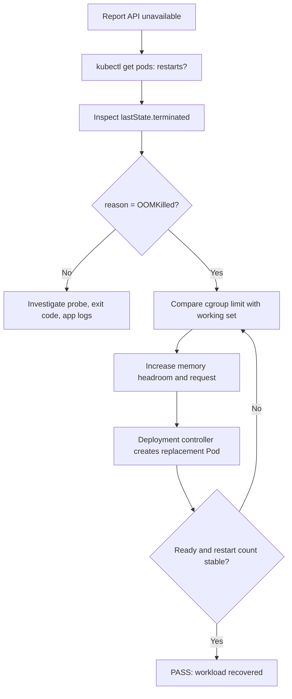
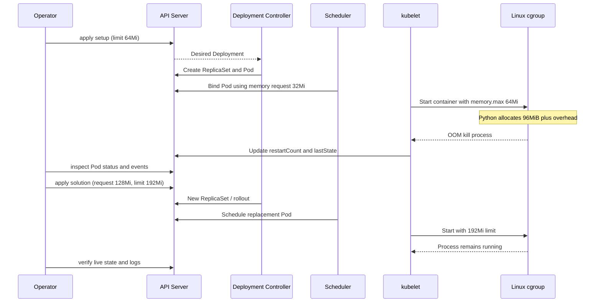

# D3-003 — OOMKilled: chẩn đoán memory limit và sizing (Intermediate)

**Domain 3 · Namespace:** `ckad-d3-003` · **Runtime:** kind Kubernetes-in-Docker.

## Sự cố production

Report API có một tác vụ dựng báo cáo chiếm 96 MiB bộ nhớ payload. Manifest hiện tại đặt memory limit 64Mi và request 32Mi. Container bị kernel cgroup OOM kill, kubelet restart liên tục; endpoint gián đoạn. Mục tiêu là **chứng minh nguyên nhân từ trạng thái Kubernetes** và sửa request/limit hợp lý, không chỉ tăng replica hoặc thay image.

**Phân biệt:** `requests.memory` là tín hiệu cho scheduler; `limits.memory` được kernel/cgroup enforce. OOMKilled thường có exit code 137, nhưng phải đọc `lastState.terminated.reason`, không suy luận chỉ từ 137. `kubectl top` cần Metrics Server và không bắt buộc trong kind. Python runtime có overhead ngoài 96MiB payload, nên limit 192Mi là headroom minh họa, không phải sizing production mặc định.

## Mục tiêu và tiêu chí

1. Dùng kind context, namespace cô lập.
2. Đọc `describe pod`, `containerStatuses.lastState`, events, restart count để xác nhận OOM.
3. Giữ một Deployment `report-api`, một container `api`, không thay logic cấp phát 96MiB.
4. Sửa request 128Mi, limit 192Mi; Pod Ready và restart count ổn định qua cửa sổ quan sát.
5. `verify.sh` tự chấm trực tiếp Deployment, Pod, container logs và trạng thái restart.

## Flowchart — triage từ triệu chứng tới nguyên nhân



## Sequence diagram — scheduler, kubelet và cgroup



## Chạy bài

Cần Docker, kind, kubectl, bash, Python 3; không chạy trên production.

```bash
kind create cluster --name ckad # nếu chưa có
kubectl config use-context kind-ckad
kubectl apply -f setup.yaml
kubectl -n ckad-d3-003 get pods -w
kubectl -n ckad-d3-003 describe pod -l app=report-api
kubectl -n ckad-d3-003 get pods -l app=report-api -o jsonpath='{range .items[*]}{.status.containerStatuses[0].lastState.terminated.reason}{"\n"}{end}'
kubectl -n ckad-d3-003 get events --sort-by=.lastTimestamp
# Tự sửa request/limit rồi chạy grader
bash verify.sh
# Xem đáp án
bash solution.sh
bash negative-tests.sh
```

`solution.sh` apply setup và đáp án, đợi rollout, gọi grader. `verify.sh` không phụ thuộc text manifest: truy vấn API và log runtime; 4 negative tests cố tình thay replica, memory limit, request và workload để kiểm chứng fail-closed. Chạy test tuần tự, không đồng thời trong namespace.

## Troubleshooting

| Triệu chứng | Nguyên nhân khả dĩ | Hành động |
|---|---|---|
| `OOMKilled` / restart tăng | Limit thấp hơn peak memory | Kiểm tra `lastState`, tăng limit có headroom |
| `Pending` sau tăng request | Node không đủ allocatable memory | `kubectl describe pod`, `kubectl describe node` |
| `CrashLoopBackOff` nhưng không OOM | App lỗi startup | `kubectl logs --previous`, xem reason/exitCode |
| Grader fail dù Ready | Request/limit sai hoặc workload bị thay | `kubectl get deploy -o yaml`, xem log `allocated` |
| `kubectl top` báo lỗi | Chưa cài Metrics Server | Dùng status/events; Metrics Server là optional |

**Giới hạn:** Test quan sát restart count trong 8 giây; không chứng minh memory ổn định dưới tải production dài hạn. Image `python:3.12-alpine` cần tải được từ registry. Tăng limit không sửa memory leak; đo peak/RSS trước khi sizing thực tế.

## Cleanup

```bash
kubectl delete namespace ckad-d3-003
```

Không xóa kind cluster dùng chung.

## Tài liệu chính thức

- [Resource management for Pods and containers](https://kubernetes.io/docs/concepts/configuration/manage-resources-containers/)
- [Pod lifecycle / container states](https://kubernetes.io/docs/concepts/workloads/pods/pod-lifecycle/)
- [Debug running Pods](https://kubernetes.io/docs/tasks/debug/debug-application/debug-running-pod/)
- [Deployments](https://kubernetes.io/docs/concepts/workloads/controllers/deployment/)
- [kind quick start](https://kind.sigs.k8s.io/docs/user/quick-start/)
