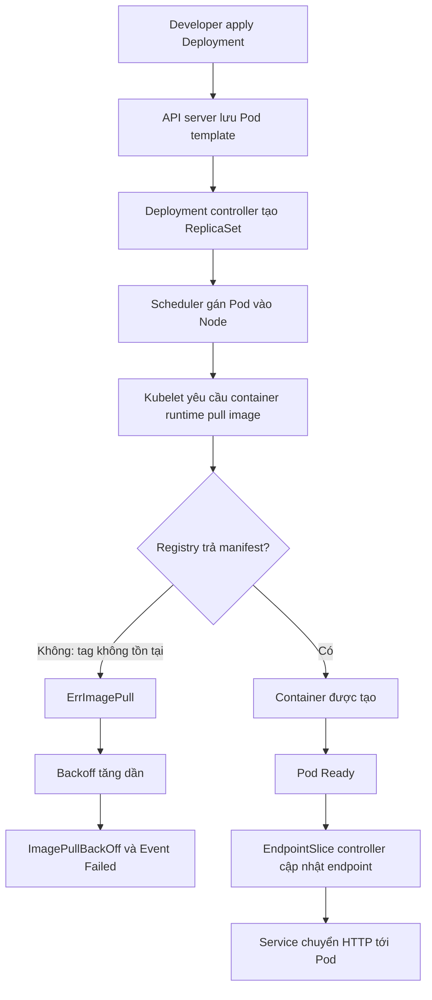
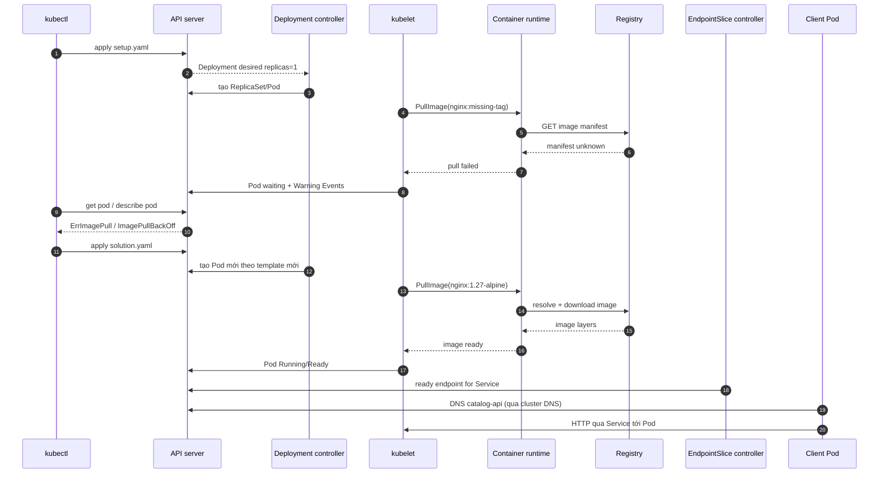

# D3-004 — ImagePullBackOff: chẩn đoán image tag và khôi phục dịch vụ

**Domain 3 — Application Observability and Maintenance** · **Mức độ:** cơ bản → trung cấp · **Thời lượng:** 25–35 phút · **Namespace:** `ckad-d3-004`

## Tình huống production

Nhóm triển khai `catalog-api` nhưng Pod không chạy. Deployment tồn tại, Service đã tạo, tuy nhiên image `nginx:ckad-intentionally-missing-tag-2026` không tồn tại. Kubelet thử pull, container runtime trả lỗi, Pod chuyển từ `ErrImagePull` sang `ImagePullBackOff`. Đây là sự cố **trước khi container khởi động**: khác CrashLoopBackOff (container chạy rồi thoát), OOMKilled (bị kernel kill), hay readiness probe fail (container có thể đang chạy).

**Nhiệm vụ:** dùng kubectl tìm lỗi từ Pod status và Events, sửa image thành `nginx:1.27-alpine`, giữ `imagePullPolicy: IfNotPresent`, bảo đảm 1 replica Ready, Service có EndpointSlice ready và HTTP nội bộ thành công. Không xóa Deployment để che giấu sự cố.

## Điều kiện thực hành

Docker daemon đang chạy, `kind` và `kubectl` có trong PATH. Tạo cluster riêng nếu chưa có:

```bash
kind create cluster --name ckad-labs
kubectl config use-context kind-ckad-labs
kubectl get nodes
```

Nếu cluster đã tồn tại thì bỏ qua bước tạo. Không chạy lệnh xóa toàn cluster. Chỉ namespace `ckad-d3-004` được sử dụng trong bài này.

## Luồng điều khiển: image không tồn tại



**Phân biệt thành phần:** Deployment controller duy trì replica mong muốn; Scheduler chọn Node; kubelet tại Node gọi container runtime; registry phục vụ image manifest/layers; EndpointSlice controller cập nhật địa chỉ backend cho Service. API server không trực tiếp tải image.

## Sequence: từ request đến sự cố và phục hồi



## Thực hành từng bước

1. `kubectl apply -f setup.yaml` để tạo namespace, Deployment lỗi và Service.
2. `kubectl -n ckad-d3-004 get deploy,rs,pods,svc -o wide`: chú ý Deployment không có READY.
3. `kubectl -n ckad-d3-004 describe pod -l app=catalog-api`: tìm phần **Events**, thông báo `Failed to pull image` và `Back-off pulling image`. Thời điểm xuất hiện phụ thuộc mạng/registry.
4. `kubectl -n ckad-d3-004 get pods -l app=catalog-api -o jsonpath='{range .items[*]}{.metadata.name}{" "}{.status.containerStatuses[0].state.waiting.reason}{"\n"}{end}'`. Nếu chưa hiện BackOff, chờ vài giây và kiểm tra lại.
5. Đọc `solution.yaml` để xác định tag và pull policy đúng, sau đó tự sửa Deployment bằng `kubectl set image deployment/catalog-api web=nginx:1.27-alpine -n ckad-d3-004` và `kubectl patch` nếu cần.
6. `kubectl -n ckad-d3-004 rollout status deploy/catalog-api --timeout=180s`; xem `kubectl -n ckad-d3-004 get endpointslice -l kubernetes.io/service-name=catalog-api`.
7. Chạy `./verify.sh`. Để xem lời giải tham khảo, chạy `./solution.sh` (script tự apply và chấm).

**Chú ý:** `imagePullPolicy` không sửa được tag sai. `IfNotPresent` chỉ giảm số lần pull khi image đã có trên node; tag phải thực sự tồn tại. Với production nên dùng digest bất biến; bài thi sử dụng tag rõ ràng để thao tác nhanh.

## Tự chấm trạng thái Kubernetes thật

`verify.sh` không chấm bằng grep YAML trong repo. Script truy vấn API server để xác minh namespace, Deployment, image, pull policy, rollout, Ready replica, trạng thái container, EndpointSlice và chạy HTTP request từ Pod tạm trong namespace. Cần mạng cho lần pull image đầu tiên. Nếu registry không truy cập được, báo lỗi môi trường thay vì nhận đạt.

```bash
chmod +x solution.sh verify.sh negative-tests.sh
./verify.sh
./negative-tests.sh
```

## Negative tests

`negative-tests.sh` chủ động gây 5 lỗi và xác nhận checker **phải fail**: tag sai, pull policy sai, scale 0 replica, xóa Service, selector Service không khớp. Script có trap khôi phục Deployment. Chỉ chạy trong namespace lab; không dùng namespace production. Trong quá trình test, một số trạng thái là eventual consistency; `verify.sh` kiểm tra cả cấu hình mong muốn để phát hiện lỗi ngay cả khi Pod cũ chưa biến mất.

## Troubleshooting / quyết định xử lý

| Dấu hiệu | Cách xác minh | Hướng xử lý |
|---|---|---|
| `ErrImagePull` | `describe pod` + Events | Kiểm tra tên registry, repository, tag |
| `ImagePullBackOff` | `get pod -o json` | Sửa nguyên nhân gốc, không chỉ chờ retry |
| `unauthorized` | Event pull image | Kiểm tra imagePullSecrets / quyền registry (không cần cho public nginx) |
| `manifest unknown` | Event pull image | Tag hoặc architecture không tồn tại |
| `i/o timeout` | Event, DNS node | Kiểm tra mạng node, proxy, registry |
| Pod Ready nhưng HTTP fail | EndpointSlice, Service selector, targetPort | Debug mạng/service; không quy lỗi image |
| Image mới nhưng Pod cũ | `rollout status`, `get rs` | Kiểm tra rollout / replica / scheduling |

**Dọn dẹp:** `kubectl delete namespace ckad-d3-004`. Không xóa cluster dùng chung.

## Tài liệu Kubernetes chính thức

- [Images & imagePullPolicy](https://kubernetes.io/docs/concepts/containers/images/)
- [Debug Pods](https://kubernetes.io/docs/tasks/debug/debug-application/debug-pods/)
- [Pod lifecycle & container states](https://kubernetes.io/docs/concepts/workloads/pods/pod-lifecycle/)
- [Deployment rollout](https://kubernetes.io/docs/concepts/workloads/controllers/deployment/)
- [EndpointSlices](https://kubernetes.io/docs/concepts/services-networking/endpoint-slices/)
