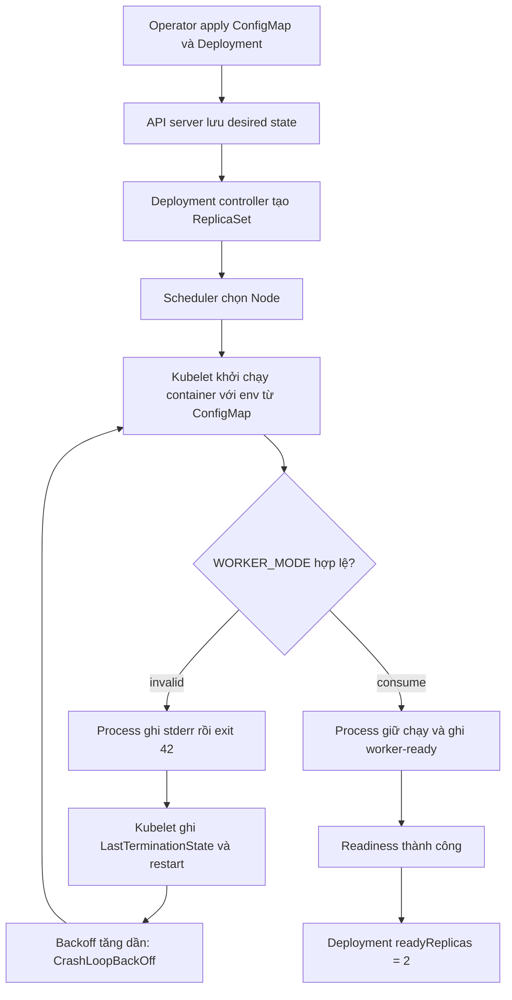

# D3-005 — CrashLoopBackOff: ứng dụng thoát vì cấu hình sai

**Domain 3 · 35–45 phút · Namespace:** `ckad-d3-005`

## Tình huống production
Một worker `invoice-worker` được rollout nhưng biến `WORKER_MODE` bị cấu hình thành `invalid`. Process khởi động, ghi lỗi ra stderr và thoát với exit code 42. Kubelet restart theo `restartPolicy: Always`, tăng backoff; Deployment không có replica Ready. Đây là **CrashLoopBackOff**, khác D3-003 OOMKilled (137) và D3-004 ImagePullBackOff (image chưa chạy).

**Mục tiêu:** điều tra bằng `kubectl describe pod`, `kubectl logs --previous`, `kubectl get pod -o json`, sửa ConfigMap thành `WORKER_MODE=consume`, kích hoạt rollout mới vì env từ ConfigMap không tự cập nhật trong container đang chạy, bảo đảm 2 replicas Ready và quan sát logs xác nhận `worker-ready`. Không sửa command để bỏ validation và không giảm replica.

## Chuẩn bị kind
```bash
kind create cluster --name ckad-labs # bỏ qua nếu đã tồn tại
kubectl config use-context kind-ckad-labs
kubectl apply -f setup.yaml
kubectl -n ckad-d3-005 get pods -w
```
Yêu cầu Docker daemon, kind, kubectl và kết nối pull image `busybox:1.36`. Namespace riêng không ảnh hưởng lab khác.

## Luồng controller và vòng đời process


## Sequence: lỗi, điều tra, phục hồi
```mermaid
sequenceDiagram
  autonumber
  participant Op as Developer
  participant API as API server
  participant DC as Deployment controller
  participant K as Kubelet
  participant P as Worker process
  Op->>API: apply setup.yaml
  API-->>DC: Deployment replicas=2
  DC->>API: ReplicaSet và Pods
  K->>API: đọc ConfigMap qua PodSpec/env
  K->>P: start WORKER_MODE=invalid
  P-->>K: stderr + exit 42
  K->>API: terminated exitCode=42 / restartCount++
  Op->>API: get pods / describe
  Op->>K: logs --previous
  K-->>Op: invalid WORKER_MODE
  Op->>API: apply solution.yaml (ConfigMap consume)
  Op->>API: rollout restart deployment
  DC->>API: tạo Pod mới
  K->>P: start WORKER_MODE=consume
  P-->>K: worker-ready; process stays alive
  K->>API: Ready=True
  API-->>Op: rollout status success
```

## Thực hành
1. Chạy `kubectl apply -f setup.yaml`. Đợi khoảng 20–60 giây. `kubectl -n ckad-d3-005 get pods` có thể hiện `Error` trước khi thành `CrashLoopBackOff`.
2. `kubectl -n ckad-d3-005 describe pod -l app=invoice-worker` xem Events, `Restart Count` và `Last State`. `kubectl -n ckad-d3-005 get pods -l app=invoice-worker -o jsonpath='{range .items[*]}{.metadata.name}{" "}{.status.containerStatuses[0].lastState.terminated.exitCode}{"\n"}{end}'`.
3. Lấy tên Pod: `POD=$(kubectl -n ckad-d3-005 get pod -l app=invoice-worker -o jsonpath='{.items[0].metadata.name}')`; chạy `kubectl -n ckad-d3-005 logs "$POD" --previous`. Vì container restart nhanh, `--previous` thường hữu ích hơn logs hiện tại.
4. Kiểm tra nguồn cấu hình: `kubectl -n ckad-d3-005 get cm invoice-worker-config -o yaml`. Sửa `WORKER_MODE` thành `consume`. Vì `env.valueFrom.configMapKeyRef` được resolve khi container khởi chạy, cập nhật ConfigMap không tự tạo Pod mới; chạy `kubectl -n ckad-d3-005 rollout restart deployment/invoice-worker`.
5. `kubectl -n ckad-d3-005 rollout status deploy/invoice-worker --timeout=180s`, `kubectl -n ckad-d3-005 logs deploy/invoice-worker --all-pods=true --prefix=true` (nếu kubectl không hỗ trợ `--all-pods`, đọc logs từng Pod). Chạy `./verify.sh`.

Có thể dùng `./solution.sh` để áp dụng lời giải tham khảo và chấm. Checker truy vấn API server và logs thực tế, không dựa trên nội dung file YAML.

## Negative tests
`./negative-tests.sh` lần lượt tạo bốn trạng thái sai và yêu cầu checker từ chối: ConfigMap sai; Deployment chỉ có một replica; command bị thay thành `sleep` để che lỗi; Pod template trỏ sang ConfigMap không tồn tại. Trap khôi phục solution và rollout khi kết thúc.

## Troubleshooting
| Triệu chứng | Lệnh | Phân tích |
|---|---|---|
| CrashLoopBackOff | `describe pod`, `logs --previous` | App đã chạy và thoát; tìm lỗi process |
| Exit 42 | `get pod -o json` | Validation WORKER_MODE chủ động thất bại |
| Exit 137 / OOMKilled | `describe pod` | Khác lab này: kiểm tra memory limit |
| CreateContainerConfigError | `describe pod` | ConfigMap/key không tồn tại; process chưa chạy |
| ConfigMap đã đúng, Pod vẫn lỗi | `rollout restart` | env không hot-reload |
| Pod Running nhưng không Ready | `describe pod` | Xem readiness probe và trạng thái workload |
| Registry không pull được | Events | Phân biệt lỗi môi trường với bài học |

Dọn dẹp: `kubectl delete namespace ckad-d3-005` (không xóa kind cluster).

## Tài liệu chính thức
- [Debug running Pods](https://kubernetes.io/docs/tasks/debug/debug-application/debug-running-pod/)
- [Pod lifecycle / restart policy](https://kubernetes.io/docs/concepts/workloads/pods/pod-lifecycle/)
- [ConfigMaps as environment variables](https://kubernetes.io/docs/tasks/configure-pod-container/configure-pod-configmap/)
- [Deployments / rollout restart](https://kubernetes.io/docs/concepts/workloads/controllers/deployment/)
- [Container logs](https://kubernetes.io/docs/concepts/cluster-administration/logging/)
