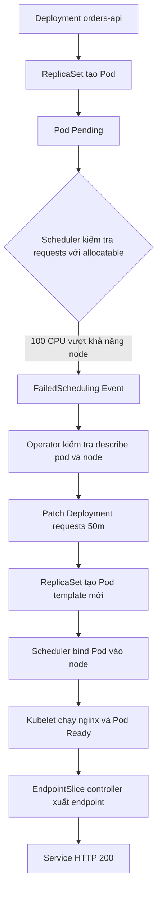
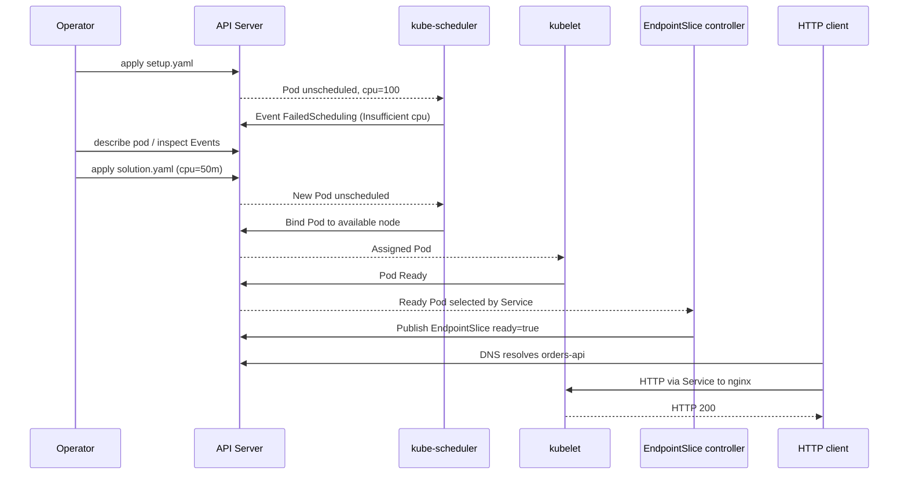

# D3-006 — Pending Pod: chẩn đoán FailedScheduling do CPU requests

**Domain:** Application Observability and Maintenance · **Môi trường:** kind (Kubernetes-in-Docker) · **Namespace:** `ckad-d3-006`

## Bối cảnh production

Đội vận hành nhận cảnh báo: `orders-api` không có endpoint, HTTP 503 từ upstream. Deployment đã tạo Pod nhưng Pod đứng ở `Pending`. Không phải lỗi image hay crash: scheduler không tìm được node thỏa **CPU request 100 cores**. Đây là lỗi cấu hình tài nguyên, không phải do ứng dụng tiêu thụ 100 cores.

## Mục tiêu

1. Phân biệt `Pending/PodScheduled=False` với `CrashLoopBackOff` và `ImagePullBackOff`.
2. Dùng `kubectl describe pod`, Events, `kubectl get nodes -o json` và `kubectl describe node` để tìm nguyên nhân.
3. Chỉnh **requests** CPU từ `100` thành `50m`, memory `32Mi`, limits CPU `200m`, memory `128Mi`.
4. Chứng minh scheduler đã gán node, Pod Ready, EndpointSlice có ready endpoint và Service trả HTTP.

> Lưu ý: scheduler so sánh requests với **allocatable trừ requests đã được cấp phát**, không so với CPU đang dùng theo thời gian thực. Đừng giải quyết bằng cách tăng limits hay restart kubelet.

## Kiến trúc và luồng điều khiển





## Chuẩn bị kind

Yêu cầu Docker daemon, `kind`, `kubectl`, quyền tạo cluster. Không dùng cluster production.

```bash
kind create cluster --name ckad-d3-006
kubectl config use-context kind-ckad-d3-006
kubectl get nodes -o wide
```

Nếu đã có cluster kind, có thể dùng cluster đó, nhưng phải chắc chắn context đúng. Chỉ xoá cluster do chính bạn tạo.

## Bài tập (không nhìn lời giải trước)

```bash
kubectl apply -f setup.yaml
kubectl -n ckad-d3-006 get deploy,pods,svc -o wide
kubectl -n ckad-d3-006 describe pod -l app=orders-api
kubectl -n ckad-d3-006 get events --sort-by=.lastTimestamp
kubectl describe nodes
kubectl -n ckad-d3-006 get pods -l app=orders-api -o jsonpath='{range .items[*]}{.status.conditions[*].reason}{"\n"}{end}'
```

Quan sát `FailedScheduling` / `Insufficient cpu`; không có `nodeName`. Tìm trong Deployment spec chỗ khai báo request phi thực tế. Hãy sửa manifest và apply, giữ nguyên namespace, selector, image và Service. Đừng dùng `kubectl delete pod` làm giải pháp: ReplicaSet sẽ tái tạo Pod với template lỗi.

## Lời giải tham khảo

```bash
bash solution.sh
bash verify.sh
```

`solution.sh` apply `solution.yaml`, chờ rollout. `verify.sh` đọc trạng thái thật từ Kubernetes: Ready replica, resource spec, Pod Running/nodeName, Service selector, EndpointSlice ready và thực hiện HTTP request từ Pod tạm trong namespace. Không chấm chỉ dựa trên YAML trong thư mục.

## Negative tests

```bash
bash negative-tests.sh
```

Ba phép thử cố ý làm sai: CPU request khác đáp án, scale replicas về 0, và Service selector trỏ sai. Mỗi lần `verify.sh` phải báo FAIL; script phục hồi Deployment bằng trap. **Chỉ chạy trong namespace lab**, không chạy đồng thời với các học viên khác trong cùng namespace.

## Troubleshooting

| Hiện tượng | Chẩn đoán | Hướng xử lý |
|---|---|---|
| `Pending` + `FailedScheduling` | CPU requests vượt allocatable | Sửa request, không chỉ limit |
| `ContainerCreating` | Đã schedule, đang pull/mount | Xem Events, image/network/volume |
| `CrashLoopBackOff` | Container đã chạy rồi thoát | `kubectl logs --previous` |
| Pod Running nhưng không Ready | Probe hoặc ứng dụng lỗi | `describe pod`, kiểm tra readiness |
| Pod Ready nhưng HTTP thất bại | Service selector, EndpointSlice hoặc DNS | `get svc,endpointslice`, thử DNS trong Pod |
| Image pull timeout trong kind | Registry/network hạn chế | Kiểm tra Docker network; preload image nếu cần |

## Tự kiểm chứng và dọn dẹp

```bash
kubectl -n ckad-d3-006 get pods -o wide
kubectl -n ckad-d3-006 get endpointslice -l kubernetes.io/service-name=orders-api
bash verify.sh
kubectl delete namespace ckad-d3-006
kind delete cluster --name ckad-d3-006  # chỉ nếu bạn tạo cluster này
```

## Tài liệu chính thức

- [Pod lifecycle](https://kubernetes.io/docs/concepts/workloads/pods/pod-lifecycle/)
- [Resource management](https://kubernetes.io/docs/concepts/configuration/manage-resources-containers/)
- [Scheduling framework](https://kubernetes.io/docs/concepts/scheduling-eviction/scheduling-framework/)
- [Debugging Pods](https://kubernetes.io/docs/tasks/debug/debug-application/debug-pods/)
- [EndpointSlices](https://kubernetes.io/docs/concepts/services-networking/endpoint-slices/)
- [kind quick start](https://kind.sigs.k8s.io/docs/user/quick-start/)
