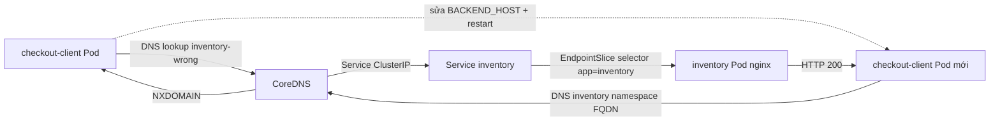

# D3-007 — Debug DNS Service Discovery từ Pod (CKAD)

**Domain:** Application Observability and Maintenance · **Mức độ:** Intermediate · **Thời lượng:** 30–45 phút · **Namespace:** `ckad-d3-007`.

## Tình huống production
Sau một lần thay đổi cấu hình, `checkout-client` vẫn Running nhưng request tới `inventory` liên tục thất bại. Nhóm trực ca tưởng Pod bị crash và định tăng replicas. Thực tế `BACKEND_HOST=inventory-wrong` trỏ tới tên Service không tồn tại. Bài này tập trung **chẩn đoán DNS từ trong Pod**, phân biệt lỗi tên Service, lỗi endpoint và lỗi HTTP. Khác D3-001 (probe), D3-005 (CrashLoop do config) và D3-006 (scheduler).

## Mục tiêu và tiêu chí chấm
1. Giữ Service `inventory` cùng Deployment backend hoạt động trong namespace cô lập.
2. Đọc logs của client và xác nhận lỗi phân giải tên.
3. Dùng `kubectl exec` để kiểm tra `nslookup`, rồi HTTP tới FQDN.
4. Sửa ConfigMap thành `inventory.ckad-d3-007.svc.cluster.local`.
5. **Rollout restart** client: biến môi trường từ ConfigMap không tự cập nhật trong container đang chạy.
6. `verify.sh` phải trả về **8/8** từ trạng thái Kubernetes thực, không dựa vào file YAML cục bộ.

## Kiến trúc và nguyên nhân


## Request / controller flow
```mermaid
sequenceDiagram
  participant O as Operator
  participant API as Kubernetes API
  participant DC as Deployment Controller
  participant P as checkout-client
  participant DNS as CoreDNS
  participant S as inventory Service
  O->>API: kubectl apply setup.yaml
  API-->>DC: Deployments / ConfigMap / Service
  DC->>P: Create Pod with BACKEND_HOST=inventory-wrong
  P->>DNS: Resolve inventory-wrong
  DNS-->>P: NXDOMAIN
  O->>API: Patch ConfigMap with valid FQDN
  Note over P: Existing env is unchanged
  O->>API: rollout restart checkout-client
  API-->>DC: Updated Pod template
  DC->>P: Replace Pod; read new ConfigMap env
  P->>DNS: Resolve inventory.ckad-d3-007.svc.cluster.local
  DNS-->>P: ClusterIP
  P->>S: GET /
  S-->>P: HTTP 200 from ready inventory Pod
```

## Chuẩn bị môi trường
Yêu cầu Docker Engine, `kind`, `kubectl`, kết nối Internet để pull `nginx:1.27-alpine` và `busybox:1.36`. Sử dụng context riêng để tránh nhầm cluster production.

```bash
kind create cluster --name ckad-labs
kubectl config use-context kind-ckad-labs
kubectl config current-context
kubectl apply -f setup.yaml
kubectl -n ckad-d3-007 rollout status deployment/inventory --timeout=120s
kubectl -n ckad-d3-007 rollout status deployment/checkout-client --timeout=120s
```

Nếu đã có cluster `kind-ckad-labs`, không tạo lại. Mọi resource của bài được cô lập trong namespace `ckad-d3-007`.

## Điều tra trước khi sửa
```bash
kubectl -n ckad-d3-007 get pods,svc,endpointslices
kubectl -n ckad-d3-007 logs deployment/checkout-client --tail=15
kubectl -n ckad-d3-007 get configmap client-config -o yaml
POD=$(kubectl -n ckad-d3-007 get pod -l app=checkout-client -o jsonpath='{.items[0].metadata.name}')
kubectl -n ckad-d3-007 exec "$POD" -- cat /etc/resolv.conf
kubectl -n ckad-d3-007 exec "$POD" -- nslookup inventory-wrong
kubectl -n ckad-d3-007 exec "$POD" -- nslookup inventory.ckad-d3-007.svc.cluster.local
kubectl -n ckad-d3-007 exec "$POD" -- wget -q -O - http://inventory.ckad-d3-007.svc.cluster.local/
```

**Giải thích:** DNS lỗi thường báo `bad address` / NXDOMAIN, trong khi Service tồn tại nhưng không có endpoint thường cho kết nối thất bại hoặc timeout. `kubectl get endpointslices -l kubernetes.io/service-name=inventory` giúp phân biệt hai nhánh. Pod `Running` không có nghĩa dependency hoạt động.

## Bài tập
Không sửa backend, Service hoặc DNS toàn cluster. Chỉ sửa `client-config` và khởi động lại client để request thành công. Làm thủ công trước khi xem đáp án.

<details><summary>Đáp án tham khảo</summary>

```bash
kubectl -n ckad-d3-007 patch configmap client-config --type merge -p '{"data":{"BACKEND_HOST":"inventory.ckad-d3-007.svc.cluster.local"}}'
kubectl -n ckad-d3-007 rollout restart deployment/checkout-client
kubectl -n ckad-d3-007 rollout status deployment/checkout-client --timeout=120s
bash verify.sh
```
Hoặc `bash solution.sh`.

</details>

## Chấm điểm, negative tests
```bash
bash verify.sh
bash solution.sh
bash negative-tests.sh
```

`verify.sh` chấm namespace, Service, hai Deployment rollout, EndpointSlice có backend, giá trị ConfigMap, DNS lookup và HTTP từ **Pod thật**. `negative-tests.sh` chủ động thử sai hostname, sai namespace, Service selector không có backend; dùng trap khôi phục cấu hình. **Lưu ý:** negative tests thay đổi cluster đang chạy, chỉ chạy trong namespace lab và sau khi solution đã ổn định. Không chạy đồng thời với người khác.

## Troubleshooting
| Triệu chứng | Nguyên nhân cần xác minh | Lệnh |
|---|---|---|
| `nslookup` NXDOMAIN | Tên Service/namespace sai | `kubectl get svc -n ckad-d3-007` |
| DNS đúng, HTTP thất bại | EndpointSlice trống, backend chưa Ready | `kubectl get endpointslices -n ckad-d3-007` |
| ConfigMap đúng, log vẫn sai | Env container cũ chưa restart | `kubectl rollout restart deployment/checkout-client -n ckad-d3-007` |
| Pod Pending | Image pull hoặc thiếu tài nguyên | `kubectl describe pod -n ckad-d3-007 <pod>` |
| DNS toàn cluster hỏng | CoreDNS chưa Ready | `kubectl get pods -n kube-system -l k8s-app=kube-dns` |

## Dọn dẹp
```bash
kubectl delete namespace ckad-d3-007
# Không chạy kind delete cluster nếu còn lab khác.
```

## Tài liệu Kubernetes chính thức
- [DNS for Services and Pods](https://kubernetes.io/docs/concepts/services-networking/dns-pod-service/)
- [Debugging DNS Resolution](https://kubernetes.io/docs/tasks/administer-cluster/dns-debugging-resolution/)
- [ConfigMaps](https://kubernetes.io/docs/concepts/configuration/configmap/)
- [Debug Services](https://kubernetes.io/docs/tasks/debug/debug-application/debug-service/)
- [Deployments](https://kubernetes.io/docs/concepts/workloads/controllers/deployment/)
