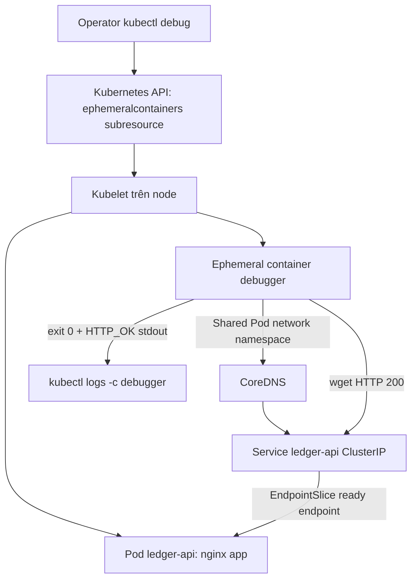
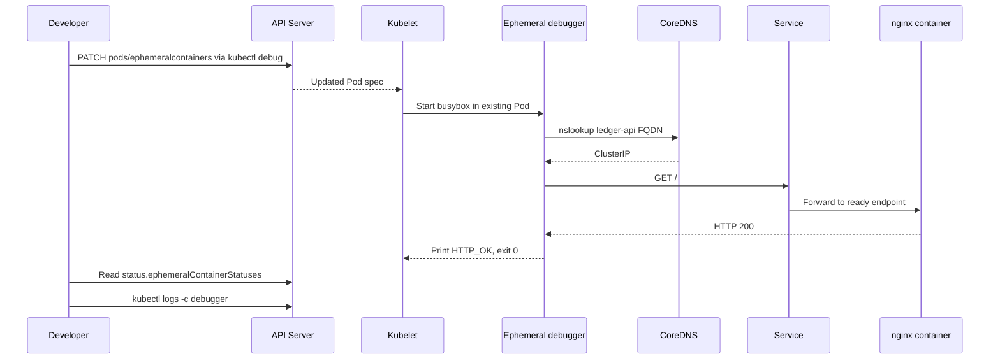

# D3-008 — Ephemeral Containers: Debug Pod không có công cụ (CKAD)

**Domain:** Application Observability and Maintenance · **Mức độ:** Intermediate/Advanced · **Thời lượng:** 40–55 phút · **Namespace:** `ckad-d3-008`.

## Sự cố thực tế

`ledger-api` vẫn Ready, nhưng đội trực cần xác nhận DNS và HTTP từ **cùng network namespace của Pod**. Image ứng dụng `nginx:1.27-alpine` tối giản; không có bộ công cụ chẩn đoán đầy đủ. Thay image production để cài tool làm thay đổi workload, tạo rollout và che mất triệu chứng. CKAD yêu cầu biết `kubectl debug` và phân biệt ephemeral container với sidecar, `kubectl exec`, Pod mới.

**Bài tập:** Không sửa Deployment hoặc restart Pod. Gắn một ephemeral container tên `debugger` dùng `busybox:1.36` vào Pod hiện tại, chạy `nslookup` và HTTP tới `ledger-api.ckad-d3-008.svc.cluster.local`, in `HTTP_OK` sau khi thành công. Đọc log debugger và kiểm tra trạng thái termination; sau đó chạy `verify.sh`.

## Cơ chế và ranh giới





**Phân biệt:** `kubectl exec` chạy trong container đang có (phụ thuộc tools sẵn có); `kubectl debug --copy-to` tạo Pod mới (không phải cùng Pod); ephemeral container thêm vào Pod hiện tại qua subresource, không nằm trong `spec.containers`, không có readiness/liveness probe và **không thể xóa hoặc sửa sau khi thêm**. Ephemeral container chia sẻ network namespace của Pod, nhưng không mặc nhiên chia sẻ filesystem của container ứng dụng. Debugger ở đây không dùng privileged mode hay host access.

## Chuẩn bị trên kind

Cần Docker Engine, kind, kubectl hỗ trợ `kubectl debug` và Internet để pull images. Không dùng context production.

```bash
kind create cluster --name ckad-labs # bỏ qua nếu đã tồn tại
kubectl config use-context kind-ckad-labs
kubectl apply -f setup.yaml
kubectl -n ckad-d3-008 rollout status deployment/ledger-api --timeout=120s
kubectl -n ckad-d3-008 get pod,svc,endpointslices
```

Nếu cluster tồn tại, **không tạo lại**. `setup.yaml` tạo namespace, Deployment 1 replica, Service; tất cả ở namespace lab.

## Điều tra trước khi can thiệp

```bash
POD=$(kubectl -n ckad-d3-008 get pods -l app=ledger-api -o jsonpath='{.items[0].metadata.name}')
kubectl -n ckad-d3-008 describe pod "$POD"
kubectl -n ckad-d3-008 exec "$POD" -c app -- sh -c 'command -v tcpdump || true'
kubectl -n ckad-d3-008 get endpointslices -l kubernetes.io/service-name=ledger-api
bash verify.sh # phải FAIL trên lab mới vì chưa có debugger
```

### Tự làm (không nhìn solution)

1. Xác nhận Pod đang Ready, ghi lại tên Pod/UID.
2. Thêm debugger vào **chính Pod này**, không thêm container thường vào Deployment.
3. Trong debugger, kiểm tra DNS và HTTP; chỉ in `HTTP_OK` nếu cả hai thành công.
4. Xem `kubectl logs "$POD" -c debugger` và `kubectl get pod "$POD" -o yaml` để đối chiếu `spec.ephemeralContainers` và `status.ephemeralContainerStatuses`.
5. Chạy `bash verify.sh` để đạt 7/7.

<details><summary>Đáp án tham khảo</summary>

```bash
bash solution.sh
bash verify.sh
```

`solution.sh` cố ý không xóa debugger đã tồn tại. Nếu debugger chạy sai và exit khác 0, hãy xóa **namespace lab**, apply lại `setup.yaml`, rồi thực hành lại.

</details>

## Negative tests và chấm điểm

```bash
bash negative-tests.sh
bash verify.sh
```

`verify.sh` đọc **trạng thái Kubernetes thật**: namespace, Deployment Available, Service, Pod Ready, ephemeral container đúng tên, exit code 0, log `HTTP_OK`. Không chấm dựa trên YAML local. `negative-tests.sh` gồm ba phép thử âm tính chỉ đọc: không có `tcpdump` trong app image, debugger không phải regular container, Service sai tên không tồn tại. Chạy `verify.sh` trước khi giải để kiểm tra fail case thật. **Giới hạn:** log marker có thể bị giả mạo bằng lệnh thủ công; grader này phục vụ tự học, không phải hệ thống chống gian lận.

## Troubleshooting

| Triệu chứng | Kiểm tra | Hướng xử lý |
|---|---|---|
| `Forbidden` khi debug | RBAC cho `pods/ephemeralcontainers` | Dùng quyền namespace thích hợp; không cấp cluster-admin tùy tiện |
| `ImagePullBackOff` debugger | Events, registry | Kiểm tra mạng/image tag; Pod app vẫn có thể Ready |
| `debugger already attached` | `spec.ephemeralContainers` | Không thể remove; tạo lại namespace lab để retry |
| `nslookup` thất bại | `/etc/resolv.conf`, CoreDNS | Kiểm tra DNS namespace, Service và CoreDNS |
| DNS đúng, HTTP fail | EndpointSlice, readiness | Kiểm tra endpoint ready và Service selector |
| `verify.sh` FAIL exit code | `status.ephemeralContainerStatuses` | Đọc logs; recreate lab nếu debugger đã terminate lỗi |
| `kubectl debug` bị treo | Kubelet/image pull | Kiểm tra `kubectl describe pod` và Events |

## Cleanup

```bash
kubectl delete namespace ckad-d3-008
# Không xóa cluster kind dùng chung cho các lab.
```

## Tài liệu chính thức

- [Debug Running Pods](https://kubernetes.io/docs/tasks/debug/debug-application/debug-running-pod/)
- [Ephemeral Containers](https://kubernetes.io/docs/concepts/workloads/pods/ephemeral-containers/)
- [kubectl debug](https://kubernetes.io/docs/reference/kubectl/generated/kubectl_debug/)
- [DNS for Services and Pods](https://kubernetes.io/docs/concepts/services-networking/dns-pod-service/)
- [RBAC](https://kubernetes.io/docs/reference/access-authn-authz/rbac/)
