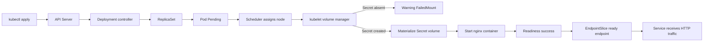

# D3-009 — FailedMount: Pod bị kẹt ContainerCreating vì thiếu Secret volume

**Domain 3 — Application Observability and Maintenance** · **Mức độ:** Intermediate · **45–60 phút** · **Namespace:** `ckad-d3-009`

## Incident: Receipt API không thể phục vụ request

Một Deployment `receipt-api` đã được apply, nhưng replica không Ready. Scheduler vẫn có thể gán Pod vào node, trong khi kubelet liên tục báo `FailedMount` vì Secret `receipt-credentials` chưa tồn tại. Container chưa khởi chạy: `kubectl logs` có thể trả về lỗi, không phải log của ứng dụng. Đây là lỗi **volume setup**, không phải CrashLoopBackOff, ErrImagePull, readiness probe hay DNS.

**Mục tiêu:** xác định bằng Pod Events, khôi phục Secret với key `token` mà không sửa image hoặc bỏ volume; đảm bảo Secret được mount read-only, Pod Ready và Service trả HTTP 200. Không đưa token thật vào Git.

## Luồng controller và node: khác với CrashLoopBackOff



```mermaid
sequenceDiagram
  autonumber
  participant Dev as Developer
  participant API as API Server
  participant DC as Deployment/ReplicaSet controllers
  participant SCH as Scheduler
  participant K as kubelet
  participant S as Secret store
  participant N as nginx container
  Dev->>API: Apply Deployment with required Secret volume
  API-->>DC: Desired replicas=1
  DC->>API: Create Pod
  SCH->>API: Bind Pod to node
  K->>API: Read Pod spec
  K->>S: Fetch Secret receipt-credentials
  S-->>K: NotFound
  K->>API: Warning FailedMount event
  Note over K,N: Container not started; application logs unavailable
  Dev->>API: Create Secret with token key
  K->>S: Retry Secret fetch
  S-->>K: Secret data
  K->>N: Mount files then start container
  N-->>K: Readiness HTTP 200
  K->>API: Pod Ready
  Note over API,N: EndpointSlice controller exposes ready endpoint
```

**Các thành phần:** Deployment/ReplicaSet controllers đảm bảo số Pod mong muốn; scheduler quyết định node; kubelet lấy Secret và chuẩn bị volume trước khi chạy container; API Server lưu Events; EndpointSlice controller phản ánh readiness để Service có backend. Secret được mount thành file, không phải biến môi trường. Secret có thể được cập nhật trong mounted volume theo cơ chế eventual consistency (ngoại trừ subPath), nhưng bài này tập trung vào Secret **bị thiếu khi Pod khởi tạo**.

## Chuẩn bị trên kind

Yêu cầu Docker Engine, kind, kubectl, Bash và image `nginx:1.27-alpine`, `busybox:1.36` có thể pull. Không chạy trên cluster production.

```bash
kind get clusters
# Chỉ chạy nếu cluster chưa có:
kind create cluster --name ckad-labs
kubectl config use-context kind-ckad-labs
kubectl apply -f setup.yaml
kubectl -n ckad-d3-009 get deployment,pods,events
kubectl -n ckad-d3-009 describe pod -l app=receipt-api
bash verify.sh   # expected FAIL trước khi sửa
```

**Bài tập tự làm:** (1) xác nhận Pod đã được schedule; (2) lọc Events `FailedMount`; (3) xác định tên Secret và key cần thiết trong Pod spec; (4) tạo Secret `receipt-credentials` với key `token` bằng giá trị giả; (5) đợi kubelet mount và Deployment Available; (6) kiểm tra file trong container và HTTP qua Service. Không sửa Deployment để xóa volume, không đặt `optional: true`, không sửa readiness probe.

```bash
kubectl -n ckad-d3-009 get pods -o wide
kubectl -n ckad-d3-009 get events --sort-by=.metadata.creationTimestamp
kubectl -n ckad-d3-009 get deploy receipt-api -o yaml
# Khi cần đáp án:
bash solution.sh
bash verify.sh
```

## Grader và negative tests

`verify.sh` chấm **9 điều kiện trên cluster thật**: context, namespace, Deployment Available, Secret, key token, volume reference non-optional, Pod Ready, file trong container, HTTP nội bộ qua Service. Không dựa vào file YAML local. Lệnh probe tạo Pod tạm thời và xóa khi kết thúc; nếu probe bị ngắt bất thường, có thể cần xóa Pod probe còn sót.

`negative-tests.sh` tạo **namespace riêng** `ckad-d3-009-negative`, triển khai Pod có Secret không tồn tại, chờ `FailedMount`, sau đó tạo Secret và xác nhận recovery. Script không xóa namespace chính. Kết quả negative test phụ thuộc kubelet phát Event và registry; nếu timeout, kiểm tra scheduler/node trước khi kết luận.

```bash
bash negative-tests.sh
bash verify.sh
```

## Troubleshooting thực tế

| Triệu chứng | Cách xác minh | Khắc phục |
|---|---|---|
| `FailedMount ... secret not found` | `describe pod`, Events | Tạo Secret đúng namespace và tên |
| Secret tồn tại nhưng Pod chưa Ready | `get secret -o jsonpath`, `describe pod` | Kiểm tra key, node và kubelet |
| `CreateContainerConfigError` | `describe pod` | Phân biệt lỗi env secretKeyRef với volume mount |
| `ImagePullBackOff` | Events reason `Failed` / image pull | Kiểm tra registry, không quy lỗi cho Secret |
| Pod Ready nhưng Service lỗi | `get endpointslices`, `get svc` | Kiểm tra selector, targetPort, readiness |
| `kubectl logs` chưa có log | `get pod -o wide`, Events | Container chưa start; ưu tiên Events |
| `verify.sh` fail ở HTTP probe | `get pods`, DNS, CoreDNS | Kiểm tra pull busybox và Service |

**Lưu ý bảo mật:** Secret base64 không phải encryption; không dùng token thật cho lab. Trong production cần RBAC tối thiểu, encryption at rest, quy trình rotation và hạn chế quyền đọc Secret.

## Dọn dẹp

```bash
kubectl delete namespace ckad-d3-009
# Không chạy kind delete cluster vì các lab dùng chung cluster.
```

## Tài liệu chính thức

- [Volumes — Secret](https://kubernetes.io/docs/concepts/storage/volumes/#secret)
- [Secrets](https://kubernetes.io/docs/concepts/configuration/secret/)
- [Debug Pods](https://kubernetes.io/docs/tasks/debug/debug-application/debug-pods/)
- [Pod Lifecycle](https://kubernetes.io/docs/concepts/workloads/pods/pod-lifecycle/)
- [EndpointSlices](https://kubernetes.io/docs/concepts/services-networking/endpoint-slices/)
- [kind quick start](https://kind.sigs.k8s.io/docs/user/quick-start/)
