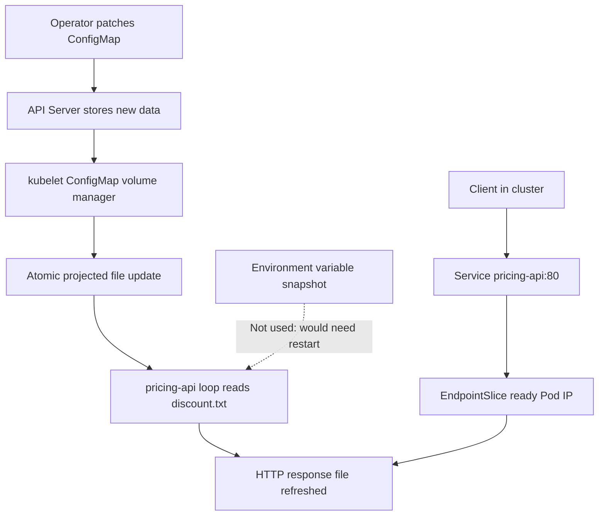

# D4-001 — ConfigMap volume: cập nhật cấu hình không restart Pod

**Domain 4 — Application Environment, Configuration and Security** · **Beginner → Intermediate** · **45–60 phút** · namespace `ckad-d4-001`

## Tình huống production

Pricing API phục vụ mức chiết khấu từ file cấu hình. Đội vận hành thay đổi chiến dịch từ 5% lên 15% nhưng muốn **giữ nguyên Pod UID**, tránh rollout không cần thiết. Ứng dụng đọc lại file định kỳ 2 giây; kubelet đồng bộ ConfigMap volume theo eventual consistency. Không được dùng `subPath`, vì ConfigMap mount qua subPath không tự cập nhật. Đây là bài về **cấu hình động**, khác D3-005 (sửa ConfigMap rồi restart ứng dụng bị crash).

**Mục tiêu:** đổi `pricing-settings.data["discount.txt"]` thành `15`; chờ volume được cập nhật; HTTP Service trả `discount=15`; giữ nguyên Pod UID và cấu hình mount read-only. Không sửa image, không tạo Pod mới, không hard-code `15` trong container.

## Kiến trúc và controller flow



```mermaid
sequenceDiagram
  autonumber
  participant O as Operator
  participant A as API Server
  participant K as kubelet
  participant P as pricing-api Pod
  participant S as Service
  participant C as HTTP client
  O->>A: kubectl patch ConfigMap discount.txt=15
  A-->>O: ConfigMap updated
  Note over A,K: Watch/cache + sync delay; not instantaneous
  K->>A: Observe new ConfigMap resourceVersion
  K->>P: Update projected volume file atomically
  loop Every 2 seconds
    P->>P: Read /etc/pricing/discount.txt
    P->>P: Rewrite /www/index.html
  end
  C->>S: GET / on port 80
  S->>P: Route to ready endpoint port 8080
  P-->>C: discount=15
  Note over P: Pod UID unchanged; no rollout
```

## Chuẩn bị trên kind

Yêu cầu Docker, kind, kubectl, Bash; cluster `kind-ckad-labs` đang chạy. Không chạy trên production.

```bash
./env/kind/up.sh
kubectl --context kind-ckad-labs apply -f setup.yaml
kubectl --context kind-ckad-labs -n ckad-d4-001 rollout status deploy/pricing-api --timeout=120s
kubectl --context kind-ckad-labs -n ckad-d4-001 get pod -l app=pricing-api -o jsonpath='{.items[0].metadata.uid}'
bash verify.sh # FAIL vì discount vẫn là 5
```

## Bài tập từng bước

1. Quan sát ConfigMap và Deployment, tìm `volumes[].configMap.name` và `volumeMounts[].mountPath`. Phân biệt volume projection với `envFrom` (env snapshot tại lúc container start).
2. Lưu Pod UID trước khi đổi cấu hình. Xác nhận endpoint trả `discount=5` từ Service.
3. Patch **chỉ** key `discount.txt` thành `15`, không restart Deployment. Chờ tối đa 2 phút cho kubelet đồng bộ volume.
4. Dùng `kubectl exec` đọc file bên trong container; dùng Pod client tạm gọi Service DNS `pricing-api.ckad-d4-001.svc.cluster.local`.
5. Chạy `verify.sh`; so sánh UID, volume mount và response. Nếu cần đáp án: `bash solution.sh`.

```bash
kubectl --context kind-ckad-labs -n ckad-d4-001 get cm pricing-settings -o yaml
kubectl --context kind-ckad-labs -n ckad-d4-001 get deploy pricing-api -o yaml
bash solution.sh
bash verify.sh
bash negative-tests.sh
```

## Chấm điểm & negative tests

`verify.sh` kiểm tra cluster context, namespace, ConfigMap data, Deployment Available, volume đúng ConfigMap, mount read-only, **không có subPath**, file thực tế trong container, HTTP qua Service, và UID Pod không đổi (so với annotation baseline của namespace do setup script tạo). Chấm bằng Kubernetes API + exec thực tế, không đọc YAML local để quyết định pass.

`negative-tests.sh` chạy trong namespace riêng: chứng minh ConfigMap qua `subPath` giữ giá trị cũ sau khi patch, trong khi volume bình thường cập nhật. Nếu timeout do image pull hoặc kubelet sync, test báo FAIL và giữ log chẩn đoán; namespace negative được dọn bằng trap.

## Troubleshooting

| Hiện tượng | Nguyên nhân khả dĩ | Lệnh chẩn đoán |
|---|---|---|
| ConfigMap mới nhưng file cũ | kubelet sync delay | `kubectl get cm -o yaml`, `kubectl exec -- cat /etc/pricing/discount.txt` |
| File đúng nhưng HTTP cũ | ứng dụng cache hoặc loop chưa chạy | `kubectl logs deploy/pricing-api`, `kubectl exec -- cat /www/index.html` |
| Không thấy cập nhật | mount qua subPath | `kubectl get deploy -o yaml` |
| Pod UID thay đổi | rollout/recreate ngoài yêu cầu | `kubectl get pod -o jsonpath` |
| Service không trả HTTP | selector, EndpointSlice hoặc DNS | `kubectl get svc,endpointslices,pods` |
| ImagePullBackOff | registry chưa sẵn sàng | `kubectl describe pod` |

**Production trade-off:** ConfigMap không mã hóa dữ liệu bí mật; dùng Secret cho credential. Thời gian propagation không có SLA tức thời. Ứng dụng phải chủ động reload file hoặc watch; một số ứng dụng chỉ đọc cấu hình khi startup và vẫn cần rollout. Dùng checksum annotation khi muốn rollout có kiểm soát.

## Dọn dẹp

```bash
kubectl --context kind-ckad-labs delete ns ckad-d4-001
```

## Tài liệu chính thức

- [ConfigMaps](https://kubernetes.io/docs/concepts/configuration/configmap/)
- [Configure Pod with ConfigMap](https://kubernetes.io/docs/tasks/configure-pod-container/configure-pod-configmap/)
- [Volumes — ConfigMap](https://kubernetes.io/docs/concepts/storage/volumes/#configmap)
- [Services](https://kubernetes.io/docs/concepts/services-networking/service/)
- [kind quick start](https://kind.sigs.k8s.io/docs/user/quick-start/)
