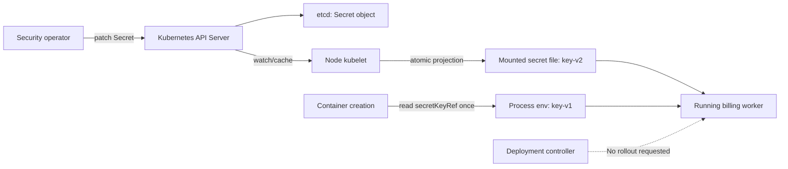

# D4-002 — Secret rotation: env snapshot và projected volume

**Domain 4 — Application Environment, Configuration and Security** · Intermediate · 45–60 phút · namespace `ckad-d4-002`

## Bối cảnh thực tế

Billing worker sử dụng API key từ Kubernetes Secret. Security team xoay vòng credential từ `key-v1` sang `key-v2` mà không muốn restart process ngay. Pod đang đọc cùng một Secret bằng **hai cách khác nhau**: biến môi trường `BOOT_API_KEY` (snapshot khi container khởi động) và file `/var/run/credentials/api-key` (projected Secret volume được kubelet cập nhật theo eventual consistency).

**Khác D3-009:** Secret ở đây tồn tại từ đầu; mục tiêu là hiểu vòng đời credential và giới hạn hot reload, không phải sửa lỗi FailedMount.

## Mục tiêu và điều kiện đạt

- Chỉ cập nhật Secret `billing-credentials` thành `key-v2`; không restart Deployment/Pod.
- Pod UID không thay đổi so với baseline mà `setup.sh` ghi vào annotation của namespace.
- File trong Pod chuyển sang `key-v2` trong khoảng thời gian chờ; `BOOT_API_KEY` vẫn là `key-v1`.
- Volume read-only, không dùng `subPath`; Deployment vẫn Available.
- `verify.sh` chấm dựa trên Kubernetes API và `kubectl exec`, không dựa trên YAML local.

## Controller flow



```mermaid
sequenceDiagram
  autonumber
  participant O as Operator
  participant API as API Server
  participant K as kubelet
  participant P as Existing Pod
  O->>API: PATCH Secret api-key=key-v2
  API-->>O: Secret updated
  K->>API: Observe Secret resourceVersion
  K->>P: Refresh projected file via atomic writer
  O->>P: kubectl exec cat /var/run/credentials/api-key
  P-->>O: key-v2
  O->>P: kubectl exec printenv BOOT_API_KEY
  P-->>O: key-v1
  Note over P: UID unchanged; env cannot refresh in running process
```

## Thực hành trên kind

Chỉ chạy trên cluster học tập, không dùng production. Cần Docker, kind, kubectl, bash và quyền tạo namespace. Tại repo root:

```bash
./env/kind/up.sh
cd domains/04-application-environment-configuration-and-security/labs/002-secret-rotation-env-vs-volume
bash setup.sh
bash verify.sh  # expected FAIL: Secret still key-v1
kubectl --context kind-ckad-labs -n ckad-d4-002 get secret billing-credentials -o yaml
kubectl --context kind-ckad-labs -n ckad-d4-002 get pods -o wide
```

**Bài tập:** (1) đọc Deployment, xác định `secretKeyRef` và `volumes[].secret`; (2) lưu baseline UID và đọc giá trị ban đầu trong Pod; (3) patch `stringData.api-key` thành `key-v2` mà không rollout; (4) quan sát giá trị file và env riêng biệt; (5) chạy auto-grader. Đáp án và negative test:

```bash
bash solution.sh
bash verify.sh
bash negative-tests.sh
kubectl --context kind-ckad-labs delete namespace ckad-d4-002
```

## Giải thích kết quả

Secret object đã đổi **không có nghĩa** mọi process đang chạy đều sử dụng credential mới. Kubelet cập nhật projected volume bất đồng bộ, còn environment variables được thiết lập khi container start. Ứng dụng phải tự đọc lại file hoặc có reload mechanism; bài này chứng minh trạng thái file chứ không giả định ứng dụng tự thay credential. Dùng `subPath` sẽ không nhận bản cập nhật volume tự động.

Trong production, không in API key thật ra logs; bài dùng chuỗi giả `key-v1`/`key-v2` để kiểm tra. Quyền đọc Secret phải hạn chế qua RBAC, và nên cấu hình encryption at rest phù hợp. Secret base64 không phải mã hóa.

## Negative tests

`negative-tests.sh` xác nhận **phủ định có chủ đích**: dù Secret đã rotate, env của Pod đang chạy vẫn là `key-v1`. Đồng thời kiểm tra key không tồn tại không tự sinh ra. Script không phá Pod và không tạo namespace phụ. `verify.sh` trả mã khác 0 khi chưa rotate, Pod bị recreate, mount sai hoặc volume chưa cập nhật.

## Troubleshooting

| Triệu chứng | Nguyên nhân | Cách kiểm tra |
|---|---|---|
| Pod Pending / CreateContainerConfigError | Secret hoặc key thiếu lúc khởi động | `kubectl describe pod` và Events |
| Secret mới, file vẫn cũ | kubelet cache/sync delay | `kubectl exec -- cat /var/run/credentials/api-key` và chờ |
| Env vẫn cũ | hành vi snapshot bình thường | `kubectl exec -- printenv BOOT_API_KEY` |
| Volume không đổi mãi | mount dùng subPath | `kubectl get deploy -o yaml` |
| Verify báo UID changed | Pod đã bị rollout/recreate | `kubectl get pod -o jsonpath` |
| ImagePullBackOff | image chưa pull được | `kubectl describe pod` |

## Tài liệu chính thức

- [Kubernetes Secrets](https://kubernetes.io/docs/concepts/configuration/secret/)
- [Distribute credentials securely using Secrets](https://kubernetes.io/docs/tasks/inject-data-application/distribute-credentials-secure/)
- [Secret volume updates and subPath limitation](https://kubernetes.io/docs/concepts/configuration/secret/#using-secrets-as-files-from-a-pod)
- [kind Quick Start](https://kind.sigs.k8s.io/docs/user/quick-start/)
