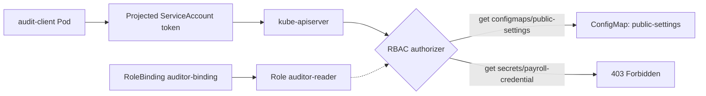
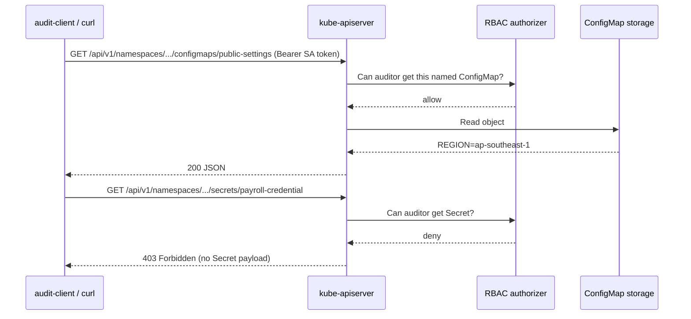

# D4-003 — ServiceAccount & RBAC: ngăn audit worker đọc Secret

**Domain 4 · CKAD · Security · kind Kubernetes-in-Docker**. Đây là lab mới, độc lập trong namespace `ckad-d4-003`; không yêu cầu cloud hay cluster-admin cho ứng dụng (người thiết lập cần quyền tạo Role/RoleBinding).

## Bối cảnh production

Một ứng dụng kiểm toán đọc `public-settings` từ Kubernetes API để kiểm tra vùng triển khai. Nhóm platform vô tình cấp Role có quyền `get,list` trên **cả ConfigMap và Secret**. Nếu container bị xâm nhập, token của ServiceAccount có thể bị dùng để đọc `payroll-credential`. Mục tiêu: giữ nguyên Pod và ServiceAccount, chỉ cho phép **get đúng ConfigMap public-settings**, không cho phép list hay đọc Secret.

Khác với D4-001 (hot reload ConfigMap) và D4-002 (Secret rotation), bài này tập trung vào **authorization RBAC và blast radius của token**.

## Mục tiêu & tiêu chí

1. Pod `audit-client` chạy dưới ServiceAccount `auditor` trong namespace riêng.
2. Role `auditor-reader` chỉ chứa một rule: apiGroup core, resource `configmaps`, `resourceNames: [public-settings]`, verb `get`.
3. RoleBinding trỏ đúng Role và ServiceAccount; không tạo ClusterRoleBinding.
4. Kubernetes SubjectAccessReview cho phép đọc ConfigMap đích, từ chối đọc ConfigMap khác, list ConfigMaps, đọc Secret và create Pod.
5. **Gọi Kubernetes API thực sự từ Pod** bằng token được mount: HTTP 200 với ConfigMap đích và HTTP 403 với Secret.

## Kiến trúc





## Chuẩn bị kind và triển khai lỗi

Cần Docker, kind, kubectl và image pull tới Docker Hub. Không tạo cluster nếu đã có một kind cluster dùng được:

```bash
kind create cluster --name ckad-labs # chỉ chạy nếu chưa có
kubectl config use-context kind-ckad-labs
cd domains/04-application-environment-configuration-and-security/labs/003-serviceaccount-rbac-least-privilege
kubectl apply -f setup.yaml
kubectl -n ckad-d4-003 wait --for=condition=Ready pod/audit-client --timeout=180s
kubectl -n ckad-d4-003 get sa,role,rolebinding,pod
```

Lưu ý: `setup.yaml` cố ý chứa Role **quá rộng**. Không áp dụng trong namespace thật. Secret chỉ là dữ liệu giả.

## Thực hành: phát hiện và sửa

Trước tiên quan sát authorization của ServiceAccount, không dùng quyền của tài khoản admin đang chạy kubectl:

```bash
kubectl auth can-i get secret/payroll-credential -n ckad-d4-003 --as=system:serviceaccount:ckad-d4-003:auditor
kubectl auth can-i list configmaps -n ckad-d4-003 --as=system:serviceaccount:ckad-d4-003:auditor
kubectl -n ckad-d4-003 describe role auditor-reader
kubectl -n ckad-d4-003 get rolebinding auditor-binding -o yaml
```

Hai lệnh `can-i` đầu phải trả `yes` ở trạng thái lỗi. Thử sửa thủ công bằng `kubectl edit role auditor-reader -n ckad-d4-003`: xóa resource secrets, verb list và thêm resourceNames chỉ chứa public-settings. Hoặc dùng đáp án:

```bash
bash solution.sh
bash verify.sh
bash negative-tests.sh
```

`verify.sh` có 11 checks, đọc tài nguyên thật từ API server và gọi HTTP trực tiếp bên trong Pod. Exit 0 chỉ khi tất cả đều pass. `negative-tests.sh` cố ý cấp lại quyền Secret, bỏ ràng buộc resourceNames, và gán sai RoleBinding; mỗi lần phải khiến verifier thất bại, sau đó khôi phục Role.

## Troubleshooting

| Triệu chứng | Chẩn đoán | Hướng xử lý |
|---|---|---|
| `ImagePullBackOff` | Docker Hub không truy cập được | Kiểm tra mạng / image cache trong kind |
| Pod `Pending` | Node thiếu tài nguyên | `kubectl describe pod -n ckad-d4-003 audit-client` |
| `403` cả ConfigMap | RoleBinding sai SA, Role sai resourceName | Kiểm tra `kubectl auth can-i` với `--as` |
| `200` với Secret | Role còn cấp quyền Secret | Xóa rule dư; chạy lại verifier |
| `401` từ Pod | Token không mount/không hợp lệ | Kiểm tra `serviceAccountName` và token volume |
| Verifier không exec được | Pod chưa Ready | `kubectl wait --for=condition=Ready pod/audit-client` |

**Trade-off:** `resourceNames` chỉ giới hạn các request có tên; `list/watch` cần field selector `metadata.name` tương ứng, vì vậy lab cấm hẳn `list`. RBAC là cơ chế cấp quyền, không phải mã hóa Secret. Ứng dụng production nên dùng quyền tối thiểu và không mount token khi không cần.

## Dọn dẹp

```bash
kubectl delete namespace ckad-d4-003
```

Không xóa kind cluster hoặc namespace của các lab khác.

## Tài liệu chính thức

- [Using RBAC Authorization](https://kubernetes.io/docs/reference/access-authn-authz/rbac/)
- [Configure Service Accounts for Pods](https://kubernetes.io/docs/tasks/configure-pod-container/configure-service-account/)
- [Good practices for Kubernetes Secrets](https://kubernetes.io/docs/concepts/security/secrets-good-practices/)
- [Debugging Kubernetes authorization](https://kubernetes.io/docs/reference/access-authn-authz/authorization/)
