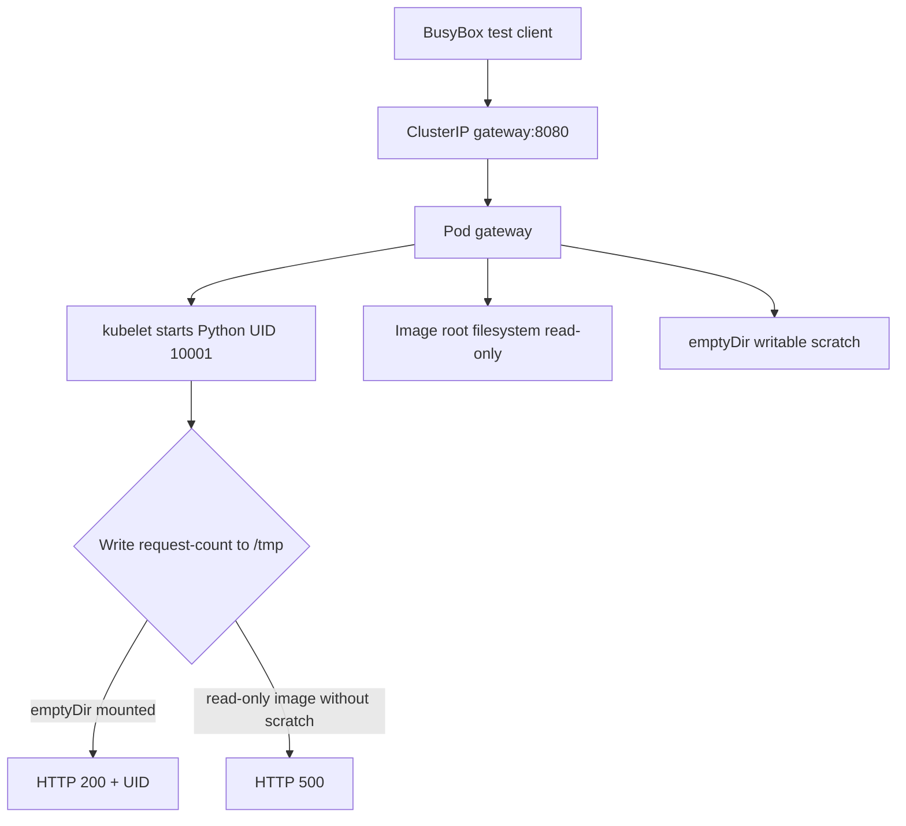
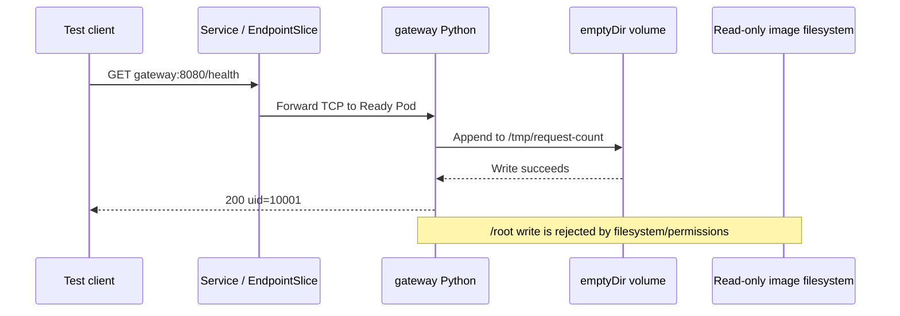

# D4-004 — Harden container: non-root, read-only rootfs và writable scratch

**Domain 4 · CKAD · kind · Namespace: `ckad-d4-004`**

## Tình huống production

Một gateway nội bộ chạy Python mặc định dưới UID 0, có quyền ghi vào filesystem của image. Nếu ứng dụng bị khai thác, kẻ tấn công có thể sửa file trong container và tăng mức độ ảnh hưởng. Nhóm bảo mật yêu cầu **chạy UID 10001**, cấm privilege escalation, bỏ Linux capabilities, bật RuntimeDefault seccomp và khóa root filesystem. Nhưng gateway vẫn cần ghi bộ đếm request tại `/tmp/request-count`: bật read-only mà quên mount scratch sẽ khiến health endpoint trả HTTP 500.

**Khác D4-003:** bài trước kiểm tra RBAC tới Kubernetes API; bài này kiểm tra Linux process identity, filesystem isolation và request HTTP thật.

## Mục tiêu

- Deployment `gateway` có 1 replica Ready, container thực thi với UID/GID 10001.
- Pod securityContext: `runAsNonRoot=true`, `runAsUser=10001`, `runAsGroup=10001`, `seccompProfile.type=RuntimeDefault`.
- Container securityContext: `readOnlyRootFilesystem=true`, `allowPrivilegeEscalation=false`, `capabilities.drop=[ALL]`.
- Mount `emptyDir` vào `/tmp` để ghi tạm, trong khi đường dẫn `/root` không thể ghi.
- HTTP `GET /health` qua Service `gateway:8080` trả 200, body chứa `uid=10001`.

## Luồng thành phần





## Chuẩn bị

Yêu cầu Docker, kind, kubectl, Python 3 trên máy chạy verifier và truy cập registry để tải `python:3.12-alpine`, `busybox:1.36`.

```bash
kind create cluster --name ckad-labs # chỉ nếu chưa có cluster
kubectl config use-context kind-ckad-labs
cd domains/04-application-environment-configuration-and-security/labs/004-security-context-nonroot-readonly
kubectl apply -f setup.yaml
kubectl -n ckad-d4-004 rollout status deploy/gateway --timeout=180s
kubectl -n ckad-d4-004 get pod,deploy,svc
```

Manifest ban đầu cố ý chưa hardened. Không dùng namespace production.

## Thực hành

1. Xem spec: `kubectl -n ckad-d4-004 get deploy gateway -o yaml`.
2. Kiểm tra UID ban đầu: `kubectl -n ckad-d4-004 exec deploy/gateway -- id -u`.
3. Sửa Deployment với `kubectl edit deploy gateway -n ckad-d4-004`, áp dụng các mục tiêu securityContext.
4. Tạo `emptyDir` tên `tmp`, mount vào `/tmp` trong container. Không dùng hostPath hoặc privileged.
5. Quan sát rollout và tự chấm:

```bash
bash solution.sh       # đáp án tham khảo, cũng gọi verifier
bash verify.sh         # đọc Deployment và trạng thái Pod, exec + HTTP thật
bash negative-tests.sh # cố ý tạo cấu hình sai và chứng minh verifier từ chối
```

**Lưu ý:** `solution.sh` làm thay đổi Deployment; nếu muốn tự giải, chỉ chạy `verify.sh` sau khi sửa. `negative-tests.sh` làm thay đổi trạng thái lab rồi khôi phục bằng solution; không chạy song song với bài khác.

## Troubleshooting

| Triệu chứng | Nguyên nhân | Cách xác minh |
|---|---|---|
| `CreateContainerConfigError` | non-root không phù hợp UID image | `kubectl describe pod`; đặt runAsUser 10001 |
| `Readiness probe failed: 500` | /tmp không writable | `kubectl logs deploy/gateway`; kiểm tra volumeMount |
| `Permission denied` | ghi nhầm rootfs | `kubectl exec ... -- id`; kiểm tra mount |
| `ImagePullBackOff` | registry/mạng | `kubectl describe pod`; tải image trước |
| `kubectl run probe` lỗi | không kéo được busybox hoặc DNS | `kubectl get endpointslice -n ckad-d4-004`; kiểm tra CoreDNS |
| Pod chưa Ready | container crash, thiếu volume | `kubectl get events -n ckad-d4-004 --sort-by=.lastTimestamp` |

**Trade-off:** read-only rootfs không có nghĩa mọi volume đều read-only. `emptyDir` sống theo vòng đời Pod, không dùng cho dữ liệu bền vững. `runAsNonRoot` giảm rủi ro nhưng không thay thế network policy, RBAC hoặc image scanning.

## Dọn dẹp

```bash
kubectl delete namespace ckad-d4-004
```

## Tài liệu chính thức

- [Configure a Security Context](https://kubernetes.io/docs/tasks/configure-pod-container/security-context/)
- [Pod Security Standards](https://kubernetes.io/docs/concepts/security/pod-security-standards/)
- [Volumes: emptyDir](https://kubernetes.io/docs/concepts/storage/volumes/#emptydir)
- [Debug Running Pods](https://kubernetes.io/docs/tasks/debug/debug-application/debug-running-pod/)
