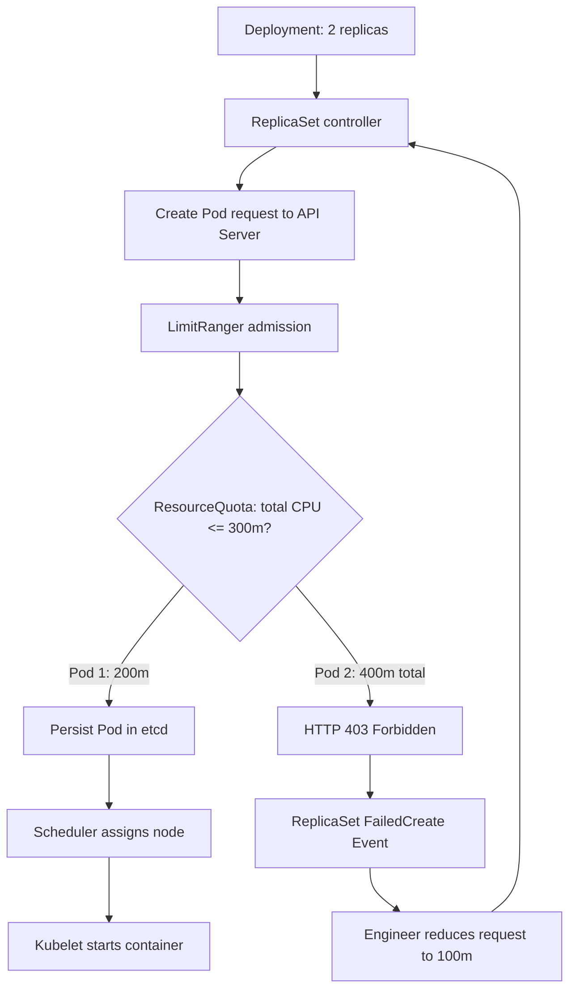
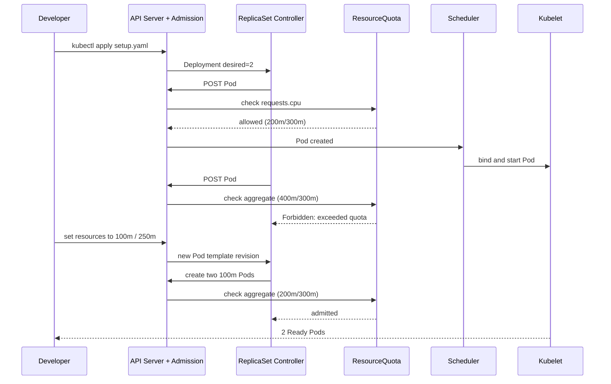

# D4-005 — ResourceQuota và LimitRange: Deployment chỉ tạo được một Pod

**Domain:** Application Environment, Configuration and Security · **Mức độ:** Intermediate · **Thời gian:** 25–35 phút

## Tình huống production
Team báo cáo triển khai `report-api` với 2 replicas. Một replica chạy được, replica còn lại không được tạo; Deployment không đạt desired state. Node vẫn còn CPU. Nguyên nhân không phải scheduler: **API admission** từ ResourceQuota từ chối Pod thứ hai do tổng `requests.cpu` vượt ngân sách namespace.

Namespace riêng `ckad-d4-005` có LimitRange mặc định 100m CPU / 64Mi request, tối đa 1 CPU mỗi container; ResourceQuota tổng 300m CPU requests, 192Mi memory requests, 3 Pods. Manifest Deployment ban đầu yêu cầu **200m CPU/Pod** → 2 Pods cần 400m, vượt quota.

## Mục tiêu
1. Phân biệt admission rejection (không tạo Pod) với Pending/FailedScheduling (Pod đã tồn tại).
2. Quan sát `kubectl describe replicaset` và Events, `kubectl describe quota`, `kubectl describe limitrange`.
3. Điều chỉnh requests/limits để có **2/2 Ready**, vẫn giữ 2 replicas, không tăng quota, không xóa LimitRange, không đổi image.
4. Chứng minh quota thực sự từ chối workload vượt ngân sách.

## Luồng admission và controller





> Lưu ý: admission áp dụng theo mỗi lần tạo Pod. Quota có thể chặn Pod trước khi scheduler nhìn thấy. Controller retry và tạo Events tại ReplicaSet; không nên chỉ xem `kubectl get pods`.

## Chuẩn bị kind

Yêu cầu Docker, kind, kubectl. Tạo cluster nếu chưa có:

```bash
kind create cluster --name ckad
kubectl config use-context kind-ckad
kubectl cluster-info
```

Lab dùng namespace độc lập, không sửa namespace của lab khác.

## Thực hành

```bash
bash setup.sh
kubectl -n ckad-d4-005 get deploy,rs,pods
kubectl -n ckad-d4-005 describe rs -l app=report-api
kubectl -n ckad-d4-005 describe resourcequota team-budget
kubectl -n ckad-d4-005 describe limitrange workload-defaults
kubectl -n ckad-d4-005 get events --sort-by=.lastTimestamp
```

**Nhiệm vụ:** giữ quota nguyên vẹn; cấu hình container `web` requests `cpu=100m,memory=64Mi`, limits `cpu=250m,memory=128Mi`. Kiểm tra 2 replicas Ready, EndpointSlice có backend.

```bash
bash solution.sh
bash verify.sh
bash negative-tests.sh
kubectl -n ckad-d4-005 port-forward service/report-api 8080:80
# terminal khác: curl -I http://127.0.0.1:8080/
```

### Vì sao không sửa quota?
Tăng quota có thể che giấu request quá lớn. CPU request dùng cho scheduling và quota accounting; CPU limit có thể gây throttling. Cần dựa trên metrics thực tế để chọn request phù hợp, không tùy tiện giảm ở production.

### Negative tests
- Tạo Pod thêm với request 200m khi hai Pod đã dùng 200m → quota từ chối (tổng 400m > 300m).
- Tạo Pod request/limit 1200m → vượt LimitRange max 1 CPU.
- Nếu chỉ tăng replicas lên 3 hoặc xóa quota để qua bài, `verify.sh` không được xem là giải pháp hợp lệ.

### Troubleshooting
| Triệu chứng | Kiểm tra | Hướng xử lý |
|---|---|---|
| 1/2 Ready, không thấy Pod thứ hai | `kubectl describe rs` | Tìm `FailedCreate` và `exceeded quota` |
| Pod Pending | `kubectl describe pod` | Phân biệt scheduler thiếu CPU với quota admission |
| `Forbidden: maximum cpu usage` | `kubectl describe limitrange` | Giảm limit về ≤1 CPU |
| `verify.sh` fail EndpointSlice | `kubectl get svc,endpointslice -n ckad-d4-005` | Kiểm tra selector và readiness |
| Rollout chưa ổn định | `kubectl rollout status` | Đợi image pull; xem Events |

### Dọn dẹp
```bash
kubectl delete namespace ckad-d4-005
```

### Tài liệu chính thức
- [Resource Quotas](https://kubernetes.io/docs/concepts/policy/resource-quotas/)
- [Limit Ranges](https://kubernetes.io/docs/concepts/policy/limit-range/)
- [Resource Management for Pods and Containers](https://kubernetes.io/docs/concepts/configuration/manage-resources-containers/)
- [Deployments](https://kubernetes.io/docs/concepts/workloads/controllers/deployment/)
- [kind Quick Start](https://kind.sigs.k8s.io/docs/user/quick-start/)
