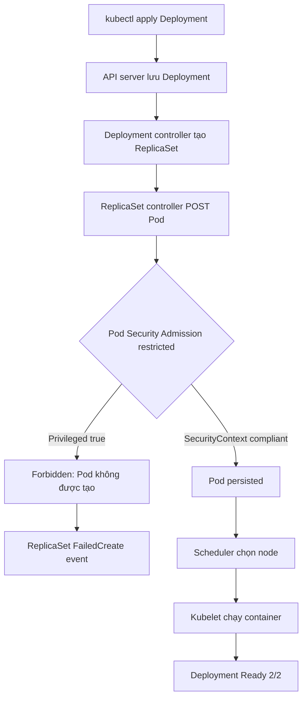
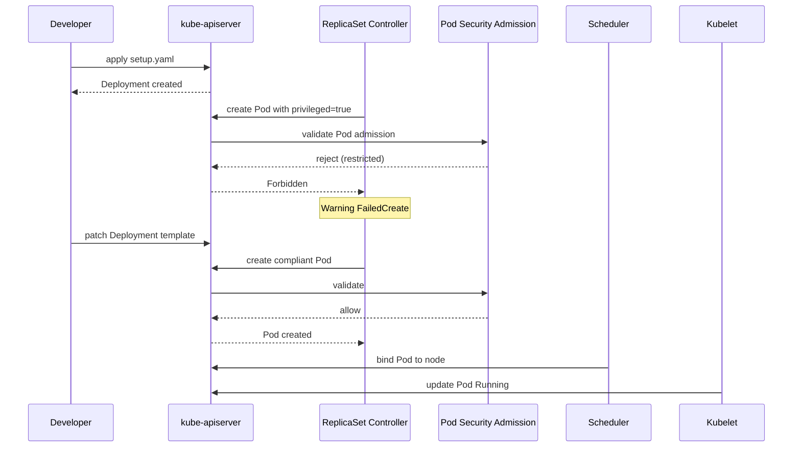

# D4-006 — Pod Security Admission: restricted policy

**Domain:** Application Environment, Configuration and Security · **Mức độ:** trung cấp · **Thời gian:** 30–45 phút.

## Sự cố production
Đội payments áp dụng nhãn `pod-security.kubernetes.io/enforce=restricted` cho namespace. Deployment `payments-api` vẫn khai báo `privileged: true`. API server chấp nhận Deployment object nhưng **ReplicaSet controller không tạo được Pod**: Pod admission từ chối, khiến `READY 0/2`. Đây là lỗi **admission** chứ không phải lỗi scheduler hay CrashLoopBackOff.

## Mục tiêu
Giữ nguyên namespace và nhãn enforce restricted; sửa Pod template để đạt 2/2 Ready mà không bỏ policy. Bắt buộc `runAsNonRoot=true`, `runAsUser=10001`, `seccompProfile=RuntimeDefault`, `allowPrivilegeEscalation=false`, `privileged=false`, `capabilities.drop=[ALL]`. Không được nới nhãn sang baseline hoặc privileged.

## Luồng điều khiển




## Chuẩn bị
Cần Docker, kind, kubectl và cluster kind đang hoạt động. Ví dụ:
```bash
kind create cluster --name ckad
kubectl config use-context kind-ckad
kubectl apply -f setup.yaml
kubectl -n ckad-d4-006 get deployment,rs,pods
kubectl -n ckad-d4-006 describe rs -l app=payments-api
kubectl -n ckad-d4-006 get events --sort-by=.lastTimestamp
```
Namespace `ckad-d4-006` được tạo riêng; chỉ cleanup namespace này. `setup.yaml` cố ý chứa lỗi. Container demo chạy vòng lặp thay vì HTTP; Service chỉ dùng làm tài nguyên nền, **không kiểm thử HTTP**.

## Thực hành
1. Xác nhận `kubectl apply` không có nghĩa là Pod đã được admission chấp nhận. Xem `Deployment`, `ReplicaSet`, Events và lý do `FailedCreate`.
2. Đọc policy của namespace bằng `kubectl get ns ckad-d4-006 --show-labels`.
3. Sửa **Pod template**, không sửa policy. Có thể tự patch theo yêu cầu rồi chạy `kubectl rollout status`. Nếu cần đáp án: `bash solution.sh`.
4. Chạy `bash verify.sh` để chấm dựa trên object và Pod thật. Chạy `bash negative-tests.sh` để chứng minh Pod privileged vẫn bị admission từ chối.
5. Cleanup: `kubectl delete namespace ckad-d4-006`.

## Vì sao từng field quan trọng?
- `runAsNonRoot` buộc container chạy non-root; UID cụ thể giúp audit dễ hơn.
- `seccompProfile: RuntimeDefault` áp dụng profile syscall mặc định.
- `allowPrivilegeEscalation: false` chặn nâng quyền qua setuid/setgid.
- `capabilities.drop: [ALL]` loại bỏ Linux capabilities mặc định.
- `privileged: false` tránh bypass nhiều cơ chế cách ly.
- `readOnlyRootFilesystem` là hardening bổ sung, không phải yêu cầu bắt buộc của Restricted PSA.
- Pod Security Admission chỉ đánh giá Pod khi được tạo/cập nhật; nó không tự sửa Pod đang chạy và không thay thế RBAC hay NetworkPolicy.

## Negative tests và troubleshooting
- **Bỏ `allowPrivilegeEscalation=false`**: ReplicaSet tiếp tục báo FailedCreate.
- **Thiếu seccomp RuntimeDefault/Localhost**: Restricted từ chối Pod.
- **Chạy privileged=true**: `negative-tests.sh` phải nhận lỗi admission.
- **Deployment tồn tại nhưng không có Pod**: xem `kubectl describe rs`, không chỉ xem logs (không có container để lấy logs).
- **Không thấy FailedCreate**: kiểm tra đúng context, namespace, nhãn policy và tuổi Events.
- **Ready không đạt 2/2**: xem `kubectl describe pod`, `kubectl get events`, khả năng kéo image hoặc tài nguyên node. Không nhầm các lỗi này với admission.

## Tài liệu chính thức
- [Pod Security Admission](https://kubernetes.io/docs/concepts/security/pod-security-admission/)
- [Pod Security Standards](https://kubernetes.io/docs/concepts/security/pod-security-standards/)
- [Configure a Security Context](https://kubernetes.io/docs/tasks/configure-pod-container/security-context/)
- [Debug Running Pods](https://kubernetes.io/docs/tasks/debug/debug-application/debug-running-pod/)
- [kind Quick Start](https://kind.sigs.k8s.io/docs/user/quick-start/)

**Giới hạn kiểm thử:** Chỉ công bố end-to-end pass sau khi chạy thật trên kind. `verify.sh` kiểm tra các trạng thái Kubernetes và cấu hình bảo mật; không kiểm thử HTTP.
