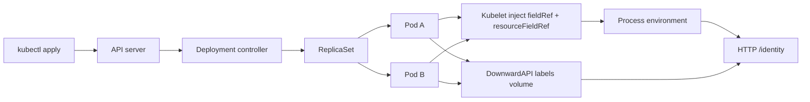
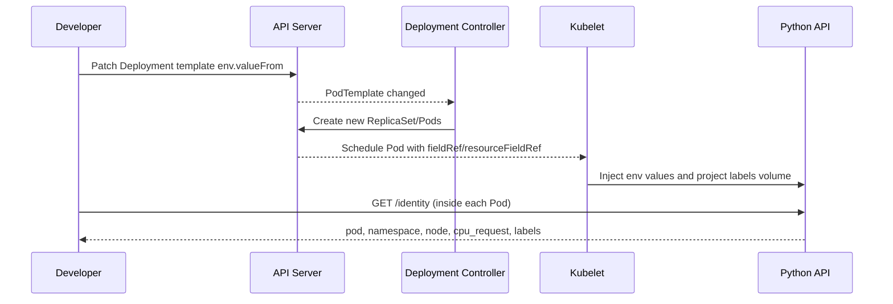

# D4-007 — Downward API: Pod identity và CPU request trong ứng dụng

**Domain:** Application Environment, Configuration and Security · **Độ khó:** Cơ bản → trung cấp · **Thời gian:** 25–35 phút

## Tình huống production

Một `identity-api` có 2 replicas phục vụ yêu cầu nội bộ. Log cần gắn chính xác Pod, namespace, node và CPU request để điều tra sự cố. Developer đang hard-code `POD_NAME=hardcoded-pod`, `POD_NAMESPACE=default` và `CPU_REQUEST=unknown`: khi Deployment scale, mọi replica tự nhận cùng một danh tính. Không được dùng Kubernetes API token, hard-code tên Pod hay sửa mã Python. Hãy sử dụng **Downward API**: `fieldRef` cho metadata và node, `resourceFieldRef` cho requests.cpu; labels tiếp tục được mount qua `downwardAPI` volume.

## Kiến trúc và luồng





## Yêu cầu đầu ra

1. Hai Pod Ready, namespace riêng `ckad-d4-007`.
2. `POD_NAME` lấy `metadata.name`, `POD_NAMESPACE` lấy `metadata.namespace`, `NODE_NAME` lấy `spec.nodeName` bằng `valueFrom.fieldRef`.
3. `CPU_REQUEST` lấy `requests.cpu` qua `valueFrom.resourceFieldRef`, `containerName: api`, `divisor: 1m`. Với `requests.cpu: 50m`, process nhận `50`.
4. Volume `/etc/podinfo/labels` giữ nguyên; HTTP trả đúng labels của Pod. Không sửa ConfigMap mã nguồn.

## Thực hành trên kind (Kubernetes-in-Docker)

Yêu cầu Docker daemon, kind, kubectl, python3 và quyền truy cập cluster. Dùng cluster đang có hoặc tạo riêng:

```bash
kind create cluster --name ckad-labs
kubectl cluster-info --context kind-ckad-labs
kubectl apply -f setup.yaml
kubectl -n ckad-d4-007 rollout status deploy/identity-api --timeout=180s
kubectl -n ckad-d4-007 get pods -o wide
kubectl -n ckad-d4-007 get deploy identity-api -o yaml
```

**Baseline lỗi:** `kubectl -n ckad-d4-007 exec deploy/identity-api -- python -c "import urllib.request; print(urllib.request.urlopen('http://127.0.0.1:8080/identity').read().decode())"` cho thấy tên Pod hard-code và namespace sai. `bash verify.sh` phải FAIL trước khi sửa.

## Tự giải

Sửa **Deployment Pod template** tại `spec.template.spec.containers[name=api].env`, thay `value` bằng `valueFrom`. Ví dụ cho `POD_NAME`:

```yaml
- name: POD_NAME
  valueFrom:
    fieldRef:
      fieldPath: metadata.name
```

Đối với `CPU_REQUEST`, sử dụng `resourceFieldRef`, chỉ rõ `containerName: api`, `resource: requests.cpu`, `divisor: 1m`. Kubernetes không cho đồng thời `value` và `valueFrom` trên cùng biến. Sau khi patch, Deployment sẽ rollout Pod mới. Quan sát từng Pod để xác nhận identity khác nhau.

## Lời giải, chấm điểm, negative tests

```bash
bash solution.sh
bash verify.sh
bash negative-tests.sh
```

`verify.sh` không so sánh file YAML tĩnh: nó kiểm tra Deployment spec, trạng thái 2 Pod thật, thực thi HTTP bên trong **từng Pod** và so sánh dữ liệu trả về với Kubernetes Pod metadata/node, CPU request và labels. Negative test 1 hard-code `POD_NAME`; test 2 hard-code `CPU_REQUEST`; cả hai phải bị grader từ chối rồi khôi phục bằng solution. **Lưu ý:** negative tests thay đổi Deployment thật, chỉ chạy trong namespace lab.

## Troubleshooting

| Triệu chứng | Nguyên nhân thường gặp | Lệnh kiểm tra |
|---|---|---|
| Deployment không rollout | YAML patch không hợp lệ hoặc image pull lỗi | `kubectl -n ckad-d4-007 describe pod -l app=identity-api` |
| `POD_NAME` vẫn hard-code | `value` chưa được thay bằng `valueFrom` | `kubectl -n ckad-d4-007 get deploy identity-api -o yaml` |
| CPU trả `50` thay vì `50m` | `divisor: 1m` chuyển giá trị sang millicores | `kubectl -n ckad-d4-007 exec deploy/identity-api -- printenv CPU_REQUEST` |
| labels không đổi ngay | projected volume cập nhật theo chu kỳ kubelet | `kubectl -n ckad-d4-007 exec deploy/identity-api -- cat /etc/podinfo/labels` |
| Pod không chạy | kind chưa có node/không kéo được image | `kubectl get nodes; kubectl -n ckad-d4-007 get events --sort-by=.lastTimestamp` |

**Tradeoffs:** env Downward API được xác định khi container khởi động, không cập nhật live; projected Downward API volume có thể phản ánh thay đổi labels sau độ trễ đồng bộ kubelet. Không dùng Downward API để đọc arbitrary resource hoặc Secret. `spec.nodeName` chỉ có giá trị khi Pod được gán node.

## Dọn dẹp

```bash
kubectl delete namespace ckad-d4-007
# Chỉ xóa cluster nếu bạn tự tạo riêng cho lab:
# kind delete cluster --name ckad-labs
```

## Tài liệu chính thức

- [Expose Pod Information to Containers Through Environment Variables](https://kubernetes.io/docs/tasks/inject-data-application/environment-variable-expose-pod-information/)
- [Expose Pod Information Through Files](https://kubernetes.io/docs/tasks/inject-data-application/downward-api-volume-expose-pod-information/)
- [Downward API](https://kubernetes.io/docs/concepts/workloads/pods/downward-api/)
- [Resource Management for Pods and Containers](https://kubernetes.io/docs/concepts/configuration/manage-resources-containers/)
