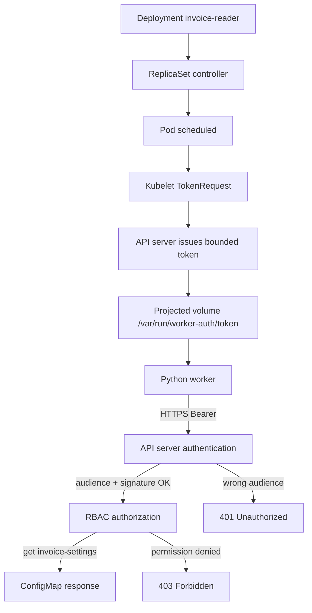

# D4-008 — ServiceAccount Token Projection: audience, automount và API authentication

**Domain 4 · Trung cấp · 35–50 phút · Namespace:** `ckad-d4-008`

## Sự cố production
Một worker `invoice-reader` gọi Kubernetes API để đọc ConfigMap `invoice-settings`. Sau đợt hardening, Pod được cấu hình `automountServiceAccountToken: false` để tránh tự động mount credential. Ứng dụng báo `401 Unauthorized` vì không còn token. Một developer đề nghị bật lại automount mặc định hoặc gán `cluster-admin` — **không được làm**. Nhiệm vụ là mount một **projected ServiceAccount token** có `audience: https://kubernetes.default.svc`, `expirationSeconds: 3600` và `path: token`, chỉ cho container đọc đúng token này; giữ nguyên RBAC least privilege.

Khác với D4-003 (RBAC authorization), bài này tập trung vào **authentication và token projection**: token hợp lệ nhưng audience sai dẫn tới 401, còn token đúng audience nhưng thiếu Role dẫn tới 403. Token projected được kubelet luân chuyển tự động trước khi hết hạn. Không tạo Secret loại `kubernetes.io/service-account-token`.

## Kiến trúc và luồng controller



```mermaid
sequenceDiagram
  participant DC as Deployment Controller
  participant K as Kubelet
  participant API as API Server
  participant W as invoice-reader
  participant RBAC as Authorizer
  DC->>API: Create Pod from template
  API-->>K: Assigned Pod with projected volume
  K->>API: TokenRequest(serviceAccount=invoice-reader, audience=https://kubernetes.default.svc)
  API-->>K: Signed short-lived token
  K->>W: Mount token in projected volume
  W->>API: GET /api/v1/namespaces/ckad-d4-008/configmaps/invoice-settings
  API->>API: Validate bearer token audience + expiry
  API->>RBAC: Authorize get ConfigMap
  RBAC-->>API: Allow only invoice-settings
  API-->>W: HTTP 200 ConfigMap JSON
  Note over K,W: Kubelet rotates token; worker reads file for every request
```

## Yêu cầu đạt
1. Deployment `invoice-reader` chạy 1/1 Ready trong namespace riêng.
2. `automountServiceAccountToken: false` trên Pod template; không mount token mặc định tại `/var/run/secrets/kubernetes.io/serviceaccount`.
3. Container có `projected` volume chứa `serviceAccountToken` với `path: token`, `expirationSeconds: 3600`, `audience: https://kubernetes.default.svc`, mount tại `/var/run/worker-auth` read-only.
4. ServiceAccount `invoice-reader` giữ Role chỉ `get` ConfigMap tên `invoice-settings`; không đọc Secret hoặc ConfigMap khác.
5. Python worker dùng token tại đường dẫn trên và HTTPS với CA từ ConfigMap `kube-root-ca.crt` (mount riêng), gọi API và in `AUTH_OK`. Không dùng `curl -k`, không disable TLS verify.
6. Grader kiểm tra live Pod spec, RBAC và response thật qua exec, không chấm bằng so sánh file YAML.

## Chuẩn bị và tái hiện lỗi
Docker daemon, kind, kubectl, python3, bash cần sẵn sàng. Nếu chưa có cluster:
```bash
kind create cluster --name ckad-labs
kubectl cluster-info --context kind-ckad-labs
kubectl apply -f setup.yaml
kubectl -n ckad-d4-008 rollout status deploy/invoice-reader --timeout=180s
kubectl -n ckad-d4-008 logs deploy/invoice-reader --tail=20
bash verify.sh   # FAIL trước khi sửa
```
Baseline Pod chạy nhưng log `AUTH_MISSING` vì không có token. Không cần registry riêng, Ingress hay service mesh.

## Bài tập
Chỉ sửa Deployment Pod template, không mở rộng Role/RoleBinding. Thêm projected volume và volumeMount cho token, đồng thời mount ConfigMap `kube-root-ca.crt` vào `/var/run/worker-ca` để TLS verify. Worker đã được cấu hình dùng `TOKEN_FILE=/var/run/worker-auth/token`, `CA_FILE=/var/run/worker-ca/ca.crt`; không sửa mã Python. Sau rollout, kiểm tra:
```bash
kubectl -n ckad-d4-008 get deploy invoice-reader -o yaml
kubectl -n ckad-d4-008 logs deploy/invoice-reader --tail=20
kubectl -n ckad-d4-008 auth can-i get configmap/invoice-settings --as=system:serviceaccount:ckad-d4-008:invoice-reader
kubectl -n ckad-d4-008 auth can-i get secrets --as=system:serviceaccount:ckad-d4-008:invoice-reader
```
**Gợi ý:** `volumes[].projected.sources[].serviceAccountToken` và `volumes[].configMap.name: kube-root-ca.crt`. TokenRequest với audience không tương thích với API server sẽ bị 401 dù Role vẫn đúng.

## Lời giải, tự chấm, kiểm thử âm
```bash
bash solution.sh
bash verify.sh
bash negative-tests.sh
```
`solution.sh` patch Deployment để thêm volumes và mounts; `verify.sh` kiểm tra 8 nhóm điều kiện trên Kubernetes thật, gọi API qua Pod và xác nhận response. `negative-tests.sh` cố ý đổi audience sai rồi chứng minh verifier FAIL, sau đó phục hồi; tiếp theo tắt mount token và chứng minh verifier FAIL, rồi phục hồi. Các test **thay đổi Pod thật** và chỉ hoạt động trong namespace lab. Script luôn cố gắng phục hồi trạng thái hợp lệ khi thoát.

## Troubleshooting
| Triệu chứng | Nguyên nhân | Cách kiểm tra |
|---|---|---|
| AUTH_MISSING | Không mount projected token | `kubectl describe pod -n ckad-d4-008 -l app=invoice-reader` |
| HTTP 401 | Sai audience, token hết hạn hoặc không có token | `kubectl logs -n ckad-d4-008 deploy/invoice-reader` |
| HTTP 403 | RoleBinding/Role không đủ quyền | `kubectl auth can-i ... --as=...` |
| TLS error | CA sai hoặc không mount | `kubectl get configmap kube-root-ca.crt -n ckad-d4-008` |
| FailedMount | Cấu trúc projected volume sai | `kubectl get events -n ckad-d4-008 --sort-by=.lastTimestamp` |
| CrashLoopBackOff | Python không đọc được file | `kubectl logs -n ckad-d4-008 deploy/invoice-reader --previous` |

**Phân biệt:** Authentication 401 xảy ra trước authorization 403. Token `audience` phải được API server chấp nhận; `expirationSeconds` là thời hạn yêu cầu, thời hạn thực tế do API server quyết định. Không lưu token vào Git, không in token ra log, không thay token projected bằng long-lived Secret. Đây là bài học về credential lifecycle, không phải cách tăng đặc quyền.

## Dọn dẹp
```bash
kubectl delete namespace ckad-d4-008
# kind delete cluster --name ckad-labs  # chỉ khi cluster do bạn tạo riêng
```

## Tài liệu chính thức
- [Configure Service Accounts for Pods](https://kubernetes.io/docs/tasks/configure-pod-container/configure-service-account/)
- [ServiceAccount token volume projection](https://kubernetes.io/docs/concepts/storage/projected-volumes/#serviceaccounttoken)
- [Service Accounts](https://kubernetes.io/docs/concepts/security/service-accounts/)
- [TokenRequest API](https://kubernetes.io/docs/reference/kubernetes-api/authentication-resources/token-request-v1/)
- [Using RBAC Authorization](https://kubernetes.io/docs/reference/access-authn-authz/rbac/)
