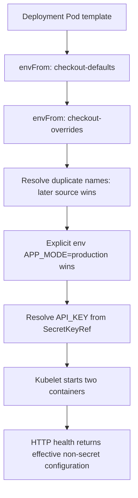
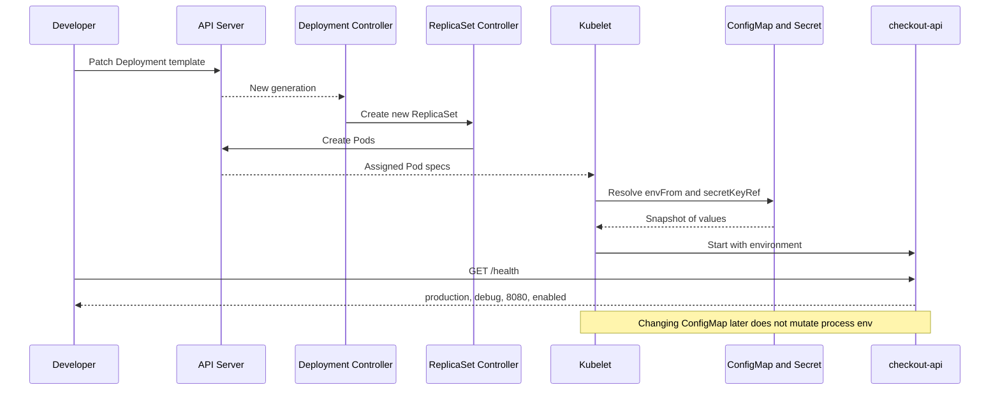

# D4-009 — envFrom Precedence: Debug cấu hình checkout-api

**Domain 4 · Trung cấp · 45 phút · Namespace cô lập:** `ckad-d4-009`

## Sự cố production

Checkout API có hai replicas. Nhóm vận hành quản lý ConfigMap `checkout-defaults` (APP_MODE=production, LOG_LEVEL=info, PORT=8080) và `checkout-overrides` (APP_MODE=staging, LOG_LEVEL=debug, FEATURE_FLAG=enabled). Deployment đang load ConfigMap **sai thứ tự** nên LOG_LEVEL thành info. Cần giữ APP_MODE=production bằng `env` explicit, nhưng LOG_LEVEL phải debug từ overrides; API_KEY phải được tham chiếu từ Secret. Không sửa ConfigMap, Secret hoặc source code.

**Khác D4-001:** Đây là snapshot environment lúc khởi tạo container, không phải cập nhật ConfigMap volume live reload. Env không đổi khi ConfigMap thay đổi, cần rollout Pod mới.

## Flowchart — thứ tự hợp nhất cấu hình



## SequenceDiagram — controller và request flow



## Tiêu chí hoàn thành

1. Deployment checkout-api 2/2 Ready trong namespace ckad-d4-009.
2. envFrom có đúng hai nguồn theo thứ tự defaults → overrides. Với key trùng, nguồn sau ghi đè nguồn trước.
3. env.APP_MODE=production explicit, ưu tiên cao hơn envFrom.
4. API_KEY từ secretKeyRef checkout-credentials, không hardcode vào Pod spec.
5. Hai Pod thực sự có APP_MODE=production, LOG_LEVEL=debug, PORT=8080, FEATURE_FLAG=enabled, API_KEY không rỗng.
6. Auto-grader đọc live Deployment và `kubectl exec` trên từng Pod, không chấm bằng so sánh YAML file.

## Thực hành trên kind

Yêu cầu Docker daemon, kind, kubectl, python3, bash và mạng tải image python:3.12-alpine.

```bash
kind create cluster --name ckad-labs   # nếu chưa tồn tại
kubectl config use-context kind-ckad-labs
kubectl apply -f setup.yaml
kubectl -n ckad-d4-009 rollout status deploy/checkout-api --timeout=180s
bash verify.sh                        # expected FAIL ở baseline
```

**Nhiệm vụ:** Sửa Pod template của Deployment bằng `kubectl edit` hoặc `kubectl patch`. Không sửa ConfigMap hay Secret. Trước khi sửa hãy kiểm tra `kubectl get deploy checkout-api -n ckad-d4-009 -o yaml`, `kubectl get pods -n ckad-d4-009`, `kubectl describe pod`. Không in API_KEY trong terminal/log production. Giải thích vì sao thay đổi envFrom tạo ReplicaSet mới và vì sao phải đợi rollout.

## Lời giải, grader và negative tests

```bash
bash solution.sh
bash verify.sh
bash negative-tests.sh
bash verify.sh
```

solution.sh sửa Deployment bằng strategic merge patch. verify.sh kiểm tra live Pod spec và process env ở cả hai replicas. negative-tests.sh làm sai APP_MODE explicit, kiểm chứng grader FAIL, phục hồi, sau đó đảo ngược envFrom và kiểm chứng FAIL. Trap cố gắng phục hồi khi script kết thúc. Negative tests thay đổi Deployment thật **chỉ trong namespace lab**.

## Troubleshooting

| Triệu chứng | Nguyên nhân | Kiểm tra |
|---|---|---|
| LOG_LEVEL=info | envFrom đảo thứ tự | `kubectl get deploy checkout-api -n ckad-d4-009 -o yaml` |
| APP_MODE=staging | thiếu env explicit | `kubectl exec -n ckad-d4-009 POD -- printenv APP_MODE` |
| CreateContainerConfigError | thiếu ConfigMap/Secret/key | `kubectl describe pod -n ckad-d4-009 POD` |
| Pod cũ vẫn chạy | rollout chưa xong | `kubectl rollout status -n ckad-d4-009 deploy/checkout-api` |
| ImagePullBackOff | node kind không kéo được image | `kubectl get events -n ckad-d4-009 --sort-by=.lastTimestamp` |
| API_KEY lộ log | debug bằng cách dump env | Không in secret; chỉ xác nhận presence |

**Tradeoff:** envFrom ngắn gọn nhưng key trùng có thể tạo lỗi cấu hình khó thấy. Với giá trị cần bảo đảm, explicit env rõ ràng hơn. Không lưu credential trong Git; Secret mẫu chỉ dùng để luyện tập.

## Dọn dẹp

```bash
kubectl delete namespace ckad-d4-009
```

Không xóa kind cluster dùng chung.

## Tài liệu chính thức

- [Define Environment Variables for a Container](https://kubernetes.io/docs/tasks/inject-data-application/define-environment-variable-container/)
- [Configure a Pod to Use a ConfigMap](https://kubernetes.io/docs/tasks/configure-pod-container/configure-pod-configmap/)
- [Distribute Credentials Securely Using Secrets](https://kubernetes.io/docs/tasks/inject-data-application/distribute-credentials-secure/)
- [Deployments](https://kubernetes.io/docs/concepts/workloads/controllers/deployment/)
- [kind Quick Start](https://kind.sigs.k8s.io/docs/user/quick-start/)
