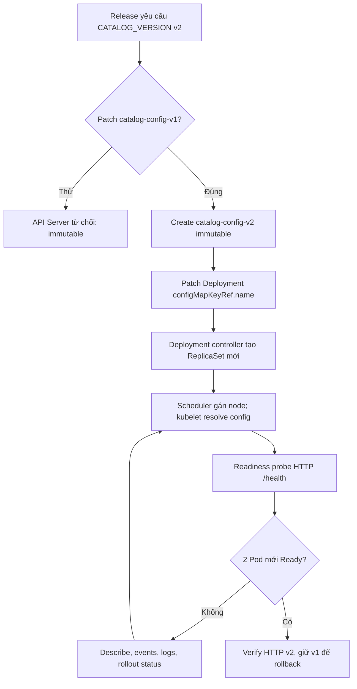
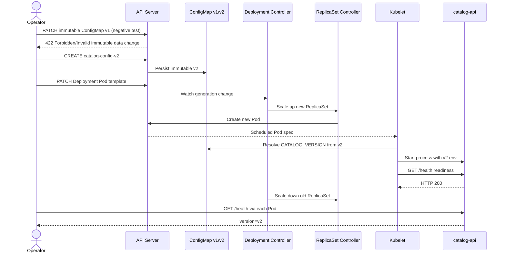

# D4-010 — Immutable ConfigMap: versioned rollout không downtime

**Domain 4 · Trung cấp · 45–60 phút · Namespace:** `ckad-d4-010`

## Sự cố thực tế
Dịch vụ `catalog-api` chạy 2 replicas, đọc cấu hình từ ConfigMap `catalog-config-v1` có `immutable: true`. Release cần đổi `CATALOG_VERSION` từ `v1` sang `v2`. Sửa trực tiếp dữ liệu của ConfigMap immutable sẽ bị API Server từ chối. Nhiệm vụ: tạo `catalog-config-v2` immutable, chuyển Deployment sang tham chiếu mới, giữ ít nhất 1 replica available trong rollout và xác nhận HTTP trả v2 trên mọi Pod. Không xóa v1, không xóa namespace.

**Điểm khác D4-001/D4-009:** Bài này luyện immutability, versioned configuration và Deployment rollout; không phải live reload hay precedence của envFrom.

## Mục tiêu
- Giải thích vì sao Kubernetes từ chối update data của ConfigMap immutable.
- Tạo ConfigMap mới có `immutable: true`, giữ nguyên v1.
- Cập nhật `env.valueFrom.configMapKeyRef.name` trong Pod template, kích hoạt ReplicaSet mới.
- Đạt `replicas=2`, `updatedReplicas=2`, `availableReplicas=2`; maxUnavailable=0.
- Kiểm tra phản hồi thật bằng `kubectl exec` từ từng Pod, không chỉ đọc YAML.

## Kiến trúc và control flow





## Chuẩn bị
Cần Docker, kind, kubectl, bash, Python 3. Dùng cluster kind hiện có hoặc tạo mới:

```bash
kind create cluster --name ckad
kubectl cluster-info --context kind-ckad
kubectl apply -f setup.yaml
kubectl -n ckad-d4-010 rollout status deploy/catalog-api --timeout=180s
kubectl -n ckad-d4-010 get cm,deploy,rs,pods
```

**Lưu ý:** `setup.yaml` là trạng thái lỗi ban đầu có chủ đích (v1). `verify.sh` phải FAIL trước khi giải bài.

## Thực hành
1. Quan sát `kubectl -n ckad-d4-010 get cm catalog-config-v1 -o yaml`. Thử thay đổi data bằng `kubectl edit cm catalog-config-v1`; Kubernetes phải từ chối.
2. Tạo ConfigMap `catalog-config-v2` có key `CATALOG_VERSION: v2` và `immutable: true`.
3. Sửa `spec.template.spec.containers[0].env[0].valueFrom.configMapKeyRef.name` của Deployment thành `catalog-config-v2`. Không thay đổi số replicas hay strategy.
4. `kubectl -n ckad-d4-010 rollout status deployment/catalog-api --timeout=180s`.
5. Chạy `bash verify.sh`. Nếu bí, chạy `bash solution.sh` rồi verify lại.

## Lệnh quan sát và troubleshooting
```bash
kubectl -n ckad-d4-010 describe deployment catalog-api
kubectl -n ckad-d4-010 get rs,pods -o wide
kubectl -n ckad-d4-010 get events --sort-by=.lastTimestamp
kubectl -n ckad-d4-010 logs deployment/catalog-api --all-containers
kubectl -n ckad-d4-010 get deployment catalog-api -o jsonpath='{.spec.template.spec.containers[0].env[0].valueFrom.configMapKeyRef.name}'
```

Nếu Pod `CreateContainerConfigError`, kiểm tra ConfigMap mới tồn tại và key chính xác. Nếu rollout treo, kiểm tra readiness và `maxUnavailable`. Nếu HTTP còn v1, kiểm tra các Pod mới thực sự thay thế Pod cũ; thay đổi ConfigMap không tự cập nhật env của container đang chạy. Khi rollback, có thể `kubectl rollout undo deployment/catalog-api` vì ConfigMap v1 vẫn còn.

## Negative tests
`bash negative-tests.sh` chủ động thử sửa ConfigMap immutable và tạo Pod tham chiếu key không tồn tại; cả hai phải bị phát hiện là lỗi, sau đó dọn Pod thử nghiệm. Không chạy negative tests đồng thời với verify.

## Dọn dẹp
`kubectl delete namespace ckad-d4-010` chỉ khi không còn cần lab. Không chạy `docker compose down -v`, không động tới namespace khác.

## Tài liệu chính thức
- [ConfigMaps — immutable](https://kubernetes.io/docs/concepts/configuration/configmap/#configmap-immutable)
- [Configure a Pod to use a ConfigMap](https://kubernetes.io/docs/tasks/configure-pod-container/configure-pod-configmap/)
- [Deployments — rolling updates](https://kubernetes.io/docs/concepts/workloads/controllers/deployment/#rolling-update-deployment)
- [Debug running Pods](https://kubernetes.io/docs/tasks/debug/debug-application/debug-running-pod/)
