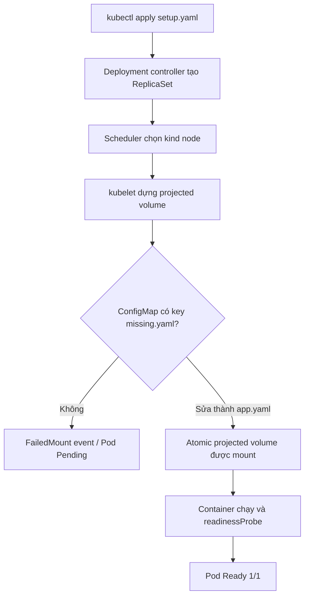
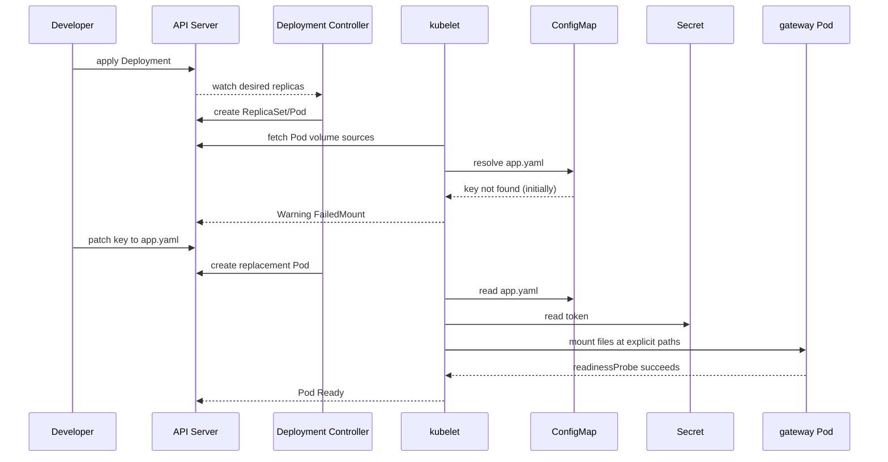

# D4-011 — Projected Volume: gom ConfigMap + Secret, key/path và file mode

**Domain:** Application Environment, Configuration and Security · **Mức độ:** Intermediate · **Thời gian:** 25–35 phút

## Tình huống production

Một billing gateway cần đọc cấu hình không nhạy cảm tại `/etc/gateway/config/app.yaml` và credential tại `/etc/gateway/credentials/token`. Team platform gom hai nguồn vào **một projected volume** để giảm số volumeMount. Sau deploy, Pod bị kẹt `ContainerCreating` vì người viết manifest dùng sai **key** trong ConfigMap: `missing.yaml` thay vì `app.yaml`. Đây là lỗi mount của kubelet, không phải image pull hay readiness probe.

**Mục tiêu:** sửa đúng key, giữ đường dẫn phân cấp, đặt quyền mặc định `0440` (YAML API biểu diễn số thập phân **288**), Deployment Ready 1/1 và xác minh nội dung trên filesystem của container. Không chuyển credential thành env var, không hard-code token vào manifest.

## Luồng chẩn đoán





## Chuẩn bị

Cần Docker daemon, kind, kubectl, Python 3 và image `busybox:1.36` có thể pull. Dùng cluster kind đang có hoặc tạo `kind create cluster --name ckad`; chọn context chính xác bằng `kubectl config current-context`. Lab **chỉ tạo namespace `ckad-d4-011`**, không sửa các namespace khác.

```bash
kubectl apply -f setup.yaml
kubectl -n ckad-d4-011 get pods -w
kubectl -n ckad-d4-011 describe pod -l app=billing-gateway
kubectl -n ckad-d4-011 get events --sort-by=.lastTimestamp
```

Quan sát sự kiện `FailedMount`, đọc `volumes[].projected.sources[].configMap.items[].key` và đối chiếu với `kubectl -n ckad-d4-011 get cm gateway-settings -o yaml`.

## Nhiệm vụ thực hành

1. Chỉ sửa `Deployment/billing-gateway` để key của ConfigMap là `app.yaml`, path vẫn là `config/app.yaml`.
2. Giữ Secret key `token` ở `credentials/token`. Giữ projected volume duy nhất và mount read-only.
3. Đặt `defaultMode: 0440` trong YAML hoặc giá trị API tương đương 288. **Lưu ý:** YAML parser có thể xử lý số có số 0 đầu khác nhau; `288` là lựa chọn không mơ hồ.
4. Kiểm tra file thực tế trong Pod, mode 440, nội dung cấu hình và token; không in token thật ra log trong hệ thống production.

```bash
bash solution.sh
bash verify.sh
```

`solution.sh` là đáp án mẫu, không bắt buộc sử dụng trong lúc luyện thi. `verify.sh` chấm trên **API Kubernetes và exec vào Pod thật**, không chỉ grep file local.

## Negative test

```bash
bash negative-tests.sh
bash solution.sh
bash verify.sh
```

Negative test cố ý đổi key về `missing.yaml`, chờ rollout thất bại rồi bắt buộc verifier trả FAIL. Nó thay đổi cluster, nên phải chạy `solution.sh` để khôi phục. Trong một số phiên bản Kubernetes, Pod cũ còn Ready khi rollout mới lỗi; verifier vẫn bắt sai spec trước khi kiểm tra Ready.

## Troubleshooting

| Triệu chứng | Kiểm tra | Nguyên nhân / hướng xử lý |
|---|---|---|
| `FailedMount` | `kubectl describe pod` | Key không tồn tại; phân biệt `key` nguồn và `path` đích |
| `ImagePullBackOff` | Events | Không pull được busybox; kiểm tra registry/network |
| `0/1 Ready` | `kubectl logs`, `kubectl exec` | File không đọc được hoặc readinessProbe thất bại |
| `stat` không ra 440 | `kubectl get deploy -o yaml` | `defaultMode` sai hoặc cấu hình per-item mode ghi đè |
| `rollout status` timeout | `kubectl get rs,pods` | Kiểm tra ReplicaSet mới, events và image |

**Trade-off:** projected volume gom nhiều nguồn dưới một mount, nhưng nếu một nguồn bắt buộc bị thiếu thì kubelet không mount được. Dùng `optional: true` chỉ khi ứng dụng thực sự hỗ trợ thiếu dữ liệu; tránh dùng để che lỗi production. Projected file updates có thể trễ và không cập nhật qua `subPath`.

## Dọn dẹp

```bash
kubectl delete namespace ckad-d4-011
```

## Tài liệu chính thức

- [Projected volumes](https://kubernetes.io/docs/concepts/storage/projected-volumes/)
- [Configure ConfigMap in a Pod](https://kubernetes.io/docs/tasks/configure-pod-container/configure-pod-configmap/)
- [Distribute credentials using Secrets](https://kubernetes.io/docs/tasks/inject-data-application/distribute-credentials-secure/)
- [Debug Pods](https://kubernetes.io/docs/tasks/debug/debug-application/debug-pods/)
