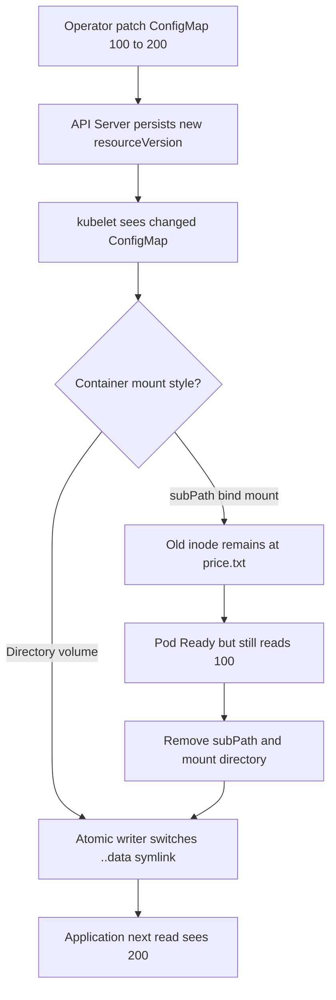
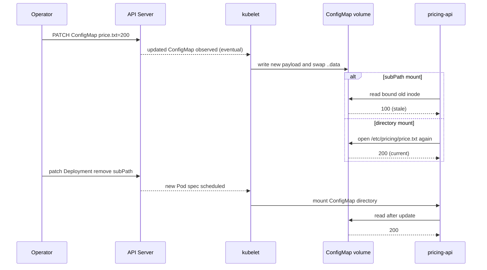

# D4-012 — ConfigMap hot reload: bẫy subPath giữ dữ liệu cũ

**Domain 4 · Intermediate · 30–45 phút.** Namespace riêng: `ckad-d4-012`.

## Production incident

Dịch vụ `pricing-api` đọc giá từ `/etc/pricing/price.txt`. Nhóm vận hành thay ConfigMap từ **100** thành **200** để áp dụng bảng giá mới mà không restart ứng dụng. Pod vẫn Ready nhưng tiếp tục đọc **100**. Root cause: `volumeMount.subPath` bind-mount một file cố định, không theo cơ chế cập nhật atomic của ConfigMap projected directory.

**Mục tiêu:** sửa Deployment để mount **thư mục** `/etc/pricing` (không `subPath`), giữ read-only, cập nhật ConfigMap lên 200, chứng minh file trong Pod đổi thành 200 mà không cần rollout thêm sau khi thay ConfigMap. Phân biệt **readiness success** với **configuration correctness**.

## Flowchart: điều tra cấu hình stale





## Prerequisites và chạy trên kind

Cần Docker, kind, kubectl, Python 3 và image `busybox:1.36` pull được. Không chạy trên production context.

```bash
kind create cluster --name ckad # bỏ qua nếu đã tồn tại
kubectl config use-context kind-ckad
kubectl apply -f setup.yaml
kubectl -n ckad-d4-012 rollout status deploy/pricing-api --timeout=120s
kubectl -n ckad-d4-012 get pods -o wide
kubectl -n ckad-d4-012 get deploy pricing-api -o yaml
```

**Baseline:** mount `subPath: price.txt`, giá ban đầu 100. Đọc giá trong Pod và so sánh ConfigMap:

```bash
kubectl -n ckad-d4-012 get cm pricing-config -o jsonpath='{.data.price\.txt}'
kubectl -n ckad-d4-012 exec deploy/pricing-api -- cat /etc/pricing/price.txt
kubectl -n ckad-d4-012 patch cm pricing-config --type=merge -p '{"data":{"price.txt":"200"}}'
kubectl -n ckad-d4-012 exec deploy/pricing-api -- cat /etc/pricing/price.txt
```

Chờ ít nhất vài chu kỳ đồng bộ kubelet; kết quả vẫn 100 do `subPath`. Không suy luận dựa trên trạng thái Ready. Trong bài thi, hãy giải thích tại sao file mount trực tiếp bằng subPath không nhận update, còn thư mục ConfigMap nhận update **eventually**, không tức thời.

## Nhiệm vụ và đáp án

1. Giữ Deployment một replica và ConfigMap `pricing-config`.
2. Thay mount path từ `/etc/pricing/price.txt` sang `/etc/pricing`, xóa `subPath`, giữ `readOnly: true`.
3. Đặt ConfigMap `price.txt=200`; đợi kubelet đồng bộ. **Không dùng environment variable**, vì env không hot reload.
4. Chạy `bash verify.sh` để chấm **live Kubernetes spec, rollout, và nội dung file thật trong Pod**.

```bash
bash solution.sh
bash verify.sh
```

## Negative test

```bash
bash negative-tests.sh
bash solution.sh
bash verify.sh
```

Negative test đưa Deployment về subPath, đảm bảo Pod đọc 100 trước khi cập nhật ConfigMap lên 200, rồi xác minh Pod vẫn đọc 100 và verifier phải FAIL. Script thay đổi tài nguyên của namespace này; phải chạy lại solution để phục hồi. Test có chờ đồng bộ, nhưng giá trị stale là đặc tính subPath, không phụ thuộc độ trễ của kubelet.

## Troubleshooting và trade-offs

| Hiện tượng | Cách kiểm tra | Hướng xử lý |
|---|---|---|
| ConfigMap 200, Pod 100 | `kubectl exec ... -- cat` | Kiểm tra `subPath`; bỏ subPath |
| Pod Ready nhưng dữ liệu sai | readinessProbe chỉ kiểm tra file đọc được | Kiểm tra semantic content riêng |
| File chưa cập nhật ngay | `kubectl get cm -o yaml`, chờ kubelet sync | Eventual consistency, chờ tới 180 giây |
| ImagePullBackOff | `kubectl describe pod` | Kiểm tra registry và mạng |
| Mount directory ghi đè file image | `kubectl describe pod` | Mount vào thư mục chuyên dụng |

**Trade-off:** mount directory hỗ trợ hot update nhưng thay thế nội dung thư mục đích trong container. `subPath` hữu ích để mount một file vào thư mục đã có sẵn nhưng đánh đổi khả năng cập nhật tự động. Ứng dụng phải mở/đọc lại file; nếu chỉ đọc lúc startup, vẫn cần reload hoặc restart.

## Cleanup

```bash
kubectl delete namespace ckad-d4-012
```

## Official references

- [ConfigMap mounted as volume and updates](https://kubernetes.io/docs/concepts/configuration/configmap/#mounted-configmaps-are-updated-automatically)
- [Configure Pod to use ConfigMap](https://kubernetes.io/docs/tasks/configure-pod-container/configure-pod-configmap/)
- [Volumes: subPath](https://kubernetes.io/docs/concepts/storage/volumes/#using-subpath)
- [Debug running Pods](https://kubernetes.io/docs/tasks/debug/debug-application/debug-running-pod/)
