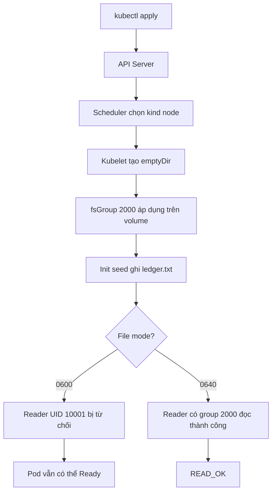

# D4-013 — fsGroup & shared emptyDir: Pod Ready nhưng ứng dụng không đọc được file

**Domain:** Application Environment, Configuration and Security · **Mức độ:** Intermediate · **Thời gian:** 20–30 phút.

## Tình huống production
Một dịch vụ đối soát hóa đơn có init container tạo `ledger.txt` vào volume chia sẻ. Container chính chạy UID 10001 để giảm đặc quyền. Kubernetes báo **Pod Ready** nhưng log ghi `READ_DENIED`: ứng dụng không thể đọc file. Không được giải quyết bằng `runAsUser: 0`, `chmod 777` hoặc cấp privileged.

## Mục tiêu
- Phân biệt trạng thái Pod Ready với tính đúng đắn của ứng dụng.
- Hiểu Linux owner/group/mode, `runAsUser`, `runAsGroup`, `fsGroup` và `emptyDir`.
- Khắc phục permission bằng quyền nhóm tối thiểu: file mode `0640`, group 2000; container đọc bằng UID 10001.
- Dùng `kubectl exec` để kiểm chứng quyền đọc thực tế thay vì chỉ kiểm tra manifest.

## Luồng điều khiển



```mermaid
sequenceDiagram
  participant Dev as Developer
  participant API as API Server
  participant K as Kubelet
  participant Init as Init container
  participant App as Reader container
  Dev->>API: apply Pod manifest
  API-->>K: Pod assigned to node
  K->>K: create emptyDir; apply fsGroup
  K->>Init: start seed
  Init->>Init: write ledger.txt with 0600
  Init-->>K: exit 0
  K->>App: start as UID 10001 + group 2000
  App->>App: cat /shared/ledger.txt
  App-->>Dev: READ_DENIED (permission denied)
  Dev->>API: recreate Pod with chmod 0640
  API-->>K: new Pod spec
  K->>Init: seed file with group-read permission
  K->>App: start reader
  App-->>Dev: READ_OK
```

## Chuẩn bị kind (Kubernetes-in-Docker)
Yêu cầu Docker, kind, kubectl, bash và Python 3 trên máy chạy lab. Nếu chưa có cluster:

```bash
kind create cluster --name ckad
kubectl cluster-info --context kind-ckad
```

Lab dùng namespace `ckad-d4-013`, không thay đổi namespace hoặc workload của lab khác.

## Thực hành
Từ thư mục lab:

```bash
kubectl apply -f setup.yaml
kubectl -n ckad-d4-013 wait --for=condition=Ready pod/ledger-api --timeout=120s
kubectl -n ckad-d4-013 logs ledger-api -c reader --tail=10
kubectl -n ckad-d4-013 exec ledger-api -c reader -- id
kubectl -n ckad-d4-013 exec ledger-api -c reader -- ls -ln /shared/ledger.txt
```

**Quan sát:** file có quyền `-rw-------`; dù Pod Ready, người dùng 10001 không đọc được file do init container tạo file bằng UID 10002 còn reader chạy UID 10001. Cả hai cùng supplementary group 2000 nhưng mode `0600` không cho nhóm đọc.

Sửa quyền file thành `0640` trong lệnh của init container; không sửa `fsGroup` hay chạy reader bằng root. Vì Pod spec phần lớn immutable, xóa/tạo lại Pod hoặc chạy `./solution.sh`. Sau đó:

```bash
bash verify.sh
bash negative-tests.sh  # cố ý phục hồi cấu hình lỗi, chứng minh test phát hiện lỗi
bash solution.sh
bash verify.sh
```

## Tại sao?
`fsGroup` cho container quyền truy cập theo supplementary group và có thể thay đổi ownership của volume hỗ trợ. Nó **không tự cấp group-read** cho file có mode `0600`. `0640` cho owner đọc/ghi, group đọc và others không có quyền. Với hai UID khác nhau và chung group 2000, container chính đọc được mà không cần root.

## Troubleshooting
- `Pod Ready` nhưng `READ_DENIED`: kiểm tra `id`, `stat -c '%u:%g %a'`, log và quyền thư mục cha.
- `Permission denied` sau khi chmod: kiểm tra file group có đúng 2000 không, `fsGroup` và `runAsGroup` khác nhau thế nào.
- `Forbidden` khi apply: kiểm tra context, quyền RBAC và namespace.
- `ImagePullBackOff`: kiểm tra Docker/kind node có tải được `busybox:1.36` không.
- `kubectl exec` không chạy: kiểm tra container name `reader`, Pod phase và events.
- `negative-tests.sh` cố ý để lại Pod lỗi; chạy lại `solution.sh` để khôi phục.

## Dọn dẹp
```bash
kubectl delete namespace ckad-d4-013
```

## Tài liệu chính thức
- [Configure a Security Context for a Pod or Container](https://kubernetes.io/docs/tasks/configure-pod-container/security-context/)
- [Volumes: emptyDir](https://kubernetes.io/docs/concepts/storage/volumes/#emptydir)
- [Init Containers](https://kubernetes.io/docs/concepts/workloads/pods/init-containers/)
- [Debug Running Pods](https://kubernetes.io/docs/tasks/debug/debug-application/debug-running-pod/)
