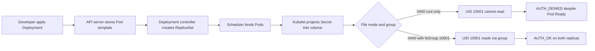
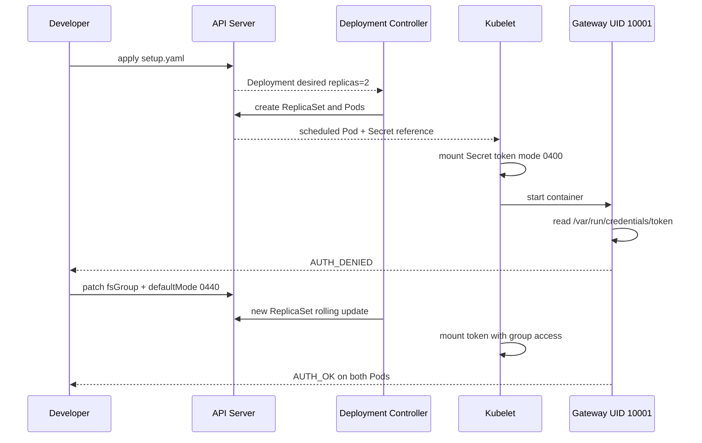

# D4-014 — Secret volume file mode: non-root gateway không đọc được token

**Domain 4 · Intermediate · 25–35 phút · Namespace:** `ckad-d4-014`.

## Sự cố production
Gateway chạy hai replicas bằng UID 10001. Token được mount từ Secret dưới dạng file, nhưng Kubernetes báo Deployment Available trong khi log liên tục `AUTH_DENIED`. Nguyên nhân là file mode `0400`: Secret volume file thường do root sở hữu, UID 10001 không đọc được. Mục tiêu là cho phép ứng dụng đọc token mà **không chạy root, không chmod 777, không đưa token vào env và không mở quyền cho others**.

## Kết quả cần đạt
- Deployment `gateway` có 2 Pod Running/Ready; mỗi Pod chạy UID 10001.
- Pod securityContext có `fsGroup: 10001`; Secret volume `defaultMode: 0440` (YAML octal, API JSON là 288).
- Cả hai Pod đọc đúng token từ `/var/run/credentials/token`; mount `readOnly: true`.
- Phân biệt `readOnly` mount với quyền đọc Linux: read-only không có nghĩa tất cả user đọc được.
- Không hiển thị giá trị token trên log trong ứng dụng thực tế; token trong lab chỉ là chuỗi giả.

## Control flow





## Chạy trên kind
Cần Docker Engine, kind, kubectl, bash, Python 3. Nếu chưa có cluster:

```bash
kind create cluster --name ckad
kubectl config use-context kind-ckad
kubectl cluster-info
```

Trong thư mục lab:

```bash
kubectl apply -f setup.yaml
kubectl -n ckad-d4-014 rollout status deployment/gateway --timeout=180s
kubectl -n ckad-d4-014 get pod -l app=gateway -o wide
kubectl -n ckad-d4-014 logs deployment/gateway -c gateway --tail=15
kubectl -n ckad-d4-014 get deployment gateway -o yaml
```

Quan sát `AUTH_DENIED` dù Pod Running. Đừng chỉ dựa vào readiness mặc định (không có readinessProbe), vì container có thể Running khi business logic lỗi.

## Nhiệm vụ
1. Kiểm tra `securityContext`, `volumes[].secret.defaultMode`, UID/GID và quyền file bằng `kubectl exec`.
2. Sửa Pod template để Secret mode `0440` và `fsGroup: 10001`, không thay đổi token hoặc bỏ non-root.
3. Đợi Deployment rollout và kiểm tra **cả hai** replicas, không chỉ một Pod.

Có thể dùng đáp án tự động:

```bash
bash solution.sh
bash verify.sh
```

`solution.sh` patch Pod template, khiến Deployment controller rolling update. `verify.sh` tự chấm **trạng thái API và filesystem thật trong từng container**; chỉ có YAML đúng nhưng Pod không chạy vẫn FAIL.

## Negative test (cố ý tạo lỗi)
```bash
bash negative-tests.sh
bash solution.sh
bash verify.sh
```

Negative test áp dụng lại cấu hình sai `0400`/thiếu `fsGroup` và yêu cầu verifier phải từ chối. Script để lại cấu hình sai có chủ đích; chạy lại solution để phục hồi. Không chạy negative test trên namespace khác.

## Troubleshooting
| Triệu chứng | Nguyên nhân có thể | Cách kiểm tra |
| --- | --- | --- |
| Pod Running nhưng AUTH_DENIED | UID 10001 không có group-read | `kubectl exec POD -- id`, `stat -c '%u:%g %a'` |
| Secret mount thất bại | Secret thiếu hoặc sai key | `kubectl describe pod POD`, Events |
| Rollout timeout | image pull, quota, admission | `kubectl get pods -o wide`, `kubectl describe deployment gateway` |
| Mode hiển thị 440 nhưng vẫn denied | thiếu fsGroup, đường dẫn sai | `kubectl get pod -o yaml`, `id -G` |
| Patch 0440 thành 440 | nhầm octal YAML với decimal JSON | JSON patch dùng **288**, không dùng 440 |
| AUTH_OK nhưng verifier fail | chưa đủ 2 Pod hoặc thiếu readOnly | kiểm tra selector, template, rollout |

**Lưu ý:** `fsGroup` và ownership behavior phụ thuộc volume type/CSI; với Secret projected volume trên kind, kiểm chứng trực tiếp bằng `kubectl exec`. Không dùng token mẫu trong production.

## Cleanup
```bash
kubectl delete namespace ckad-d4-014
```

## Tài liệu chính thức
- [Secrets](https://kubernetes.io/docs/concepts/configuration/secret/)
- [Distribute Credentials Securely Using Secrets](https://kubernetes.io/docs/tasks/inject-data-application/distribute-credentials-secure/)
- [Configure a Security Context](https://kubernetes.io/docs/tasks/configure-pod-container/security-context/)
- [Deployments and rolling updates](https://kubernetes.io/docs/concepts/workloads/controllers/deployment/)
