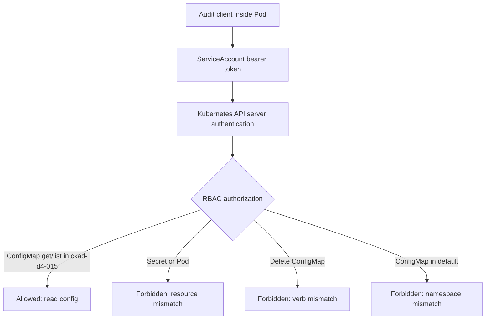
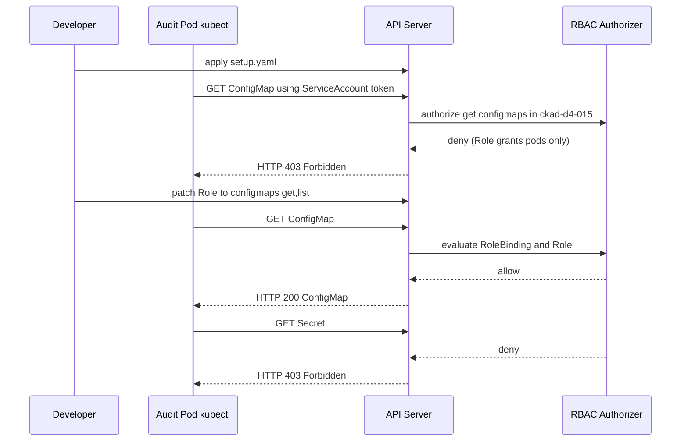

# D4-015 — ServiceAccount RBAC: chỉ đọc ConfigMap, không lộ Secret

**Domain 4 · Advanced · 35–45 phút · Namespace:** `ckad-d4-015`.

## Tình huống thực tế

Một audit sidecar cần xem cấu hình ứng dụng qua Kubernetes API để đối chiếu thay đổi. Team cấp nhầm Role cho phép đọc Pod thay vì ConfigMap. Không được giải quyết bằng ClusterRoleBinding `cluster-admin`, quyền đọc Secret hay quyền ghi tài nguyên. Lab yêu cầu chứng minh **identity thực của Pod** có đúng quyền tối thiểu.

## Mục tiêu và tiêu chí chấm

- ServiceAccount `audit-reader` chỉ được `get,list` ConfigMap trong namespace `ckad-d4-015`.
- Pod `audit-client` thực sự dùng ServiceAccount này và gọi API bằng token tự động mount.
- Đọc ConfigMap thành công; đọc Secret, đọc Pod, xóa ConfigMap và truy cập ConfigMap ở namespace `default` đều bị từ chối.
- RoleBinding trỏ đúng ServiceAccount, không dùng wildcard, ClusterRoleBinding hay cluster-admin.
- Verifier kiểm tra cả RBAC spec lẫn kết quả lệnh thực thi **bên trong Pod**, không chỉ `kubectl auth can-i` của người quản trị.

## Flowchart — từ workload đến API authorization



## Sequence — lỗi và sửa đúng quyền



## Chuẩn bị kind

Yêu cầu Docker, kind, kubectl, Bash và Python 3 trên host. Image `bitnami/kubectl:1.33` cần pull được từ registry; nếu tag không tồn tại tại thời điểm chạy, đổi sang image kubectl tương thích và ghi nhận thay đổi. Tạo cluster khi cần:

```bash
kind create cluster --name ckad
kubectl config use-context kind-ckad
kubectl cluster-info
```

## Thực hành từng bước

```bash
kubectl apply -f setup.yaml
kubectl -n ckad-d4-015 wait --for=condition=Ready pod/audit-client --timeout=180s
kubectl -n ckad-d4-015 exec audit-client -- kubectl get configmaps -n ckad-d4-015
kubectl -n ckad-d4-015 get role,rolebinding,serviceaccount
kubectl -n ckad-d4-015 describe role audit-reader
kubectl -n ckad-d4-015 describe rolebinding audit-reader
```

**Quan sát:** Pod chạy bình thường nhưng API trả `Forbidden` khi đọc ConfigMap. Phân biệt lỗi 403 (authentication thành công nhưng authorization từ chối) với lỗi 401 (token/identity không hợp lệ), lỗi network hoặc image pull.

**Nhiệm vụ:** chỉ sửa Role `audit-reader` từ `pods` sang `configmaps`; giữ `get,list`, namespace và RoleBinding. Không cấp quyền `secrets`, `delete`, wildcard `*` hoặc quyền toàn cluster.

```bash
bash solution.sh
bash verify.sh
```

Verifier tự chấm bằng Kubernetes API và `kubectl exec` vào Pod. Đọc ConfigMap bằng token trong Pod phải thành công, trong khi 4 hành động vượt quyền phải thất bại. Không dùng output mô phỏng.

## Negative test

```bash
bash negative-tests.sh
bash solution.sh
bash verify.sh
```

Negative test áp dụng lại Role sai (pods-only), đợi Pod Ready và yêu cầu verifier trả FAIL. **Không** dùng lệnh `kubectl auth can-i` của host thay cho identity trong Pod.

## Troubleshooting

| Triệu chứng | Kiểm tra | Hướng xử lý |
| --- | --- | --- |
| `ImagePullBackOff` | `kubectl describe pod audit-client` | Kiểm tra tag image, mạng, registry |
| `Forbidden` với ConfigMap | `kubectl get role audit-reader -o yaml` | Kiểm tra `resources` và `verbs` |
| `Unauthorized` | `kubectl get pod audit-client -o yaml` | Kiểm tra ServiceAccount và token mount |
| Đọc được Secret | `kubectl get rolebinding -o yaml` | Thu hồi quyền rộng; không dùng cluster-admin |
| Quyền namespace khác vẫn hoạt động | `kubectl get clusterrolebinding` | Kiểm tra binding ngoài lab, chạy cluster kind cô lập |
| Verifier FAIL dù Role đúng | `kubectl exec audit-client -- kubectl auth whoami` | Kiểm tra Pod identity và token |
| Server-side dry-run delete trả lỗi khác | `kubectl exec ... -- kubectl delete ... --dry-run=server` | Phân biệt lỗi RBAC với lỗi admission |

**Lưu ý:** verifier không thể chứng minh không tồn tại mọi ClusterRoleBinding khác trên toàn cluster; dùng kind cluster sạch để tránh quyền bổ sung ngoài namespace. Negative test không xóa ConfigMap vì sử dụng server-side dry-run.

## Dọn dẹp

```bash
kubectl delete namespace ckad-d4-015
```

## Tài liệu chính thức

- [Using RBAC Authorization](https://kubernetes.io/docs/reference/access-authn-authz/rbac/)
- [Configure Service Accounts for Pods](https://kubernetes.io/docs/tasks/configure-pod-container/configure-service-account/)
- [Authorization Overview](https://kubernetes.io/docs/reference/access-authn-authz/authorization/)
- [kubectl auth can-i](https://kubernetes.io/docs/reference/kubectl/generated/kubectl_auth/kubectl_auth_can-i/)
