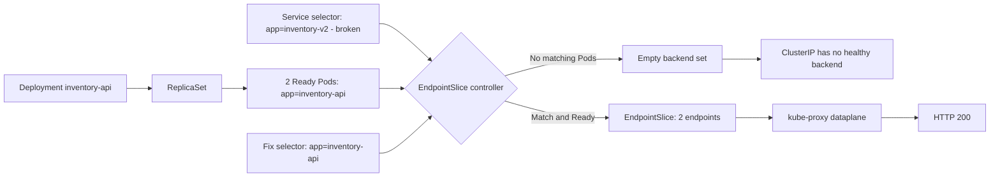

# D5-001 — Service selector và EndpointSlice: sửa lỗi 503 khi gọi inventory-api

**Domain 5 · Cơ bản · 30–40 phút · Namespace:** `ckad-d5-001`.

## Tình huống production

Frontend `storefront` gửi HTTP tới `http://inventory-api:8080` nhưng nhận lỗi kết nối. Deployment backend đã Ready 2/2, Service cũng tồn tại. Nguyên nhân: selector của Service đang chọn `app: inventory-v2`, trong khi Pod thực tế có nhãn `app: inventory-api`. Kubernetes không tạo EndpointSlice chứa backend hợp lệ. Bài học phân biệt **Pod Ready**, **Service tồn tại**, **Service có endpoints**, và **DNS hoạt động**.

## Mục tiêu

1. Giữ 2 Pod backend Ready và Service ClusterIP `inventory-api` port 8080.
2. Sửa selector thành `app: inventory-api`, không đổi Pod labels hoặc bypass DNS bằng Pod IP.
3. EndpointSlice do controller quản lý phải có đúng 2 địa chỉ Pod Ready.
4. Từ Pod `storefront`, gọi `http://inventory-api:8080` nhận HTTP 200 và body `inventory-ok`.
5. Không dùng NodePort, LoadBalancer, hostNetwork, externalIPs hoặc endpoints thủ công.

## Luồng điều khiển — EndpointSlice controller



## Request path — trước và sau sửa

```mermaid
sequenceDiagram
  participant Client as storefront Pod
  participant DNS as CoreDNS
  participant VIP as Service ClusterIP
  participant Proxy as kube-proxy / dataplane
  participant ES as EndpointSlice
  participant Pod as inventory-api Pod
  Client->>DNS: lookup inventory-api.ckad-d5-001.svc.cluster.local
  DNS-->>Client: ClusterIP
  Client->>VIP: GET / HTTP :8080
  VIP->>Proxy: forward packet
  Proxy->>ES: programmed backend set (conceptual)
  Note over Proxy,ES: Controller publishes EndpointSlices; kube-proxy watches them asynchronously
  ES-->>Proxy: no matching endpoints (broken)
  Proxy-->>Client: connection fails
  Note over Client,Pod: After fixing Service selector
  ES-->>Proxy: two Ready Pod IPs
  Client->>VIP: GET /
  Proxy->>Pod: route to Ready backend :8080
  Pod-->>Client: HTTP 200 inventory-ok
```

**Lưu ý:** sequenceDiagram biểu diễn quan hệ logic. kube-proxy **watch** EndpointSlice qua API, không gọi EndpointSlice đồng bộ cho từng request.

## Chạy trên kind

Yêu cầu Docker Engine, kind, kubectl, Bash, Python 3 và image pull được từ registry. Dùng cluster riêng, không tác động CKA:

```bash
kind create cluster --name ckad
kubectl config use-context kind-ckad
kubectl apply -f setup.yaml
kubectl -n ckad-d5-001 rollout status deployment/inventory-api --timeout=180s
kubectl -n ckad-d5-001 wait --for=condition=Ready pod/storefront --timeout=180s
kubectl -n ckad-d5-001 get deploy,pods,svc,endpointslices -o wide
kubectl -n ckad-d5-001 describe svc inventory-api
```

**Chẩn đoán:** Pod Ready không có nghĩa Service có backend. So sánh `kubectl get pod --show-labels` với `kubectl get svc inventory-api -o jsonpath='{.spec.selector}'`. Xem `kubectl get endpointslices -l kubernetes.io/service-name=inventory-api -o yaml`. DNS có thể resolve ClusterIP dù không có endpoints.

## Bài tập

Chỉ sửa selector của Service; không chỉnh Pod labels, Deployment replicas, readinessProbe hay tạo EndpointSlice thủ công. Quan sát reconciliation rồi thử HTTP từ Pod client.

```bash
bash solution.sh
bash verify.sh
```

Verifier đọc Service/Deployment/Pod/EndpointSlice thực qua Kubernetes API và chạy HTTP request **bên trong client Pod**. Nó chờ controller hội tụ tối đa 90 giây, không giả lập output.

## Negative tests

```bash
bash negative-tests.sh
bash solution.sh
bash verify.sh
```

Negative test phục hồi selector sai và đòi verifier FAIL, sau đó bạn chạy solution để khôi phục. Không xóa namespace hoặc Pod của lab khác.

## Troubleshooting

| Hiện tượng | Câu lệnh | Nguyên nhân / xử lý |
| --- | --- | --- |
| Deployment 0/2 Ready | `kubectl describe pod -l app=inventory-api` | Image pull, probe, tài nguyên |
| Service có ClusterIP nhưng HTTP fail | `kubectl get endpointslices -l kubernetes.io/service-name=inventory-api` | Selector mismatch / readiness |
| DNS không resolve | `kubectl exec storefront -- nslookup inventory-api` | CoreDNS / DNS policy; khác với empty endpoints |
| EndpointSlice chưa cập nhật | `kubectl get endpointslices -w` | Chờ controller reconcile; kiểm tra label |
| HTTP timeout | `kubectl exec storefront -- wget -S -O- http://inventory-api:8080` | Port mapping, policy, dataplane |
| 1 endpoint thay vì 2 | `kubectl get pods -l app=inventory-api -o wide` | Pod chưa Ready / rollout |
| ImagePullBackOff | `kubectl describe pod` | Registry hoặc tag; kiểm tra kết nối |

**Phân biệt:** Service `port` là cổng client kết nối; `targetPort` là cổng container. Service selector không chọn Deployment, nó chọn **Pod labels**. EndpointSlice controller phản ánh các Pod khớp selector và readiness. Kubernetes có thể có nhiều EndpointSlice khi số endpoints lớn; verifier gộp tất cả slices.

## Dọn dẹp

```bash
kubectl delete namespace ckad-d5-001
```

## Tài liệu chính thức

- [Service](https://kubernetes.io/docs/concepts/services-networking/service/)
- [EndpointSlices](https://kubernetes.io/docs/concepts/services-networking/endpoint-slices/)
- [Debug Services](https://kubernetes.io/docs/tasks/debug/debug-application/debug-service/)
- [DNS for Services and Pods](https://kubernetes.io/docs/concepts/services-networking/dns-pod-service/)
- [kind Quick Start](https://kind.sigs.k8s.io/docs/user/quick-start/)
